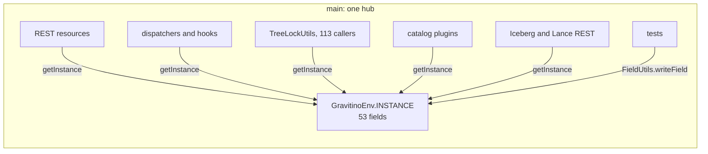
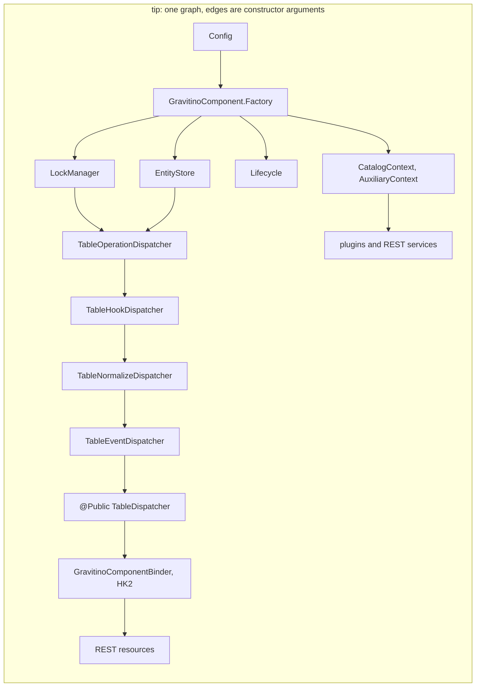
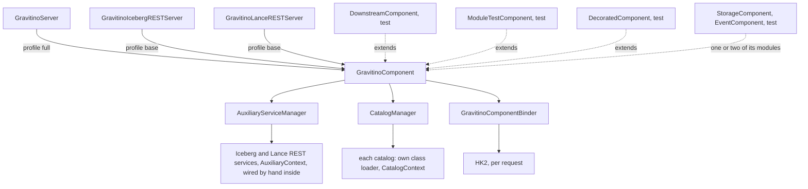
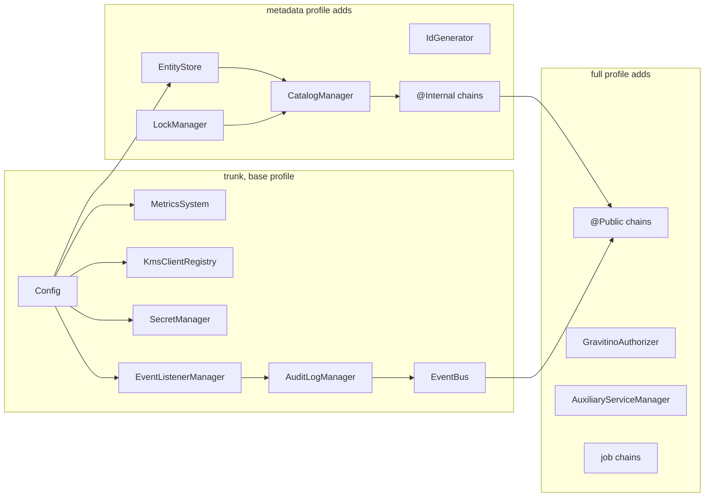
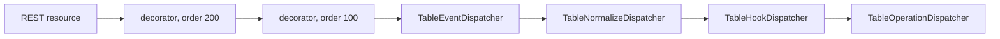

<!--
  Licensed to the Apache Software Foundation (ASF) under one
  or more contributor license agreements.  See the NOTICE file
  distributed with this work for additional information
  regarding copyright ownership.  The ASF licenses this file
  to you under the Apache License, Version 2.0 (the
  "License"); you may not use this file except in compliance
  with the License.  You may obtain a copy of the License at

   http://www.apache.org/licenses/LICENSE-2.0

  Unless required by applicable law or agreed to in writing,
  software distributed under the License is distributed on an
  "AS IS" BASIS, WITHOUT WARRANTIES OR CONDITIONS OF ANY
  KIND, either express or implied.  See the License for the
  specific language governing permissions and limitations
  under the License.
-->

# SPIP: Dependency injection with Dagger

| Field   | Value                                                                                     |
| ------- | ----------------------------------------------------------------------------------------- |
| Status  | Draft                                                                                     |
| Author  | Nevin Zheng ([@nevzheng](https://github.com/nevzheng))                                    |
| Updated | 2026-10-22                                                                                |
| Module  | `core`, `server`, `server-common`, `iceberg/iceberg-rest-server`, `lance`, `dev/di`       |
| Code    | Line references are against apache `main` at `026a6603` (2026-10-19)                      |
| Proof   | Draft stack [#18] to [#43] on `nevzheng/gravitino` (stack PR 01 to 26), tip `8c9d4abae`   |

The questions come first. The appendices hold the strategies with their proof PRs (Appendix A),
the measured dimensions (Appendix B), the detailed design and plan (Appendices C to J), and the
case for dependency injection and Dagger, with before and after code (Appendix K).

Two numberings appear. "Plan PR" is a row of the plan in Appendix D.2 (1 to 17, with 12a, 12b,
15b and 15e). "Stack PR" is a draft PR of the proof stack (01 to 26); stack PR N is
`nevzheng/gravitino#(17+N)`. Appendix D.2 maps one to the other.

---

## Q1. What are you trying to do?

Make the way the Gravitino server is put together explicit, checked by the compiler, and easy to
extend without editing upstream files.

Today one global object, `GravitinoEnv`, builds every server component and hands it to whoever
asks. The goals:

- **Visible dependencies.** Every component receives what it needs through its constructor, so
  a reader sees its inputs and a test can pass its own.
- **Wiring errors at build time.** A missing, duplicate or circular dependency fails the compile,
  not the first request after start-up.
- **Tests without global state.** Tests build the objects they need instead of writing private
  fields of a process-wide singleton, so they can run in parallel and in any order.
- **One start and stop order.** Start order is written once, stop is its reverse, and a failed
  start rolls back what already started.
- **Extension points instead of subclassing.** Downstream builds (forks, vendor distributions)
  add behaviour through declared seams, so an upstream sync does not conflict in core files.
- **Narrow plugin boundaries.** Catalog plugins, auxiliary services and authorizers receive a
  plain Java context that lists what they may use, instead of reaching the whole server through a
  static.
- **Progress that cannot regress.** Every anti-pattern is counted in CI, and a count can only go
  down.

## Q2. What problem is this proposal NOT designed to solve?

1. **No runtime DI framework swap.** HK2 stays as Jersey's injector for resources and filters. We
   do not add a second runtime container.
2. **No Jersey replacement.** REST resources, filters and `GravitinoInterceptionService` keep
   their current shape.
3. **Plugin SPI stays framework-free.** `CatalogOperations`, `GravitinoAuxiliaryService` and
   authorization plugins never see a Dagger or `javax.inject` type. They receive plain Java
   context objects.
4. **No behaviour change.** Requests, configuration keys, and the order components start in are
   preserved; only how objects are constructed and found changes. The one exception is a bug fix
   found on the way (Q3.3, forced metalake drop), which is its own PR.
5. **No big-bang rewrite.** Every PR leaves the server runnable and the ratchet green.
6. **Not the relational storage singletons.** The `*MetaService` classes, `SqlSessionFactoryHelper`
   and the other 41 `public static getInstance()` singletons (254 calls in `src/main`, 1219 in
   `src/test`) are a separate track. The ratchet reports them; this proposal does not move them.
7. **No new scopes.** No per-request or per-catalog scopes; Jersey owns the request.

## Q3. How is it done today, and what are the limits?

### Q3.1 The service locator

`GravitinoEnv` is a process-wide singleton (`core/.../GravitinoEnv.java:215-227`) that builds every
server component in `initializeFullComponents` (`:271`), exposes each one through a getter, and
starts and stops them by hand (`start()` at `:803`, `shutdown()` at `:814`). The numbers on apache
`main` at `026a6603`, from `python3 -B dev/di/di_ratchet.py report` run over that tree:

| Measure                                                 | Value                                    |
| ------------------------------------------------------- | ---------------------------------------- |
| `GravitinoEnv.java` length                              | 1207 lines, 89 `new` calls               |
| Instance fields in `GravitinoEnv`                       | 53                                       |
| `GravitinoEnv.getInstance()` in `src/main`              | 169 occurrences in 76 files              |
| `GravitinoEnv.getInstance()` in `src/test`              | 397 occurrences in 94 files              |
| Hidden lookups: `TreeLockUtils` callers in `src/main`   | 113, each reads `getInstance()` at `:46` |
| `public static X getInstance(` singleton declarations   | 41 in `src/main`, 2 in `src/test`        |
| `*MetaService.getInstance()` calls                      | 254 in `src/main`, 1219 in `src/test`    |
| `mockStatic(GravitinoEnv.class)` in tests               | 34 in 16 files                           |
| `FieldUtils` read/write on `GravitinoEnv.getInstance()` | 341 occurrences in 85 test files         |

Counts are code only: comments and string literals are stripped first, and a call that Spotless
wraps after `(` still counts once. With comments included, the `getInstance()` rows read 170 and
399.

The locator calls are spread across modules, so the problem is not confined to `core`: `core` 32
files, `server` 15, `iceberg-rest-server` 9, `server-common` 6, `plugins/idp-basic` 5, `lance` 3,
and five catalog modules, `plugins/tms` and `authorization-ranger` 1 each. Catalog plugins, which
load in an isolated classloader, still call back into the host singleton, for example
`FilesetCatalogOperations.java:214-215,263,293`. The debt grows with every feature.

### Q3.2 What goes wrong

- **Hidden dependencies.** A class's real inputs are not in its constructor. `TreeLockUtils`
  (`core/.../lock/TreeLockUtils.java:46`) looks up the lock manager on every call, so 113 call
  sites (108 `doWithTreeLock`, 5 `doWithRootTreeLock`) depend on the lock manager without saying so.
- **Wiring errors surface at runtime.** Nothing checks that every getter is set before it is
  read. A missing component is a `NullPointerException` on the first request that needs it, and a
  wrong start order shows only when the server runs.
- **Nullable components.** Optional features are `null` fields. `gravitinoAuthorizer` is set later
  through `setGravitinoAuthorizer` (`GravitinoEnv.java:748`) and callers test for `null` in
  `OwnerManager.java:218`, `AuthorizationUtils.java:461` and
  `AccessControlHookDispatcher.java:346,362,373,380`. A missed check is a `NullPointerException`
  in production; a present check silently skips the work (Q3.3).
- **Tests write global state.** Tests cannot pass a fake into a constructor, so they write
  private fields with reflection (341 `FieldUtils` reads and writes on
  `GravitinoEnv.getInstance()`), mock the static `getInstance()` (34 places in 16 files) or mock
  `PrincipalUtils` and `GravitinoAuthorizerProvider` statics (82 places). A test that does not put
  the fields back changes the next test's world, and shared static state means test classes that
  touch the store cannot run in parallel.
- **Lifecycle gaps.** `start()` and `shutdown()` are hand-ordered `if (x != null)` chains. Nothing
  guarantees stop is the reverse of start, and a failure in the middle of `GravitinoServer.start()`
  leaves half-started components with no rollback. `GravitinoServer.stop()` closes the authorizer
  before it stops Jetty, so a request in flight can reach a closed authorizer.
- **Two composition roots in one process.** Auxiliary services such as the Iceberg REST server
  (`iceberg/.../RESTService.java:108,128,129,148`) and the Lance REST server
  (`lance/.../LanceRESTService.java:87-88,98`,
  `GravitinoLanceNamespaceWrapper.java:166,302,310,433`) reach into the singleton from their own
  `serviceInit`, so their start order relative to `GravitinoEnv` is implicit.
- **Downstream builds extend by subclassing and editing.** The only way to change a component is
  to subclass `GravitinoEnv`, override its getters, and edit the upstream files that build the
  dispatcher chains. Every upstream change to those files then conflicts on the next sync. One
  downstream fork (Appendix F) has two `GravitinoEnv` subclasses with 47 overrides and 23
  dispatcher subclasses, and five of its last five syncs needed conflict commits.

### Q3.3 Found while migrating

Moving construction into a checked graph surfaced defects that the locator hid. Each is fixed in
the proof stack.

| Finding | Where it showed | Fix |
| ------- | --------------- | --- |
| A forced metalake drop calls `CatalogManager.dropCatalog` directly (`MetalakeManager.java:423-438` on `026a6603`). For each catalog this skips the drop events (`DropCatalogPreEvent`, `DropCatalogEvent`, `DropCatalogFailureEvent`), any `@Public` decorator, and `CatalogHookDispatcher.dropCatalog`, which tells the authorization plugin to remove the catalog and its locations. | Hiding the raw managers (Appendix A.4): this was the only production caller that mutated catalogs through the raw manager | Stack PR 26 ([#43]): the drop goes through the `@Public` catalog chain |
| The raw `CatalogManager` was handed out by the component, HK2 and three contexts, so any resource or plugin could create, alter or drop a catalog without events, hooks or decorators | Survey of `CatalogManager` consumers while binding chain bottoms `@Undecorated` | Stack PR 25 ([#42]): read-only `CatalogAccess`; the managers are not exposed |
| HK2's `bind(x).to(C)` also advertises the implementation class of `x`, so binding the manager as `CatalogAccess` still let a resource inject `CatalogManager` | `TestGravitinoComponentBinder` | `ContractBinding.only(service, contract)` advertises one contract (stack PR 25, [#42]) |
| With no authorizer installed, callers either skip the check (`AuthorizationUtils.java:143` skips the metalake membership check) or throw a `NullPointerException` that a REST call reports as 500 | Making the authorizer non-null (plan PR 9) | `DenyAllGravitinoAuthorizer` while authorization is enabled and none is installed: the request fails closed with 403 (stack PR 12, [#29]) |
| `GravitinoServer.stop()` closed the authorizer before Jetty stopped | Writing the server's start and stop as one `Lifecycle` | Jetty stops first (stack PR 03, [#20]) |
| Store tests (`BackendTestExtension`, `TestFilesetMetaService`, `AbstractEntityStorageTest`) wrote the env's config and ID generator and never put them back; `TestJdbcPartitionStatisticStorageFactory.testEmptyPassword` passed only when an earlier test left a store in the env | Running `core` tests in parallel forks | One restoring fixture, `LegacyStoreEnvironment` (stack PR 23, [#40]) |
| `TestFilesetCatalogOperations` wrote a store into the env and one of its tests never reset it | Draining the module tests | The store and secret manager are constructor arguments (stack PR 24, [#41]) |
| Dagger cannot see constructors that Lombok 1.18.20 generates, and Error Prone 2.10.0 has no `allowlistAnnotations` for `@RestrictedApi` | Adding Dagger to `core` and restricting the locator | Lombok 1.18.42 (stack PR 04, [#21]); Error Prone 2.42.0 and plugin 5.1.1, which renames `options.errorprone.isEnabled` to `enabled` in every build script (stack PR 05, [#22]) |

## Q4. What is new in your approach, and why will it succeed?

The server is built by one compile-time Dagger graph, `GravitinoComponent`, and migrated to it
with the strangler fig pattern. `GravitinoEnv` stays as a deprecated facade whose getters
delegate to the graph until it is empty. Six strategies carry the migration; Appendix A gives each
with where it is applied, its outcome and its proof PR:

1. **Strangler fig facade** (A.1). One graph from the first PR, ownership moved one area at a
   time; `GravitinoEnv.getInstance()` callers must be marked `@LegacyEnvAccess` to compile.
2. **Count ratchet** (A.2). `dev/di/di_ratchet.py` counts every anti-pattern; `check` fails when a
   count rises, and each PR that lowers one commits the new ceiling.
3. **Decorator seams and multibindings** (A.3). Downstream builds contribute ordered decorators and
   managed services to sets instead of overriding getters.
4. **Qualifiers** (A.4). `@Public` and `@Internal` name the two dispatcher chains; package-private
   `@Undecorated` hides the layers under a chain, so no module can skip hooks and events.
5. **Explicit lifecycle and no-op bindings** (A.5). `Lifecycle` owns start and stop; disabled
   features bind a no-op, and a missing authorizer fails closed.
6. **Dual-stack mirror** (A.6). The same commits are applied to a downstream fork with a companion
   commit per breaking PR, and the shared paths are checked for zero diff at every step.

Why it will succeed:

- **The defects are wiring defects.** A dependency that is not declared, a component that is
  `null`, an order that is not written down. Dagger turns the first two into compile errors and
  gives the third one place to live.
- **Dagger generates plain Java.** No reflection to reason about in a security review, nothing to
  configure at runtime, and generated code can be stepped through. It reads both the
  `javax.inject` annotations Jersey 2.41 brings and the `jakarta.inject` annotations a later
  Jersey brings. Appendix H compares it with hand wiring, Guice, Avaje, Spring and HK2.
- **It is incremental and already demonstrated.** The proof stack moves construction of every
  component into the graph in 26 reviewable PRs, each green on its own, and the same commits apply
  to a downstream fork with 0 zero-diff failures (Appendix B).
- **The ratchet keeps the gains.** Counts are enforced by `./gradlew check`, so a regression is a
  red build, not a review comment.

## Q5. Who cares? If it succeeds, what difference does it make?

- **Downstream users and distributors.** Teams that ship Gravitino with their own components today
  must subclass `GravitinoEnv` and edit upstream files, and pay for it at every sync. With the
  seams they add a module: decorators on a chain, managed services in the lifecycle, extra
  bindings on a component that extends `GravitinoComponent`. Upstream files stay untouched, so a
  sync merges cleanly. Deprecated paths keep them compiling during the window, and the plan's
  last PR waits until a downstream fork has moved (Appendix F). For maintainers this is the main
  payoff: downstream builds keep up with releases instead of drifting.
- **Maintainers and reviewers.** A component's dependencies are its constructor. A missing binding
  is a compile error in the PR that introduced it. The ratchet shows in numbers whether a PR moves
  the code toward or away from the target.
- **Test authors.** Tests build a component or pass fakes into constructors instead of writing
  private fields of a singleton. Order-dependent failures go away, and `core` unit tests already
  run in parallel forks on the stack.
- **Plugin authors.** Catalog plugins, auxiliary services and authorizers get a plain Java context
  (`CatalogContext`, `AuxiliaryContext`, `AuthorizerContext`) with default methods, so existing
  plugins keep compiling and new ones see exactly what the host offers.
- **Operators and security reviewers.** Start and stop order is one list, a failed start rolls
  back, the authorizer is never `null`, and authorization fails closed when it is enabled but not
  installed. The forced metalake drop now fires catalog events and plugin cleanup.

## Q6. What are the risks?

| Risk | Mitigation |
| ---- | ---------- |
| Annotation-processor ordering with Lombok and Error Prone; Dagger cannot see Lombok 1.18.20 constructors | Lombok 1.18.42 and Error Prone 2.42.0 land first (stack PR 04, 05). `@Inject` constructors are written by hand (C.9), and `disableWarningsInGeneratedCode` stays on so Error Prone skips `Dagger*` sources. Stack PR 06 is the build gate before any module lands. |
| Generated code size and build time | One root component, modules per area; `./gradlew :core:compileJava` time before and after is not measured yet (Appendix B) |
| Reviewer unfamiliarity with Dagger | `dev/di/README.md` holds a one-page primer and the rules in C.9 |
| `GovernanceModule` grows into a monolithic factory shell | Rule: `@BindsInstance` only for `Config`; review gate |
| Upstream drift during a long stack | Small PRs; independent groups in parallel; re-baseline the ratchet at each merge |
| Python on CI runners for the ratchet | Standard library only; `-PdiRatchetPython`; fallback grep in `dev/di/README.md` |
| The scanner misses static imports, aliases and wrappers | `@RestrictedApi` is the hard gate; the scanner is the metric |
| `allowlistWithWarningAnnotations` only warns, and `-Werror` fails the build | Hard ban plus `allowlistAnnotations` (plan PR 4) |
| Downstream builds break on each deprecation: a fork that compiles with `-Werror` turns "deprecate, keep behaviour" into a build break | Deprecated paths stay until plan PR 17; the dual-stack mirror (A.6) writes the companion change for each breaking PR before the sync that carries it |
| A decorator replaces its chain instead of delegating, and drops the hook and event layers | The `DispatcherDecorator` contract requires delegation; a test pins that the hook layer runs under a delegating decorator |
| The two provider bags (`AuthorizationServices`, `MetadataObjectDispatchers`) hide edges from Dagger's cycle check | Bounded and listed in C.3; replaced by narrow dependencies before plan PR 17 (D.5) |
| Construction has side effects (store connects, lock threads start) that Dagger orders only by edges | Orders the server relies on are edges (C.5); an initialize phase in `Lifecycle` is planned (D.5) |

## Q7. How long will it take?

The proof stack exists: 26 draft PRs, 89 commits on `b748d734a`, covering plan PRs 1 to 16 and
15e. Upstream time is review time. The stack is ordered so that the first three groups can be
opened at once (D.2), and later PRs are independent within their group.

Remaining work after the stack, from the gap list in D.5:

| Step | Size |
| ---- | ---- |
| Finish the test drain: 36 `getInstance`, 20 `FieldUtils`, 9 `mockStatic`, 2 legacy tree-lock calls | S |
| Narrow dependencies replace the provider bags in hooks and managers | M |
| Authorizer built in the graph; `LegacyBridge` deleted | M |
| Small cleanups: no-op `AccessControlDispatcher`, Dagger as `api`, typed downstream factory, `@IntoMap` orders | S each |
| Initialize phase in `Lifecycle`; `@Provides` only constructs | M |
| Plan PR 17: delete the facade, the `Environment*` contexts and the deprecated constructors | M |
| Profile components (base, metadata, full) from module groups | M |
| Own components for the Iceberg and Lance REST services; per-layer decorator seam | M |

Plan PR 17 waits for the downstream gate in Appendix F. The `*MetaService` track (Q2, item 6) is
separate and larger.

## Q8. What are the mid-term and final "exams" to check for success?

Mid-term, at every PR:

- `./gradlew check` is green, which includes `checkDiRatchet` and `testDiRatchet`.
- Every hard ratchet count is at or below its baseline, and a PR that lowers one commits the new
  baseline.
- Each commit compiles and passes `spotlessCheck`.
- On the downstream mirror, the shared paths show zero diff against the upstream commit, outside
  a reviewed exception list (A.6).

Milestones, each with a number from Appendix B:

1. **Foundation** (stack PR 02 to 07): ratchet, `Lifecycle`, Dagger in the build, and
   `getInstance()` restricted. Exam: an unmarked new `getInstance()` caller fails to compile.
2. **Graph owns construction** (stack PR 08 to 18): exam: `GravitinoEnv` `new` calls 89 to 3,
   legacy tree-lock calls in `src/main` 113 to 0, HK2 bound from component provision methods.
3. **Boundaries** (stack PR 16, 19 to 22, 25): exam: production `getInstance()` 169 to 43, every
   one of them marked; plugins and auxiliary services take a context; no component method returns
   a raw manager.
4. **Tests** (stack PR 23, 24): exam: `FieldUtils` on the env 341 to 20, `mockStatic` 34 to 9,
   test `getInstance()` 397 to 36, and `core` unit tests pass with parallel forks.

Final (D.4):

- `dev/di/di_ratchet.py report` shows 0 for every hard metric in both `src/main` and `src/test`.
- `migrated_packages` in the baseline covers every package under `org.apache.gravitino`.
- `GravitinoEnv.getInstance()` and `@LegacyEnvAccess` no longer exist.
- `./gradlew :core:coreUnitTest` runs with `maxParallelForks > 1`.
- A downstream fork builds on the seams with no `GravitinoEnv` subclass (Appendix F).

---

## Appendix A. Strategies

Each strategy lists the idea, where it is applied, the outcome, and the proof PRs.

### A.1 Strangler fig facade

- **Idea.** Keep the old entry point working while a new one takes over behind it. `GravitinoEnv`
  becomes a facade over one `GravitinoComponent`: each PR moves one area's construction into a
  module, the matching getter becomes a one-line delegate, and call sites move to constructor
  injection. There is one graph throughout; objects are never built twice.
- **Applied.** `LegacyBridge` and `LegacyModule` seed what the env still builds (D.1).
  `getInstance()` is `@Deprecated` and `@RestrictedApi`; grandfathered callers carry
  `@LegacyEnvAccess`. Old public constructors stay, deprecated, and resolve dependencies lazily.
  Plugins, auxiliary services and authorizers get plain contexts with `Environment*` fallbacks
  for the old entry points (C.7, C.8).
- **Outcome.** `GravitinoEnv` `new` calls 89 to 3 and 1207 to 1043 lines; production
  `getInstance()` 169 to 43, all marked; the server binds HK2 from the component.
- **Proof.** Stack PR 07 ([#24]) restricts the locator; 08 ([#25]) adds the component; 10 to 14
  ([#27] to [#31]) move the areas; 16 ([#33]), 19 ([#36]), 20 ([#37]) add the contexts; 18
  ([#35]) binds HK2 from the component.

### A.2 Count ratchet

- **Idea.** Count each anti-pattern, fail the build when a count rises, and lower the ceiling
  whenever a PR lowers the count. Same pattern as Betterer and ArchUnit's `FreezingArchRule`.
- **Applied.** `dev/di/di_ratchet.py` with `baseline.json`, the `checkDiRatchet` Gradle task in
  `check`, and overlays for downstream trees (Appendix E).
- **Outcome.** Every commit in the stack after stack PR 02 passes `checkDiRatchet`. The baseline
  was rewritten 24 times, and the locator, `FieldUtils` and `mockStatic` counts only fell. The one
  count that rose is `@LegacyEnvAccess`, 0 to 137 when stack PR 07 marked the existing callers;
  it has fallen to 43 since. Downstream, an overlay keeps the fork's own counts separate, so
  syncs do not fail the check.
- **Proof.** Stack PR 02 ([#19]); the lowering commits in each PR, the last in stack PR 24
  ([#41]).

### A.3 Decorator seams and multibindings

- **Idea.** Dagger rejects two bindings of the same type, so a downstream module cannot override
  an upstream binding. Instead upstream declares sets that downstream modules contribute to with
  `@IntoSet`: an ordered `DispatcherDecorator<T>` set on every chain, and a `ManagedService` set in
  the lifecycle.
- **Applied.** `@Public` and `@Internal` `Set<DispatcherDecorator<T>>` per chain;
  `ManagedService` in `LifecycleModule`; `GravitinoModules` lists the upstream modules so a
  downstream component extends `GravitinoComponent`; every profile and the standalone servers
  take a factory (Appendix F).
- **Outcome.** Upstream contributes nothing, so its chains do not change. A downstream fork
  builds its whole server from its own component with no edit to upstream wiring files.
  `TestDownstreamComponent` pins the order rules and the delegation contract.
- **Proof.** Stack PR 17 ([#34]) and 18 ([#35]); applied downstream in the mirror (A.6).

### A.4 Qualifiers and hidden chain bottoms

- **Idea.** Name the two chains of one interface with `@Public` and `@Internal`, and bind the
  concrete layers under them with a package-private `@Undecorated`, so only `di` modules can name
  them and the component exposes none of them.
- **Applied.** Every dispatcher chain (C.2). `CatalogManager` and `MetalakeManager` are chain
  bottoms too; code outside `di` reads catalogs through `CatalogAccess`. HK2 binds `CatalogAccess`
  through `ContractBinding`, which advertises one contract.
- **Outcome.** The only writable path to a catalog or metalake is its chain. Hiding the managers
  surfaced the forced metalake drop bug (Q3.3), now fixed. `TestGravitinoComponent` checks that no
  component method returns either manager.
- **Proof.** Stack PR 11 ([#28]) for the chain qualifiers; 25 ([#42]) for `CatalogAccess`; 26
  ([#43]) for the metalake drop.

### A.5 Explicit lifecycle and no-op bindings

- **Idea.** Dagger constructs; `Lifecycle` starts and stops. Optional features bind a no-op
  instead of `null`.
- **Applied.** `Lifecycle` in `GravitinoServer` first, then `LifecycleModule` for the
  environment's services (C.5). `NoopGravitinoAuthorizer` when authorization is off,
  `DenyAllGravitinoAuthorizer` when it is on and none is installed (C.4).
- **Outcome.** Jetty stops before the authorizer closes; a failed start rolls back in reverse;
  `close()` aggregates stop failures and is idempotent; the authorizer null checks are gone and a
  missing authorizer fails closed.
- **Proof.** Stack PR 03 ([#20]), 12 ([#29]), 14 ([#31]).

### A.6 Dual-stack mirror

- **Idea.** Prove that a downstream fork can follow the stack before upstream merges it. Apply
  each upstream commit unchanged to a fork branch, add a companion commit wherever the fork's
  build breaks, and check that the shared paths stay byte-identical to upstream at every step.
- **Applied.** `datastrato/gravitino-enterprise`, experiment issue
  [datastrato/gravitino-enterprise#2790](https://github.com/datastrato/gravitino-enterprise/issues/2790).
  The fork-side detail is in its own appendix to this document,
  `design-docs/architecture/dependency-injection/dagger/enterprise.md` in that repository.
- **Outcome.** 93 upstream commits (the stack on `026a6603`) cherry-picked unchanged, 22 companion
  commits, 0 zero-diff failures, 19 reviewed exception files, unit tests passing in all 21 fork
  modules (Appendix B).
- **Proof.** The mirror branch; every upstream stack PR has its pair there.

---

## Appendix B. Measured dimensions

"main" is apache `main` at `026a6603`; "stack" is the proof stack tip `8c9d4abae` on `b748d734a`.
Ratchet rows come from `python3 -B dev/di/di_ratchet.py report` on each tree, written as
occurrences in files. The stack base `b748d734a` is above `main` on two test rows: 38
`mockStatic` in 17 files and 471 `FieldUtils` on any target in 107 files. The fork mirror rows
were measured on the stack as it stood on `026a6603` (A.6).

| Dimension | Measure | main | stack | Target |
| --------- | ------- | ---- | ----- | ------ |
| Hidden wiring | `GravitinoEnv.getInstance()`, `src/main` | 169 in 76 | 43 in 37, all `@LegacyEnvAccess` | 0 |
| Hidden wiring | Legacy `TreeLockUtils` overloads, `src/main` | 113 in 15 | 0 | 0 |
| Facade size | `GravitinoEnv` lines / `new` calls | 1207 / 89 | 1043 / 3 | deleted |
| Facade size | `GravitinoEnv` instance fields | 53 | 51 (getters delegate) | 0 |
| Test global state | `GravitinoEnv.getInstance()`, `src/test` | 397 in 94 | 36 in 17 | 0 |
| Test global state | `FieldUtils` on the env | 341 in 85 | 20 in 9 | 0 |
| Test global state | `mockStatic(GravitinoEnv)` | 34 in 16 | 9 in 7 | 0 |
| Test global state | `FieldUtils` on any target (report only) | 465 in 103 | 132 in 51 | no target |
| Test parallelism | `core` unit test forks | 1 | half the processors | more than 1 |
| Correctness | Defects found and fixed | none known | 1 production (Q3.3), 3 test isolation, 1 fail-open path | |
| Downstream cost | Fork mirror: commits applied unchanged / companions | n/a | 93 / 22 | companions only where a fork's own code breaks |
| Downstream cost | Fork mirror: zero-diff failures / exception files | n/a | 0 / 19 | 0 / 0 |
| Out of scope | Other `public static getInstance()` singletons | 41 | 41 | separate track |
| Out of scope | `*MetaService.getInstance()` (report only) | 254 / 1219 | 254 / 1219 | separate track |

The test drain is two steps: after stack PR 23 (core) the test counts were 108 `getInstance`, 90
`FieldUtils` and 26 `mockStatic`; stack PR 24 (modules) took them to 36, 20 and 9. Three of the
9 `mockStatic` calls, in `TestGravitinoInterceptionService` and
`TestLoadViewAuthorizationExecutor`, exist because upstream's `LoadViewAuthorizationExecutor`
still reads `GravitinoEnv` (D.5, gap 1).

Tests at the stack tip, as recorded in the PR bodies: two `./gradlew :core:test -PskipITs` runs
with two forks ran 3133 tests each, failing only the sandbox-dependent
`TestLocalJobExecutor.testOutputIndexKeepsSpecialCharactersInWorkingDir`; the `:core`, `:server`,
`:server-common`, `:iceberg:iceberg-rest-server` and `:lance:lance-rest-server` unit tests pass.
On the fork mirror, 7,992 unit tests pass in 21 modules. Integration and Docker tests were not run
on either.

Not measured yet:

- Build time: `./gradlew :core:compileJava` before and after, and Dagger's annotation-processing
  overhead.
- Size of the generated `Dagger*` sources.
- Wall time of `core` unit tests with parallel forks against one fork, and CI job time.
- Server start-up time and memory.
- Sync cost on the fork: conflict count per sync before and after the seams.

---

## Appendix C. Design

### C.1 One root component

There is one `@Singleton` component, `GravitinoComponent`, in `core`. Modules are grouped by area
and each module is small enough to review on its own.

```java
@Singleton
@Component(
    modules = {
      ConfigModule.class,       // Config, IdGenerator, MetricsSystem
      StorageModule.class,      // EntityStore, relational services, caches
      LockModule.class,         // LockManager
      EventModule.class,        // EventBus, EventListenerManager
      CatalogModule.class,      // CatalogManager, MetalakeManager, CatalogAccess
      SchemaTableModule.class,  // schema, table, partition, view dispatcher chains
      FilesetTopicModelModule.class,
      GovernanceModule.class,   // tag, policy, owner, statistics
      AuthorizationModule.class,
      JobModule.class,
      LifecycleModule.class     // Lifecycle
    })
public interface GravitinoComponent {
  @Public TableDispatcher tableDispatcher();
  @Internal TableDispatcher internalTableDispatcher();
  // one provision method per type GravitinoServer binds into HK2
  Lifecycle lifecycle();

  @Component.Factory
  interface Factory {
    GravitinoComponent create(@BindsInstance Config config);
  }
}
```

`Config` is the only `@BindsInstance` leaf. Everything else is built by a module or by an `@Inject`
constructor, so the compiler proves the graph is complete.

### C.2 Qualifiers for the two dispatcher chains

`GravitinoEnv` holds a public chain (operation → hook → normalize → event) and an internal
normalize-only chain for the same `TableDispatcher` type (`GravitinoEnv.java:145-146`, built at
`:1105-1111` and `:961-970`). Dagger needs a qualifier to tell them apart. This design uses two
shared qualifiers, `@Public` and `@Internal`, defined once in `org.apache.gravitino.di`, rather
than one pair per entity type.

```java
@Module
abstract class SchemaTableModule {
  @Provides @Singleton @Public
  static TableDispatcher publicTable(TableEventDispatcher event) { return event; }

  @Provides @Singleton @Internal
  static TableDispatcher internalTable(
      @Undecorated CatalogManager catalogs, EntityStore store, IdGenerator ids,
      @Internal SchemaDispatcher schemas, SecretManager secrets) {
    return new TableNormalizeDispatcher(
        new TableOperationDispatcher(catalogs, store, ids, () -> schemas, secrets), catalogs);
  }
}
```

The qualifiers only protect the interface types. A manager or operation dispatcher at the bottom
of a chain (`TagManager`, `PolicyManager`, `OwnerManager`, `StatisticManager`,
`AccessControlManager`, `JobManager`, `JobTemplateValidationDispatcher`,
`SchemaOperationDispatcher`, `PartitionNormalizeDispatcher`, and the fileset, topic, model and
function operation dispatchers) is a concrete type, and an unqualified
binding for it would let any module, including a downstream one, inject it and skip both the hooks
and the decorators. These are bound with a third qualifier, `@Undecorated`, which is
package-private: only the modules in `org.apache.gravitino.di` can name it, and the component
exposes none of them.

`CatalogManager` and `MetalakeManager` are chain bottoms too, and are bound `@Undecorated` the same
way (plan PR 15e). `MetalakeManager` has no consumer outside its chains. `CatalogManager` has two
faces that code outside `di` uses: lookups (`listCatalogs`, `listCatalogsInfo`, `loadCatalog`,
`catalogExists`) and leased access to the live catalog (`doWithCatalog`, which the normalize
dispatchers, `CapabilityHelpers`, `AuthorizationUtils`, `MetadataIdResolver` and the Iceberg REST
server use to read a catalog's capability, properties or authorization plugin). These form a
separate interface, `CatalogAccess`, together with `addCatalogCacheRemoveListener`, which the
Iceberg wrapper cache uses to follow evictions. `CatalogModule` binds it unqualified with `@Binds`
to the `@Undecorated` manager; the component provides `catalogAccess()` and no method returning
either manager, HK2 binds `CatalogAccess`, and `AuxiliaryContext`, `AuthorizationServices` and
`AuthorizerContext` hand out `catalogAccess()`. Their `catalogManager()` is a deprecated default
that returns the same object cast to `CatalogManager`, so a downstream caller keeps working until
plan PR 17 removes it. The package-private internals that the operation dispatchers use
(`doWithCatalogWrapper`, `getCatalogCache`) stay on the manager. `doWithCatalog` still hands out
`BaseCatalog.ops()`, a per-catalog write path below the entity store; that is the existing leased
access contract every operation dispatcher relies on, not a way to change the catalog list.

A forced metalake drop removes the metalake's catalogs through the `@Public` catalog chain, which
`MetalakeManager` receives as a `Supplier` (`CatalogModule` passes a `Provider` to avoid a
cycle). Each catalog drop therefore fires its events and runs its hook and decorators, like a
user's forced catalog drop. The old four-argument constructor is deprecated and still drops
through the raw manager.

### C.3 `Provider<T>` for cycles

The table dispatcher needs the schema dispatcher and the access-control hook needs the owner
dispatcher, which needs the catalog dispatcher. Where a cycle is real, the consumer takes
`Provider<T>` (or the existing `Supplier<T>` style, adapted with `provider::get`) and resolves it
lazily. Dagger rejects a cycle that has no `Provider` edge at compile time, so the cycle list is
explicit and reviewable.

The graph has three real cycles:

- `CatalogManager` → its authorization plugin context → `@Internal CatalogDispatcher` →
  `CatalogManager`;
- `OwnerManager` → `AuthorizationServices` → `@Internal OwnerDispatcher` → `OwnerManager`;
- `AccessControlManager` → `AuthorizationServices` → `@Internal AccessControlDispatcher` →
  `AccessControlManager`.

Two parameter objects, `AuthorizationServices` (hooks, managers, `CatalogAccess` and the
authorization plugins) and `MetadataObjectDispatchers` (the tag and policy managers and REST
resources), hold a `Provider` for every service they hand out, not only for the three cycle edges.
They are the strangler bridge to `GravitinoEnv`: each has a component implementation
(`ComponentAuthorizationServices`, `ComponentMetadataObjectDispatchers`) and an `Environment*`
implementation that reads the facade's getters, so a hook or manager takes the same parameter
whether the graph builds it or a deprecated constructor does. Their `Provider`s keep the laziness
of those getters: building a hook builds no access-control, owner or catalog object, which matters
while authorization is off and on a store the owner manager cannot use. The cost is that Dagger
cannot report a new cycle that runs through one of them, and a hook's real inputs are not visible
in its constructor. They stay until plan PR 17 deletes the `Environment*` implementations; the
follow-up is for each hook and manager to take the narrow dependencies it uses, with `Provider`
only on the three edges above.

### C.4 No-op bindings instead of `null`

Optional features are bound to a no-op implementation when disabled. `GravitinoAuthorizer` becomes
non-null everywhere; the six null checks in Q3.2 are deleted.

```java
@Module
abstract class AuthorizationModule {
  @Provides @Singleton
  static GravitinoAuthorizer authorizer(Config config, Provider<AccessControlManager> acm) {
    return config.get(Configs.ENABLE_AUTHORIZATION)
        ? GravitinoAuthorizerProvider.load(config, acm.get())
        : NoopGravitinoAuthorizer.INSTANCE;
  }
}
```

Until the authorizer is built in the graph, the server installs it into `GravitinoEnv` after the
component is built and takes it back while it shuts down. While none is installed,
`gravitinoAuthorizer()` returns `NoopGravitinoAuthorizer` only when `ENABLE_AUTHORIZATION` is false.
When it is true, it returns `DenyAllGravitinoAuthorizer`, so a request that runs before the
authorizer is installed or after it is closed fails closed.

Because the installed authorizer changes after the graph is built, the graph binds it only as
`Supplier<GravitinoAuthorizer>`, which reads the bridge on every call, and the component has no
`GravitinoAuthorizer` provision method; code outside the graph reads it through
`AuthorizationServices.gravitinoAuthorizer()`. A bare `GravitinoAuthorizer` binding would let a
`@Provides` method or an `@Inject` constructor, a downstream decorator or managed service
included, keep the authorizer that was current when it was built: `NoopGravitinoAuthorizer`,
which allows everything, or `DenyAllGravitinoAuthorizer`. The holder goes away once the authorizer
is built in the graph.

Whether authorization is enabled is bound once, as `@AuthorizationEnabled boolean`, and bindings
read it instead of the configuration. While it is false the owner chains bind
`NoopOwnerDispatcher`, so the owner manager, which needs a relational store, is never built and no
binding yields `null`. The access-control getters of `GravitinoEnv` still return `null` while
authorization is disabled, as their callers test for; they stay so until the facade is deleted in
plan PR 17.

The same rule applies to `EventListenerManager`, `MetricsSystem` reporters and the cache.
`@BindsOptionalOf` is not used; `Optional<T>` leaks the same decision to every caller.

### C.5 `Lifecycle` for start and stop order

Dagger constructs objects; it does not start or stop them.
`org.apache.gravitino.lifecycle.Lifecycle` in `core` owns that. It is a builder:
`add(name, start, stop)` registers a service and `addStopOnly(name, stop)` registers one that is
already running. It starts services in the order they are added. When a start fails it stops the
services already started, in reverse, and rethrows. `close()` stops everything in reverse, keeps
going when a stop fails, aggregates the failures into one exception and is idempotent, instead of
swallowing failures one by one as `GravitinoEnv.shutdown()` did.

```java
@Module
abstract class LifecycleModule {
  @Provides @Singleton
  static Lifecycle lifecycle(
      MetricsSystem metrics, EventListenerManager listeners, EntityStore store,
      CatalogManager catalogs, AuxiliaryServiceManager aux) {
    return Lifecycle.builder()
        .add("metrics", metrics::start, metrics::close)
        .add("event-listeners", listeners::start, listeners::stop)
        .addStopOnly("entity-store", store::close)
        .addStopOnly("catalogs", catalogs::close)
        .add("aux-services", aux::serviceStart, aux::serviceStop)
        .build();
  }
}
```

`GravitinoServer` builds its own `Lifecycle` (plan PR 2), before any Dagger code exists: it adds
the environment, then the authorizer as stop-only, then Jetty. Jetty therefore cannot accept a
request before the environment is up, and on shutdown Jetty stops before the authorizer closes and
before the environment shuts down. On `026a6603`, `GravitinoServer.stop()`
(`GravitinoServer.java:280-283`) closes the authorizer first, then stops Jetty, then the
environment. `TestLifecycle` covers the builder and `TestGravitinoServerLifecycle` covers the
server (rollback on Jetty failure, idempotent stop, aggregated cleanup errors). Plan PR 11 moves
the environment's own services into `LifecycleModule`.

The lock manager is one of those services. It used to be a process singleton that was never
stopped; now each component builds its own, and each `LockManager` starts a lock cleaner and a
deadlock checker thread. `LockManager.close()` stops both, and the lifecycle closes the lock
manager last, after every service that may take a tree lock while it stops. A test that builds many
components therefore leaks no lock threads, which parallel test forks need.

Construction still has side effects in a few `@Provides` methods: the entity store connects to its
backend, the lock manager starts its threads, the event listener manager loads its listeners, the
auxiliary service manager loads and initializes its services, and the audit log manager registers
its listener. Dagger orders these only by dependency edges, so an order the server relies on must
be an edge, not a position in `GravitinoEnv`'s initialization sequence. The audit listener is one:
the event bus depends on the audit log manager, so the listener is registered before anything can
post an event, whoever asks for the bus first. The others stay as they are for now. Moving them
into an explicit start phase is a separate change, because objects read the store while they are
built (the metalake manager loads every metalake in its constructor) and auxiliary services use
host services while they initialize: it needs an initialize phase in `Lifecycle` ahead of start,
and constructors that no longer do I/O. The job manager is still built after the auxiliary
services only because `GravitinoEnv` asks for it later; nothing is known to depend on that order,
and the follow-up either drops the ordering or makes it an edge.

### C.6 HK2 at the edge

Jersey keeps HK2. `GravitinoServer.java:161-196` already binds finished instances into HK2 with
`bind(gravitinoEnv.x()).to(X.class).ranked(1)`. The only change is the source: the component's
provision methods instead of `GravitinoEnv` getters.

```java
GravitinoComponent graph = DaggerGravitinoComponent.factory().create(serverConfig);
config.register(new AbstractBinder() {
  @Override protected void configure() {
    bind(graph.tableDispatcher()).to(TableDispatcher.class).ranked(1);
    // ...
  }
});
```

No bridge library exists between Dagger and HK2, and none is needed: Dagger builds, HK2 binds.
Resources and filters keep `@Inject`/`@Context` fields served by HK2. `core` never depends on HK2.

Besides the dispatchers, both binders (`GravitinoComponentBinder` and the deprecated-path
`GravitinoEnvBinder`) bind the host services that resources, filters and REST features take
through `@Inject` constructors: `Config`, `EventBus`, `IdGenerator`, `EntityStore`,
`CatalogAccess`, `AuxiliaryServiceManager` and the `@Internal` table dispatcher. HK2 advertises
the implementation class of every `bind(instance)`, so `CatalogAccess` is bound through a
descriptor from `ContractBinding.only` that advertises only that contract; otherwise a resource
could still inject `CatalogManager`. The access-control dispatcher, owner dispatchers and
`BulkManager` exist only when authorization is enabled. HK2 cannot bind `null`, so the binders
bind them only then and the resources inject them as `@org.jvnet.hk2.annotations.Optional`. An
internal chain is bound with `qualifiedBy(InternalQualifier.INSTANCE)` at rank 0, below its public
chain at rank 1, because HK2 also serves a qualified binding to an unqualified lookup. Each
resource keeps its no-argument constructor, deprecated, which reads the process environment as
before.

### C.7 `CatalogContext` for plugins

`CatalogOperations.initialize(Map<String,String>, CatalogInfo, HasPropertyMetadata)`
(`core/.../connector/CatalogOperations.java:48`) gives a plugin no way to receive host services, so
plugins call `GravitinoEnv.getInstance()` across the classloader boundary. The fix is a plain Java
interface, built by `CatalogManager` from the graph and passed to the plugin:

```java
/** Host services a catalog plugin may use. Plain Java, no DI types. */
public interface CatalogContext {
  EntityStore entityStore();
  SecretManager secretManager();
  MetricsSystem metricsSystem();
  IdGenerator idGenerator();
}
```

`CatalogOperations` gains a default method `initialize(Map, CatalogInfo, HasPropertyMetadata,
CatalogContext)` that delegates to the existing three-argument method, so third-party plugins keep
compiling. The host narrows what a plugin can reach to the methods on `CatalogContext`; a plugin can
no longer walk into the lock manager or authorizer through a static.

A `GravitinoAuthorizer` gets its host services the same way, through `AuthorizerContext`
(`config()`, `entityStore()`, `internalAccessControlDispatcher()`) and a default
`initialize(AuthorizerContext)` that calls `initialize()`. `GravitinoServer` initializes
`GravitinoAuthorizerProvider` with a context over its own environment and hands the authorizer to
that environment, instead of the provider calling `GravitinoEnv.getInstance()`.

### C.8 Iceberg and Lance auxiliary services

Auxiliary services receive their host services through `AuxiliaryContext`
(`core/.../auxiliary/AuxiliaryContext.java`), a plain Java interface like `CatalogContext`.
`IsolatedClassLoader` shares `org.apache.gravitino` classes, so the context crosses the loader
boundary that `AuxiliaryServiceManager` puts around each service.

- **Base services** that every profile builds: `config()`, `eventBus()`, `metricsSystem()`,
  `secretManager()` and `kmsClientRegistry()`.
- **Server services** that only the full profile builds: the ID generator, lock manager, entity
  store and catalog access; the `@Public` catalog, schema, table and policy dispatchers; the
  secret property dispatcher; the `@Internal` schema, table and view dispatchers; and
  `internalOwnerDispatcher()`, which is `null` when authorization is disabled. A context that does
  not have one of these throws `IllegalStateException`.

`GravitinoAuxiliaryService` gains a default `serviceInit(Map, boolean, AuxiliaryContext)` that calls
the two-argument method, so a service that does not override it, such as a downstream one, behaves
as before. `AuxiliaryServiceManager(AuxiliaryContext)` passes the context to the three-argument
method; the no-argument constructor is deprecated and keeps calling the two-argument one.

There are three implementations:

| Context | Built by | Used by |
| ------- | -------- | ------- |
| `ComponentAuxiliaryContext` | `AuxiliaryModule`, from `Provider`s of the root graph | The full profile. `AuxiliaryModule` also provides the `AuxiliaryServiceManager`, records it in `BuiltServices`, and `LifecycleModule` starts it after every host service and stops it first. `GravitinoEnv` takes the manager from the component instead of building it. |
| `AuxiliaryContext.standalone(...)` | The standalone Iceberg and Lance servers, from `GravitinoEnv.component()` after `initializeBaseComponents` | The base profile. It holds only the base services, so the standalone servers build nothing they did not build before. |
| `EnvironmentAuxiliaryContext` | Its `INSTANCE`, which reads each service from `GravitinoEnv` when asked | The two-argument `serviceInit` and the deprecated constructors that take no context. It goes in plan PR 17. |

`RESTService` and `LanceRESTService` override the three-argument method and pass the context down:
Iceberg to its config provider, catalog wrapper manager, cleanup manager and hook dispatchers;
Lance to the namespace wrapper of a backend with a `(LanceConfig, boolean, AuxiliaryContext)`
constructor. Server services are only read in auxiliary mode or with authorization enabled, which a
standalone server rejects, so the standalone servers behave as before.

Neither service has its own Dagger component. `RESTService` builds its dispatcher chains by hand,
and downstream forks change those chains; a component would turn that textual conflict into a
second graph. A service can add a separate component, seeded with the context through
`@BindsInstance`, when it has enough wiring to justify one. The base profile needs no extra factory
overload, because the standalone servers read the component that `initializeBaseComponents` builds.

### C.9 Rules

- `@Inject` constructors are written by hand; no Lombok on classes Dagger constructs.
- A type that is not part of a dispatcher chain and that the graph builds with a plain `new` gets
  an `@Inject` constructor and no `@Provides` method (`BulkManager`, `FutureGrantManager`). The
  types of a chain stay in `@Provides` methods: an `@Inject` constructor creates an unqualified
  binding, which would let any module inject the object under the chain (C.2), and the wrappers of
  a chain each wrap one specific instance. Those modules hold only the qualifier and decorator
  wiring of each chain. `CredentialOperationDispatcher` and `SecretPropertyOperationDispatcher`
  take the `@Undecorated` catalog manager, so `CatalogModule` builds them.
- One root component in `core`. Auxiliary services get separate components, never subcomponents.
- `@BindsInstance` only for `Config` and for seeding auxiliary contexts.
- No `@Nullable` bindings. Disabled features bind a no-op.
- Modules are `abstract class` with `static @Provides` or `@Binds`; no instance state.
- `javax.inject` annotations until Jersey moves to Jakarta; Dagger accepts either.

---

## Appendix D. Migration plan

### D.1 Strangler fig mechanics

`GravitinoEnv` is the legacy facade. Each PR moves one area's construction into a module of the
single `GravitinoComponent`; the matching `GravitinoEnv` getter becomes a one-line delegate to the
component; call sites switch from the getter to constructor injection. The facade shrinks until
every getter is a delegate, then the getters are deleted. There is one graph throughout; ownership
moves, objects do not get built twice.

Transitional code, deleted at the end:

- **`LegacyModule`.** During migration, components that `GravitinoEnv` still builds are seeded into
  the component with `@BindsInstance` through a `LegacyBridge` interface that `GravitinoEnv`
  implements. Dagger only sees the provision methods on that interface, so the legacy surface the
  graph depends on is explicit and shrinks PR by PR.
- **Deprecated constructors.** Old public constructors stay, resolve their dependencies lazily, and
  are covered by a compatibility test until the last caller is gone.
- **`GravitinoEnv` as a deprecated facade.** `getInstance()` is annotated `@Deprecated` and
  `@RestrictedApi` (Error Prone, already in the build at `build.gradle.kts:734`) with an allowlist
  annotation `@LegacyEnvAccess` for grandfathered callers. New callers fail to compile.

### D.2 PR plan and proof stack

Each PR is small enough to review in one sitting and leaves `./gradlew check` green. "Introduce"
and "adopt" are separate commits in each PR. The last column is the draft PR that implements the
row; stack PR 01 ([#18]) is this document.

| Plan | PR | Depends on | Group | Stack PR |
| -- | --------------------------------------------------------- | ---------- | -------------- | -------- |
| 1 | `dev/di/di_ratchet.py` with `test_di_ratchet.py`, `baseline.json` on `b748d734a`, Gradle `checkDiRatchet` wired into `check` and `testDiRatchet`; `dev/di/README.md` with this migration pattern | none | A | 02 [#19] |
| 2 | `Lifecycle` in `core`; `GravitinoServer` registers environment, authorizer (stop-only) and Jetty, so Jetty stops first; `TestLifecycle`, `TestGravitinoServerLifecycle` | none | A | 03 [#20] |
| pre-3 | Lombok 1.18.20 to 1.18.42; Error Prone 2.10.0 to 2.42.0 and plugin 3.1.0 to 5.1.1 | none | A | 04 [#21], 05 [#22] |
| 3 | Dagger 2.60.x in `libs.versions.toml`, `core` processor wiring, `LICENSE.bin`/`NOTICE.bin`, CI spike with Lombok and Error Prone | pre-3 | A | 06 [#23] |
| 4 | `@RestrictedApi` on `GravitinoEnv.getInstance()` with `@LegacyEnvAccess` grandfather annotation | 1 | A | 07 [#24] |
| 5 | Root `GravitinoComponent`, `ConfigModule`, `LockModule`, `LegacyModule`/`LegacyBridge`; `GravitinoEnv.initializeFullComponents` builds the component | 3 | none | 08 [#25] |
| 6 | `TreeLockUtils` takes `LockManager`; 113 callers migrated; legacy 3-arg overload deprecated | 5 | B | 09 [#26] |
| 7 | `GovernanceModule`: tag, policy, owner, statistics | 5 | B | 10 [#27] |
| 8 | `SchemaTableModule` with `@Public`/`@Internal` | 5 | B | 11 [#28] |
| 9 | `AuthorizationModule` with `NoopGravitinoAuthorizer`; delete authorizer null checks | 5 | B | 12 [#29] |
| 10 | `FilesetTopicModelModule`, `JobModule`, `CatalogModule`, `StorageModule` | 5 | B | 13 [#30] |
| 11 | `LifecycleModule`; `GravitinoEnv.start/shutdown` delegate to the component's `Lifecycle` | 2, 10 | none | 14 [#31] |
| 12a | Downstream seams: an ordered `DispatcherDecorator<T>` set on every `@Public` and `@Internal` chain, a `ManagedService` set in `LifecycleModule`, `GravitinoModules`, `GravitinoEnv.initializeFullComponents(Config, Factory)` and the base and metadata overloads; `TestDownstreamComponent` | 11 | none | 17 [#34] |
| 12b | `GravitinoComponentBinder`; `GravitinoServer(ServerConfig, GravitinoEnv, Factory)` binds HK2 from component provision methods; the two-argument constructor is deprecated and binds from getters through `GravitinoEnvBinder` | 12a | none | 15 [#32], 18 [#35] |
| 13 | `CatalogContext`; catalog plugins stop calling `getInstance()` | 10 | C | 16 [#33] |
| 14 | `AuxiliaryContext` and `AuxiliaryModule`; the component builds `AuxiliaryServiceManager`; Iceberg REST, Lance REST and the Lance namespace wrapper take the context; standalone servers pass a base-profile context | 11 | C | 19 [#36] |
| 15 | `AuthorizerContext`; HK2 binds the host services; `server-common`, `server` resources and filters, `plugins/idp-basic` and `plugins/tms` take them by constructor or context; `authorization-ranger` stays annotated | 12b | C | 20 [#37] |
| 15b | `MetadataAccessChecker` and `MetadataIdResolver` replace the static authorization facades; `AuthenticatorContext`, `AuthorizationPluginContext`, `AuthorizationServices` and `MetadataObjectDispatchers` hand authenticators, Ranger plugins, hooks, managers and REST resources their services; old entry points are deprecated | 15 | C | 21 [#38], 22 [#39] |
| 15e | `CatalogAccess` (lookups and `doWithCatalog`), bound unqualified to the catalog manager; `CatalogManager` and `MetalakeManager` bound `@Undecorated` and dropped from the component; HK2, `AuxiliaryContext`, `AuthorizationServices` and `AuthorizerContext` hand out `CatalogAccess`, their `catalogManager()` deprecated; `TestGravitinoComponent` checks that neither manager is exposed; the forced metalake drop goes through the catalog chain | 15b | C | 25 [#42], 26 [#43] |
| 16 | Drain tests: replace `FieldUtils.writeField(GravitinoEnv…)` and `mockStatic(GravitinoEnv)` with component factories and test modules; enable parallel forks in `core` | 12b | C | 23 [#40], 24 [#41] (partial) |
| 17 | Delete `LegacyModule`, deprecated constructors, `GravitinoEnv` getters; `GravitinoEnv` becomes `GravitinoRuntime` holding only the component | 13-16 | none | not opened |

Group A has no code dependencies and can be opened the same day. Group B PRs touch disjoint
modules and can run in parallel after plan PR 5. Group C can run in parallel after plan PR 12b.

### D.3 Production callers that stay `@LegacyEnvAccess`

After plan PR 15b these production calls stay marked:

- The compat paths that plan PR 17 deletes: the `Environment*` contexts and services
  (`EnvironmentAuxiliaryContext`, `EnvironmentAuthorizerContext`, `EnvironmentCatalogContext`,
  `EnvironmentAuthorizationPluginContext`, `EnvironmentAuthorizationServices`,
  `EnvironmentMetadataObjectDispatchers`), `EnvironmentServices` in `server`,
  `TreeLockUtils.legacyLockManager`, and the env helpers behind deprecated constructors and
  methods: `MetadataAuthzHelper`, `MetadataIdConverter`, `GravitinoAuthorizerProvider`,
  `JettyServer`, `GravitinoInterceptionService`, `LoadTableAuthorizationExecutor`,
  `MetalakeManager`, the table, view and topic operation dispatchers, the Jdbc and Lance partition
  statistic storages, `BasicAuthenticator`, and the `idp-basic` and `tms` features.
- The process entry points that create the singleton: `GravitinoServer.main` and the standalone
  Iceberg and Lance servers.
- The `GravitinoAuthorizer.handleRolePrivilegeChange` default, which external authorizers inherit.
  `JcasbinAuthorizer` overrides it with its context.
- `HierarchicalSchemaUtil.schemaSeparator`, a static config read with about 50 callers in catalogs
  and REST code.
- The relational storage layer: `RelationalEntityStore`, `SqlSessionFactoryHelper`,
  `POStorageReadRouting` and the schema, topic, model and fileset meta services. They are static
  singletons outside the component and read the metrics system, the cache flag and the ID
  generator; they move with `StorageModule` once the meta services become instances.
- `MethodMonitorAspect`, which AspectJ instantiates with no arguments.

### D.4 Exit criteria

- `dev/di/di_ratchet.py report` shows 0 for every hard metric in both `src/main` and `src/test`.
- `migrated_packages` in the baseline covers every package under `org.apache.gravitino`.
- `GravitinoEnv.getInstance()` and `@LegacyEnvAccess` no longer exist.
- `./gradlew :core:coreUnitTest` runs with `maxParallelForks > 1`.

### D.5 End state and remaining PRs

The target after plan PR 17:

- **No facade, no locator.** `GravitinoEnv`, `LegacyBridge`, `LegacyModule`, the `Environment*`
  contexts, `GravitinoEnvBinder`, `@LegacyEnvAccess` and every deprecated constructor are deleted.
  The process entry points build a component and hand objects down; nothing static holds a graph.
- **One root component per profile.** Base, metadata and full profiles are separate root
  components assembled from shared module groups, so Dagger validates each at compile time.
  Today the profiles are which getters `GravitinoEnv` calls.
- **HK2 at the edge.** `GravitinoComponentBinder` is the only binder.
- **Plugins behind contexts.** Catalog plugins, auxiliary services, authorizers, authenticators
  and authorization plugins receive plain Java contexts. The Iceberg and Lance REST services each
  get their own component seeded with `AuxiliaryContext`.
- **Lifecycle with an initialize phase.** `@Provides` only constructs; connecting the store,
  starting lock threads, loading listeners and auxiliary services, and the metalake preload move
  to an initialize step.
- **Tests.** No `FieldUtils` on the env, no `mockStatic`; fixtures are `ModuleTestComponent`,
  `TestGravitinoComponent` and `TestDownstreamComponent`.
- **Downstream.** A downstream component extends `GravitinoComponent` with its own factory and
  contributes decorators, managed services and its own bindings.

Remaining PRs, in order:

| # | Gap | Size |
| - | --- | ---- |
| 1 | Finish the test drain: 36 `getInstance`, 9 `mockStatic`, 20 `FieldUtils` on the env, 2 legacy tree-lock calls in 24 files. 3 of the `mockStatic` calls are for upstream's `LoadViewAuthorizationExecutor`, which still reads `GravitinoEnv`: inject an `@Internal ViewDispatcher` through `GravitinoComponentBinder` and `GravitinoEnvBinder` | S |
| 2 | Narrow dependencies replace `AuthorizationServices` and `MetadataObjectDispatchers` in hooks and managers; `Provider` only on the three cycle edges (C.3) | M |
| 3 | Authorizer built in `AuthorizationModule`; `GravitinoAuthorizerProvider` injected, not static; `LegacyBridge` deleted | M |
| 4 | No-op `AccessControlDispatcher` and `FutureGrantManager`; Dagger as `api` for downstream components; a typed downstream factory; `@IntoMap @IntKey` orders, so a duplicate order is a compile error | S each |
| 5 | Initialize phase in `Lifecycle`; the lifecycle requested eagerly; `BuiltServices` removed | M |
| 6 | Plan PR 17: delete the getters, 51 fields, `Environment*` contexts, deprecated constructors, `GravitinoEnvBinder` and `@LegacyEnvAccess`; 43 production callers to 0 | M |
| 7 | Profile components from module groups; standalone servers build a component | M |
| 8 | Own components for the Iceberg and Lance REST services; a per-layer decorator seam | M |
| 9 | `*MetaService` and `SqlSessionFactoryHelper` as instances in `StorageModule` | L, separate track |

---

## Appendix E. Guardrails: the anti-pattern count ratchet

The ratchet is `dev/di/di_ratchet.py` (Python standard library only, with `test_di_ratchet.py`).
It is lexical: it strips comments and string literals and balances parentheses to count arguments,
so it does not need a Java parser. It lands in plan PR 1, before any DI code, so counts can only
fall from then on. It has three subcommands: `report` prints the current counts, `check` fails
when a hard metric rises above its baseline, and `update` rewrites the baseline from the current
tree.

### E.1 What it counts

Every metric is counted for `src/main` and `src/test` separately. The values below were measured
on apache `main` `026a6603`; the committed `baseline.json` is taken at the stack base `b748d734a`,
where some test counts are higher. Appendix B has the values at the stack tip.

| Metric | Kind | Baseline (main / test) |
| --------------------------------------------------------------- | ----------- | ----------- |
| `\w*GravitinoEnv.getInstance(` occurrences and files | Hard | 169 / 397 |
| Instance fields in `GravitinoEnv` | Hard | 53 |
| `TreeLockUtils` legacy overloads: `doWithTreeLock` with 3 arguments | Hard | 108 / 3 |
| `TreeLockUtils` legacy overloads: `doWithRootTreeLock` with 2 arguments | Hard | 5 / 0 |
| `public static X getInstance(` singleton declarations | Hard | 41 / 2 |
| `mockStatic(\w*GravitinoEnv.class` | Hard | 0 / 34 |
| `FieldUtils` read or write on `GravitinoEnv.getInstance()` | Hard | 0 / 341 |
| `@LegacyEnvAccess` annotations | Hard | 0 / 0 |
| Any legacy pattern inside a package in `migrated_packages` | Hard (zero) | 0 |
| `FieldUtils` read or write on any target | Report only | 23 / 465 |
| `*MetaService.getInstance(` calls | Report only | 254 / 1219 |
| `GravitinoEnv.java` line count and `new` calls | Report only | 1207, 89 |

The `\w*` prefix on the locator patterns means subclass locators such as
`DatastratoGravitinoEnv.getInstance()` are counted too (Appendix F).

### E.2 Baseline file and Gradle gate

- `dev/di/baseline.json` holds the counts, `source_revision` and `migrated_packages`.
- `./gradlew checkDiRatchet` runs `di_ratchet.py check`; it fails when a hard metric rises.
  `-PdiRatchetPython` selects the interpreter.
- `./gradlew testDiRatchet` runs the tool's own unit tests.
- `checkDiRatchet` is a dependency of `check`, so every CI run and every local `./gradlew check`
  enforce it.
- A PR that lowers a count also runs `di_ratchet.py update` and commits the regenerated baseline,
  so the ceiling drops with it.

### E.3 Layered baselines

The tool reads `--baseline` plus repeatable `--overlay` files. An overlay names the baseline it
`extends`, has a `name`, and scopes its limits with `paths` globs, not by package, so files that
live in `org.apache.gravitino.*` packages but belong to another tree are still attributed
correctly. Apache `main` ships one baseline. A downstream tree ships its own overlay with its own
file name, so an upstream sync never overwrites it, and runs `update --overlays-only` to lower
only its own limits.

---

## Appendix F. Downstream builds: the enterprise fork

`gravitino-enterprise` at `1943b89f` (2026-10-19) is a merge-commit fork whose last upstream sync
merged apache `654106b5`. Upstream counts match apache `main` almost exactly, so the difference
below is fork code, not sync lag. This table counts comment lines too, so its apache column
sits one or two above the code-only figures in Q3.1.

| Pattern (`src/main` / `src/test`) | apache | enterprise | of which `com/datastrato` |
| -------------------------------------------------------- | ---------- | ----------- | ------------------------- |
| `GravitinoEnv.getInstance()` | 170 / 399 | 287 / 646 | 115 / 243 |
| `DatastratoGravitinoEnv`/`Extended…GravitinoEnv.getInstance()` | 0 / 0 | 19 / 46 | 18 / 46 |
| `FieldUtils.*Field(` with a `*GravitinoEnv` first argument | 0 / 341 | 0 / 533 | 0 / 189 |
| `public static X getInstance()` singletons (`src/main`) | 40 | 63 | 19 of the 23 added |
| Legacy 3-argument `doWithTreeLock` | 108 | 119 | 11 |

The other 4 added singletons are the fork's `Datastrato*MetaService` classes under
`core-extension/.../org/apache/gravitino/storage/relational/service`.

The fork plugs in by subclassing: `DatastratoGravitinoEnv extends GravitinoEnv` with its own
`INSTANCE` and 15 extra fields, with 47 `@Override` methods; `ExtendedDatastratoGravitinoEnv`
extends it again with a third `INSTANCE`; `DatastratoGravitinoServer` passes the extended env into
`GravitinoServer(ServerConfig, GravitinoEnv)` (`GravitinoServer.java:123`) and adds HK2 bindings.
It extends 23 upstream dispatcher classes and rebuilds the hook/normalize/event chains by hand.

The three singletons show the hazard DI removes: the production server initializes only
`ExtendedDatastratoGravitinoEnv.INSTANCE`, while
`PermissionProjectionCache.accessControlDispatcher()` (`PermissionProjectionCache.java:65-74`)
reads `DatastratoGravitinoEnv.getInstance()`, a different and never-initialized instance, and falls
back silently to the upstream dispatcher. This finding comes from reading the code, not from a
runtime reproduction.

What this design gives a downstream fork:

1. **Decorator seams, not subclassing.** Dagger reports a duplicate binding when two modules bind
   the same type, so a fork cannot override an upstream binding. Plan PR 12a adds seams instead:
   - Every `@Public` and `@Internal` chain has its own ordered set, for example
     `@Public Set<DispatcherDecorator<TableDispatcher>>`. Each decorator has an explicit `order()`.
     The set wraps the outermost layer of the chain, after the event layer of a public chain and
     after normalize, or the manager, of an internal one. The lowest order wraps first, and two
     decorators with the same order fail when the chain is built.
   - A public chain wraps the undecorated layers it shares with the internal chain, so the
     decorators of one chain never appear in the other. Every upstream consumer of a chain, such
     as the owner supplier of the hooks, gets the decorated chain.
   - A decorator must delegate to the dispatcher it is given. A decorator that replaces the chain
     drops the hook and event layers under it. On a public chain the hook layer keeps
     authorization in step with metadata changes: it sets owners and future grants on new objects,
     notifies the catalogs' authorization plugins, and refreshes the authorizer's caches after role,
     privilege and role-binding changes. Without it a user whose role is revoked keeps the access
     `JcasbinAuthorizer` has cached until the cache expires, and no audit event is sent. The
     contract is documented on `DispatcherDecorator` and not enforced.
   - `ManagedService` contributions start after the component's services and stop before them.
     The lifecycle builds them when it starts, so a shutdown after a failed initialization never
     builds one.
   - `GravitinoModules` lists the upstream modules. A downstream component that extends
     `GravitinoComponent` is built from it and the downstream modules.
     `GravitinoEnv.initializeFullComponents(config, factory)` builds the one environment from that
     component, so downstream env singletons are not needed. The base and metadata profiles have
     the same overload (`initializeBaseComponents(config, factory)`,
     `initializeMetadataComponents(config, factory)`), and the standalone Iceberg and Lance servers
     take a factory in their constructor and in `run(args, factory)`, which their `main` calls
     with the upstream factory. A downstream entry point passes its own factory, so its
     decorators and managed services are present in every profile, not only on the full server.

   Upstream contributes no decorators and no services, so its chains do not change.

   ```java
   @Provides @IntoSet @Public
   static DispatcherDecorator<CatalogDispatcher> connectionTests(
       ConnectionTestStore tests, EntityStore store) {
     return DispatcherDecorator.of(100, c -> new DatastratoCatalogDispatcher(c, tests, store));
   }
   ```

2. **Server seam, and the facade for unmigrated subclasses.** Plan PR 12b binds HK2 from the
   component's provision methods through `GravitinoComponentBinder`, with the contracts and ranks
   the getters had. A downstream server passes its own component factory to
   `GravitinoServer(ServerConfig, GravitinoEnv, GravitinoComponent.Factory)` and reads the
   component back with the protected `component()` to bind its own services. The deprecated
   `GravitinoServer(ServerConfig, GravitinoEnv)` still binds from the virtual getters through
   `GravitinoEnvBinder`, so dispatcher subclasses keep working until the fork moves to
   decorators. The constructor and the getters go in plan PR 17.
3. **Separate baseline and limits.** The fork commits its own overlay with `"extends":
   "baseline.json"` and two scopes: `oss` (paths it does not own, held to the upstream numbers so
   drift is caught where it would conflict) and its own scope (its owned paths, seeded from a
   `report` run). Without this, the first upstream sync after plan PR 1 fails `check` on the fork.
4. **Sync step.** The sync workflow re-runs `check` with the overlay and labels the sync PR when
   the `oss` scope moves.
5. **Own `migrated_packages`.** The fork starts with one self-contained package.

The fork's appendix (A.6) has the per-PR touch points, the companion commits, the zero-diff
check and its exceptions, the overlay values, and the gate plan PR 17 waits for: no class extends
`GravitinoEnv`, the downstream server uses the three-argument constructor, the fork's
`mockStatic` count is 0, and the zero-diff check passes with an empty exception list.

---

## Appendix G. Testing strategy

All tests run through Gradle tasks: `./gradlew :core:coreUnitTest`, `./gradlew :server:test
-PskipITs`, `./gradlew checkDiRatchet testDiRatchet`.

- **Graph tests.** `TestGravitinoComponent` builds the component with a test `Config` and asserts
  that every provision method returns the same instance twice (singletons), that `@Public` and
  `@Internal` chains are distinct, and that no method returns `CatalogManager` or
  `MetalakeManager`. Dagger's compile step is itself the test for completeness.
- **Module tests.** Each area module gets a `TestXxxModule` that replaces one dependency with a
  fake through a test component, for example `AuthorizationModule` with `ENABLE_AUTHORIZATION`
  false must bind `NoopGravitinoAuthorizer`.
- **Lifecycle tests.** `TestLifecycle` covers ordered start, reverse stop, rollback on a start
  failure, idempotent `close()` and aggregated stop errors. `TestGravitinoServerLifecycle` checks
  that the server registers environment, authorizer and Jetty in that order, that Jetty stops
  first, and that a Jetty start failure rolls the others back.
- **Downstream tests.** `TestDownstreamComponent` builds a component from `GravitinoModules` plus a
  test module and checks decorator order, duplicate orders, delegation through the hook layer and
  managed-service order.
- **Compatibility tests.** A `TestLegacyConstructors` test in `core` and `server` proves the old
  constructors exist and resolve dependencies lazily, until plan PR 17 deletes both.
- **Ratchet tests.** `dev/di/test_di_ratchet.py` runs through `testDiRatchet` in `check`.
- **Test drain (plan PR 16).** Each replaced `FieldUtils.writeField` becomes a constructor argument
  or a test module binding. The relational store still reads its config, ID generator and metrics
  system through `GravitinoEnv`, so `LegacyStoreEnvironment` is the only place that writes them,
  and closing it restores the previous values. `maxParallelForks` is raised in `core` only when
  the store tests no longer share static state, and the gate is a green run with forks enabled.
  `:core:test` stays at one fork when Docker tests are enabled, because the MySQL and PostgreSQL
  backends share containers.
- **Integration.** Existing Docker integration tests run unchanged; no behaviour change means no
  new integration tests, only the existing ones kept green at every PR.

---

## Appendix H. Options considered

| Option | What it is | Pros | Cons | Decision |
| ----------------- | ----------------------------------------- | ------------------------------------------- | ---------------------------------------------------------------------- | ----------- |
| Pure constructor injection, no framework | Hand-written wiring in one `Wiring` class | Zero dependencies; trivially debuggable | The wiring class becomes a 1200-line `GravitinoEnv` again; cycles and optionals handled by convention only; no compile-time check that every binding exists | Rejected as the end state; it is the first migration step |
| Guice | Runtime reflection DI (Google) | Well known; `javax`/`jakarta` dual support in 6.x | Last release 7.0.0 in May 2023 and no activity since; Airlift forked it in Aug 2026 to keep it alive; 7.x is `jakarta.inject` only, which conflicts with Jersey 2.41's `javax` stack; errors appear at start-up, not compile time; reflection and runtime bytecode generation | Rejected |
| Avaje Inject | Compile-time DI, annotation processor | Small, fast, Jakarta-native | Single-maintainer project with no Apache-project precedent; Jakarta-only annotations; smaller reviewer familiarity | Rejected |
| Spring / Quarkus | Full application frameworks | Large ecosystem | Replaces Jersey/Jetty; classpath-scanning and reflection; far outside the "no behaviour change" non-goal; heavy transitive footprint for an ASF `LICENSE.bin` | Rejected |
| HK2 everywhere | Extend the injector Jersey already uses | Already on the classpath | Runtime reflection; no compile-time validation; coupled to Jersey's lifecycle so `core` would depend on a web framework | Rejected |
| **Dagger 2** | Compile-time DI, generated plain Java | Missing binding, duplicate binding and cycles are compile errors; no reflection; generated code is readable and steppable; reads both `javax.inject` and `jakarta.inject` since 2.41; active releases (2.60.1 as of 2026-10) | Annotation processor must co-exist with Lombok and Error Prone; new `LICENSE.bin` entries (Dagger, Jakarta Inject API, JSpecify); server-side use is a niche practice, so fewer examples | **Chosen** |

Prior exploration: Nevin Zheng's July 2026 proof of concept (`codex/dagger-gradual-migration-poc`,
Appendix J) is reading material for this design, not a code base for it. No code is reused. It
taught four things: lifecycle needs its own owner, separate from the object graph; a monolithic
factory shell with a dozen constructor arguments adds little over the singleton it replaces; an
auxiliary-service graph needs a settled start order before it can drop `Supplier` indirection; and
a lexical ratchet over the Java sources is enough to hold the line in CI.

---

## Appendix I. Open questions

| Question | Owner or next step |
| -------- | ------------------ |
| Downstream dispatchers add methods (`listEntities`, `preview`) to every layer | A decorator sees only the outermost layer and must not replace the chain to add them, so these need a per-layer seam (D.5, row 8) |
| `javax.inject` now, `jakarta.inject` when Jersey moves? | Dagger reads both; decide when Jersey is upgraded |
| Per-request or per-catalog scopes after migration? | Out of scope; subcomponents only after plan PR 17 |
| Should `doWithCatalog`, which hands out the live `BaseCatalog`, stay on `CatalogAccess`? | Kept: every leased-access consumer would otherwise inject two interfaces |

---

## Appendix J. References

- Dagger: <https://dagger.dev/> and `@Component` Javadoc:
  <https://dagger.dev/api/latest/dagger/Component.html>
- Dagger 2.41 release notes (Jakarta support):
  <https://github.com/google/dagger/releases/tag/dagger-2.41>
- Dagger multibindings: <https://dagger.dev/dev-guide/multibindings>
- Hilt migration guide (incremental adoption pattern): <https://dagger.dev/hilt/migration-guide>
- Strangler Fig, Martin Fowler: <https://www.martinfowler.com/bliki/StranglerApplication.html>
- Error Prone `@RestrictedApi`:
  <https://errorprone.info/api/latest/com/google/errorprone/annotations/RestrictedApi.html>
- ArchUnit `FreezingArchRule` as used by Flink:
  <https://apache.googlesource.com/flink/+/refs/heads/master/flink-architecture-tests/>
- Betterer (count ratchet pattern): <https://dev.to/phenomnominal/betterer-v1-0-0-301b>
- Jersey custom DI (`AbstractBinder`):
  <https://third-party-mirror.googlesource.com/jersey/+/48c4fb8e03b1656f4a68d8b5d71ed7aebe89b44b/docs/src/main/docbook/custom-di.xml>
- Guice: <https://github.com/google/guice>
- Prior exploration (reading only, no code reused; Appendix H):
  `origin/codex/dagger-gradual-migration-poc` (`4c79d1bea..8ea476bfe`) and
  `origin/codex/dagger-iceberg-integration` (`..965b6126a`), Nevin Zheng, 2026-07-26

---

## Appendix K. Why dependency injection, and why Dagger

Q1 to Q4 state the goals. This appendix makes the case with the code: the problems first, highest
impact first, then every other reason, then the limits. "main" is `b748d734a`, the stack base, and
counts on it come from `dev/di/di_ratchet.py report`. "Tip" is the head of this stack, where
`GravitinoEnv` no longer exists. Excerpts are shortened; `// ...` marks a cut.

### K.1 Problems in the code today, by impact

| #   | Problem                                    | Evidence on main                                                                                                                            | Fixed by                                              |
| --- | ------------------------------------------ | ------------------------------------------------------------------------------------------------------------------------------------------- | ----------------------------------------------------- |
| 1   | A write path can skip a chain's layers     | Forced metalake drop calls `CatalogManager.dropCatalog` directly (Q3.3); the raw manager is handed to any caller                            | One chain per qualifier; hidden chain bottoms (K.1.1) |
| 2   | One mutable global object holds everything | `GravitinoEnv`: 53 fields, 1207 lines; `getInstance()` 169 times in 76 `src/main` files                                                     | Constructor injection (K.1.2)                         |
| 3   | Tests rewrite that global object           | 341 `FieldUtils` calls on it in 85 test files; 38 `mockStatic(GravitinoEnv)` in 17; `core` unit tests in one fork                           | Fakes through constructors (K.1.3)                    |
| 4   | Wiring errors surface at run time          | `null` until set: `setGravitinoAuthorizer` (`GravitinoEnv.java:748`); `entityStore()` throws "GravitinoEnv is not initialized"              | Compile-time graph (K.1.4)                            |
| 5   | Build order is the position of a line      | `initGravitinoServerComponents` (`:1056`); "Fileset dispatcher is created before schema dispatcher so schema can take it directly" (`:918`) | Order follows dependency edges (K.1.5)                |
| 6   | Stop order and state after stop are ad hoc | `shutdown()` (`:814`) is a list of `if (x != null)` blocks; only one field is cleared (`:852`)                                              | `Lifecycle` (K.1.6)                                   |
| 7   | Downstream builds extend by subclassing    | Appendix F: two `GravitinoEnv` subclasses, 47 overrides, 23 dispatcher subclasses                                                           | Decorator and service seams (K.1.7)                   |

#### K.1.1 A write path can skip a chain's layers

The public chain of each type is event, normalize, hook, then operation. On main each chain is
assembled by hand in `initPublicMetadataDispatchers`, and the objects at its bottom are ordinary
getters, so any caller can go around the chain. The forced metalake drop did: it called the raw
manager and skipped the drop events, the decorators and the hook that tells authorization plugins
to clean up (Q3.3).

Before (main, `MetalakeManager.dropCatalogsUnderMetalake`):

```java
for (CatalogEntity catalog : catalogs) {
  catalogManager.dropCatalog( // the raw manager: no event, no decorator, no hook
      NameIdentifier.of(metalakeIdent.name(), catalog.name()), true /* force */);
}
```

After (tip): the chain bottoms are bound with the package-private `@Undecorated`, so only modules
in `org.apache.gravitino.di` can name them, and other code reads catalogs through `CatalogAccess`,
which has no mutation. The manager is handed the public chain and drops through it:

```java
// CatalogModule
@Provides @Singleton @Undecorated
static MetalakeManager metalakeManager(EntityStore entityStore, IdGenerator idGenerator,
    @Undecorated CatalogManager catalogManager,
    @Public Provider<CatalogDispatcher> catalogDispatcher, LockManager lockManager,
    BuiltServices built) { /* ... */ }

// MetalakeManager.dropCatalogsUnderMetalake
CatalogDispatcher childCatalogs = catalogDispatcher.get();
for (CatalogEntity catalog : catalogs) {
  childCatalogs.dropCatalog( // events, decorators and hook run
      NameIdentifier.of(metalakeIdent.name(), catalog.name()), true /* force */);
}
```

`TestGravitinoComponent` checks that no component method returns either manager.

#### K.1.2 One mutable global object holds everything

Before (main, `TreeLockUtils.java:46`): every one of 113 call sites depends on the lock manager
without saying so.

```java
public static <R, E extends Exception> R doWithTreeLock(
    NameIdentifier identifier, LockType lockType, Executable<R, E> executable) throws E {
  TreeLock lock = GravitinoEnv.getInstance().lockManager().createTreeLock(identifier);
  // ...
}
```

Before (main, `TableOperationDispatcher`): the four-argument constructor, which the public table
chain used, reaches into the singleton for another chain.

```java
public TableOperationDispatcher(
    CatalogManager catalogManager, EntityStore store, IdGenerator idGenerator,
    SecretManager secretManager) {
  this(catalogManager, store, idGenerator,
      () -> GravitinoEnv.getInstance().internalSchemaDispatcher(), secretManager);
}
```

After (tip): the inputs are the constructor.

```java
public TableOperationDispatcher(
    CatalogManager catalogManager, EntityStore store, IdGenerator idGenerator,
    Supplier<SchemaDispatcher> schemaDispatcherSupplier, SecretManager secretManager,
    LockManager lockManager) { /* ... */ }

TreeLockUtils.doWithTreeLock(lockManagerSupplier.get(), ident, LockType.READ, () -> load(ident));
```





Arrows in the second diagram point from a dependency to the object built from it.

#### K.1.3 Tests rewrite the global object

A test could not hand a fake to code that called `getInstance()`, so it wrote the singleton.
Writes that were not undone leaked into the next test, which is why `core` unit tests ran in one
fork on main (`core/build.gradle.kts:161`, `maxParallelForks = 1`). Q3.3 lists the leaks found.

Before (main, `TestMetalakeManager`):

```java
FieldUtils.writeField(GravitinoEnv.getInstance(), "lockManager", new LockManager(config), true);
metalakeManager = new MetalakeManager(entityStore, new RandomIdGenerator());
```

After (tip):

```java
lockManager = new LockManager(config);
metalakeManager =
    new MetalakeManager(entityStore, new RandomIdGenerator(), null, null, lockManager);
```

Before (main, `TestFunctionHookDispatcher`): the hook read the authorizer and catalog manager from
the singleton, so the test mocked the static method.

```java
GravitinoEnv env = Mockito.mock(GravitinoEnv.class);
Mockito.when(env.gravitinoAuthorizer()).thenReturn(authorizer);
Mockito.when(env.catalogManager()).thenReturn(catalogManager);
try (MockedStatic<GravitinoEnv> envStatic = Mockito.mockStatic(GravitinoEnv.class)) {
  envStatic.when(GravitinoEnv::getInstance).thenReturn(env);
  FunctionDispatcher hookDispatcher =
      new FunctionNormalizeDispatcher(
          new FunctionHookDispatcher(dispatcher, () -> null), catalogManager);
  // assertions
}
```

After (tip): the hook takes `AuthorizationServices`, and the test passes a plain fake.

```java
FunctionDispatcher hookDispatcher =
    new FunctionNormalizeDispatcher(
        new FunctionHookDispatcher(
            dispatcher,
            new FakeAuthorizationServices()
                .withAuthorizer(authorizer)
                .withCatalogAccess(catalogManager)),
        catalogManager);
```

| Measure                                  | main       | tip                 |
| ---------------------------------------- | ---------- | ------------------- |
| `FieldUtils` read or write on the env    | 341 in 85  | 0                   |
| `mockStatic(GravitinoEnv)`               | 38 in 17   | 0                   |
| `GravitinoEnv.getInstance()`, `src/test` | 397 in 94  | 0                   |
| `FieldUtils` on any target, `src/test`   | 471 in 107 | 96 in 41            |
| `core` unit test forks                   | 1          | half the processors |

#### K.1.4 Wiring errors surface at run time

On main nothing checks that a getter is set before it is read. The authorizer is a field set later
through `setGravitinoAuthorizer` (`GravitinoEnv.java:748`), callers test it for `null`, and a missed
test is a `NullPointerException` on a request. In the graph every binding must exist when `javac`
runs, and disabled features bind a no-op (C.4). A binding that nothing provides fails the build;
Dagger's message names the missing type and the path that needs it, in this form (illustrative,
abridged):

```text
error: [Dagger/MissingBinding] org.apache.gravitino.lock.LockManager cannot be provided without
an @Inject constructor or an @Provides-annotated method.
    org.apache.gravitino.lock.LockManager is injected at
        SchemaTableModule.schemaOperationDispatcher(..., lockManager)
```

#### K.1.5 Build order is the position of a line

On main, `initializeMetadataComponents` must run on the singleton because "some metadata components
read their dependencies directly from that singleton" (`GravitinoEnv.java:249-257`), and
`initMetadataComponents` builds the fileset chain first only so that the schema chain can take it
(`:918`). Moving a line changes behaviour, and nothing says which lines may move.

At the tip a dependency is a parameter, so Dagger builds it first wherever the line is:

```java
@Provides @Singleton @Undecorated
static SchemaOperationDispatcher schemaOperationDispatcher(
    @Undecorated CatalogManager catalogManager, EntityStore entityStore, IdGenerator idGenerator,
    SecretManager secretManager, @Internal FilesetDispatcher filesetDispatcher,
    LockManager lockManager) { /* ... */ }
```

The few orders that are not data dependencies (the store connects before the metalake manager loads
metalakes, auxiliary services start after the host services) live in one place,
`GravitinoProfiles`, with a comment each, and become edges or an initialize phase later (D.5).

#### K.1.6 Stop order and state after stop

On main, `start()` starts metrics, listeners and auxiliary services, and `shutdown()` closes the
store, catalogs, auxiliary services, metrics, listeners and the rest, each behind `if (x != null)`.
Stop is not the reverse of start, a failure in the middle of start rolls nothing back, and after
`shutdown()` every field except the job dispatcher (`:852`) still points at a closed object, which
the next `getInstance()` caller in the same JVM receives. A side fix for the stale references is
in review separately; the structural cause is that the singleton outlives what it holds.

At the tip each component owns its objects and its `Lifecycle`: start in a written order, stop in
reverse, roll back on a failed start, aggregate stop errors, idempotent `close()` (C.5). A closed
component is dropped; a new server or test builds a new one.

#### K.1.7 Downstream builds extend by subclassing

A downstream build that changes one dispatcher on main subclasses `GravitinoEnv`, overrides its
getters and rebuilds the chain by hand, so every upstream change to a chain is a merge conflict or,
worse, merges cleanly and is missing from the copy. K.7 shows the seams that replace this.

### K.2 Standard reasons for dependency injection

| Reason                      | What it means here                                                        |
| --------------------------- | ------------------------------------------------------------------------- |
| Explicit dependencies       | A class's inputs are its constructor; a reviewer sees them in one place   |
| No global mutable state     | No `static` holder; two components in one JVM share nothing               |
| One composition root        | `GravitinoComponent` and its modules are the only place objects are wired |
| Order from the graph        | A dependency is built before its user, by construction                    |
| Swap implementations        | Tests pass fakes; a test component replaces a module (K.6)                |
| Readable constructors       | A long constructor is a visible design smell, not hidden in a getter call |
| Narrow plugin boundaries    | Plugins get a context listing what they may use (C.7, C.8)                |
| Lifecycle tied to ownership | Whoever builds an object closes it (`Lifecycle`)                          |

### K.3 Why a generator and not hand wiring

Dependency injection is the pattern: constructor injection plus one composition root. It is not a
framework. C++ and Rust services usually wire their objects by hand in `main`, and that is still
dependency injection.

Dagger is that hand wiring, generated at compile time. The output is plain Java that calls
constructors in dependency order and caches scoped instances; there is no reflection and no
runtime container, unlike Spring or Guice, which resolve the graph when the application starts.

A generator pays off when the graph is large, has several entry points and must be extended
downstream, and Gravitino has all three:

- **Size.** The root component has 56 provision methods, and its modules hold 105 `@Provides`,
  `@Binds` and `@Multibinds` declarations.
- **Entry points.** The server builds the full profile, the standalone Iceberg and Lance REST
  servers build the base profile, and tests build six components of their own, each from a
  subset of the modules or with a module replaced.
- **Extension.** Downstream builds add decorators, services and bindings (K.7).

Hand wiring at that size is how `GravitinoEnv` grew to 53 fields, 1207 lines and 89 `new` calls,
with build order carried by line position (`:918`), a profile that works only on the singleton
(`:249-257`), and each entry point calling a different subset of its init methods.

What DI does not do: it does not shorten a dispatcher chain. The public table chain still has an
event, normalize, hook and operation layer. What changes is that each layer is written once, in
order, in one `@Provides` method; scoped instances are shared, so the internal and public chains
share their undecorated layers; and Dagger generates only the bindings reachable from a
component's entry points, so a test component that never asks for a chain does not build it.

### K.4 Why Dagger

Appendix H compares the options. The reasons that decide it:

- **The graph is checked when `javac` runs.** A missing binding, a duplicate binding of one type
  and a dependency cycle with no `Provider` edge fail the build, in the PR that introduces them.
- **Generated plain Java, no runtime reflection.** The generated component is ordinary code that
  can be read and stepped through. An excerpt of `DaggerGravitinoComponent` at the tip:

  ```java
  this.lockManagerProvider = DoubleCheck.provider(
      LockModule_LockManagerFactory.create(configProvider, builtServicesProvider));
  this.tableDispatcherProvider = DoubleCheck.provider(
      SchemaTableModule_TableDispatcherFactory.create(eventBusProvider, catalogManagerProvider,
          /* ... */, SetFactory.<DispatcherDecorator<TableDispatcher>>empty()));
  ```

  The empty `SetFactory` is upstream's decorator set: with no contributions the chain is exactly
  what its module builds. Plugins are still loaded by class name from the configuration, as
  before; Dagger adds no reflection of its own.
- **Start-up cost** *(inferred, not measured)*. There is no classpath scanning or reflective
  injection when the server starts, only the constructor calls the old code made by hand.
  Appendix B lists start-up time as not measured.
- **Multibindings for extension.** `@IntoSet` lets any module add to a set that upstream declares
  with `@Multibinds`. Upstream contributes nothing, downstream contributes what it needs, and
  neither edits the other's files.
- **Scopes.** `@Singleton` means one instance per component, not per JVM. Two components in one
  test JVM have two lock managers and two entity store objects. The relational meta services under
  the store are still static (Q2, item 6).
- **Qualifiers.** `@Public`, `@Internal` and the package-private `@Undecorated` are checked by the
  compiler, so code outside `di` cannot name the layer under a chain.
- **Fits the toolchain.** It runs beside Lombok and Error Prone in one `javac` (stack PR 04 to 06),
  and reads both `javax.inject` and `jakarta.inject`.
- **Native images.** Because the graph needs no reflection, it needs no reflection configuration
  for GraalVM `native-image`. Gravitino does not build native images, and this was not tested.

### K.5 Graph shape

The dependency graph is a directed acyclic graph checked at compile time. A cycle is a build
error unless one edge is a `Provider` (or `Lazy`); the three real cycles take a `Provider` and are
listed in C.3. An object is built the first time it is requested, after everything it depends on,
so construction follows a topological order of the graph that Dagger generates.

The shape is a shared trunk with branches, and roots at the entry points. At the tip there is one
production component, `GravitinoComponent`, and each entry point builds the part it needs through
a profile in `GravitinoProfiles`:



Inside the component:



The principle: keep subgraphs as subgraphs. One component that every process and every lifetime
shares rebuilds `GravitinoEnv` with a code generator. Split by lifetime (process, catalog with its
own class loader, request) and by deployable (server, standalone REST servers), and share the trunk
only through an explicit seam: a component dependency or a context seeded with `@BindsInstance`
(C.9), or a subcomponent for a shorter lifetime inside the server.

Candidate splits, from the code at the tip. None is done:

- **Profile components** (D.5, row 7). The standalone Iceberg and Lance servers build only the base
  profile, but compile against a graph that also holds the server's chains. A base component and a
  full component built from shared module groups would let Dagger check each one.
- **REST service components** (D.5, row 8). `RESTService` and `LanceRESTService` build their
  dispatchers by hand from `AuxiliaryContext`. Each can become a component seeded with that
  context, a separate graph from the server's.
- **Per-catalog graph.** `CatalogManager` builds each catalog with its own class loader and
  `CatalogContext` by hand. A per-catalog subcomponent on the host side could build the context
  and wrapper; the plugin itself still sees only the plain context (Q2, item 3). Appendix I keeps
  subcomponents until after plan PR 17.
- **Per request.** Stays with HK2 (Q2, item 7).

### K.6 Testing

- **Ease.** A unit test calls the constructor with the objects it wants. An integration-style test
  builds a real component from a test `Config`: `DaggerDownstreamComponent.factory()
  .create(config())` in `TestDownstreamComponent`, closed with `component.lifecycle().close()`.
- **Swapping a module.** `ModuleTestComponent` leaves out `StorageModule`, `EventModule` and
  `AuthorizerModule` and binds their types in `FakeLeavesModule`, so the real chains run over a
  fake store, event bus and authorizer.
- **Mocking.** Fakes and Mockito mocks go in through constructors; no `mockStatic` of the env and
  no `FieldUtils` on it remain (K.1.3). Static mocks of other classes remain and are not part of
  this proposal: `PrincipalUtils` 48, `SessionUtils` 48, `GravitinoAuthorizerProvider` 42 and
  `AuthorizationUtils` 37 `mockStatic` calls at the tip.
- **Isolation and parallelism.** Nothing a test builds is process-wide, so tests do not restore
  state for the next one, and `coreUnitTest` runs in half the processors' worth of forks. The
  relational meta services are still static singletons (Q2, item 6); `StoreSeedsFixture` sets
  their inputs, and each fork has its own copy.
- **Speed.** No per-test speedup is claimed. One serial Gradle run of five migrated `core` test
  classes on main and on the tip (JDK 17) is not comparable: on the tip the classes ran in two
  forks at once, and the first test of each fork paid JVM and Mockito start-up (4.4 s for one
  test whose whole class took 0.2 s on main). Class times were 7.8 s on main and 20.7 s on the
  tip.
  The gain that follows directly is parallel forks: `coreUnitTest` ran in 1 fork on main and runs
  in half the processors' worth at the tip *(inferred: wall time with forks against one fork is
  not measured, Appendix B)*. Removing `mockStatic` also removes Mockito's per-`try` class
  retransformation, a small cost per test *(inferred, not measured)*.

### K.7 Extending without editing upstream

A downstream build creates its own component from `GravitinoModules` and its modules:

```java
@Singleton
@Component(modules = {GravitinoModules.class, DownstreamModule.class})
interface DownstreamComponent extends GravitinoComponent {
  DownstreamService downstreamService();          // a new binding

  @Component.Factory
  interface Factory {
    DownstreamComponent create(@BindsInstance Config config);
  }
}
```

**Add a step to a chain.** Contribute a decorator to the chain's set. The lowest order wraps first;
the highest is outermost. A decorator must delegate to the dispatcher it is given.

```java
@Provides @IntoSet @Public
static DispatcherDecorator<TableDispatcher> auditedTables(AuditTrail trail) {
  return DispatcherDecorator.of(100, tables -> new AuditedTableDispatcher(tables, trail));
}
```



The decorators wrap the outermost layer, so every upstream layer under them stays. When upstream
adds a layer to the chain, the downstream build gets it with no change. Two decorators with the same
order fail when the chain is built (`Decorators.apply`); making that a compile error with
`@IntoMap` keys is a follow-up (D.5).

**Add a service with a lifecycle.** Contribute a `ManagedService`; it starts after the component's
services and stops before them, in `order()`.

```java
@Provides @IntoSet
static ManagedService searchIndex(SearchIndex index) {
  return index; // implements ManagedService: order(), name(), start(), stop()
}
```

**Add a new object.** Bind it in the downstream module and add a provision method, as
`downstreamService()` above. It can inject anything upstream binds, such as `CatalogAccess` or
`@Public CatalogDispatcher`.

**Swap a binding.** Dagger rejects a second binding of a type, so a downstream module cannot
override an upstream one, and an upstream sync cannot silently change which one wins. There are
three ways to change what a type resolves to:

1. Configuration, as today, for pluggable implementations: the authorizer, entity store and event
   listeners are chosen by configuration keys.
2. A wrapping decorator, as above, for behaviour on a chain.
3. A decorator that returns its own chain and ignores the one it is given. This breaks the
   delegation contract and drops the upstream layers; it exists to carry a hand-built chain during
   migration (K.8). A downstream chain built that way takes the catalog manager it needs as
   `@ForDispatcherChains CatalogManager`.

The server and the standalone Iceberg and Lance servers take the component factory, so a
downstream entry point passes its own and its contributions are present in every profile.

### K.8 Hand-built and Dagger-built chains coexist

The migration did not need a flag day, and a downstream build does not need one either:

- **During the stack**, the component built objects while `GravitinoEnv` delegated its getters to
  the component (A.1, D.1). Callers moved one area at a time; the old and new entry points
  returned the same instance.
- **Inside the graph**, a hand-built chain becomes the chain's binding through a decorator that
  replaces it (K.7, way 3). The rest of the graph, HK2 and the lifecycle use it like any other
  chain.
- **One chain at a time.** Converting a replaced chain to wrapping decorators is local to that
  chain's module; the others keep working.

The cost of a replaced chain is the one this proposal removes elsewhere: it does not get upstream
layer changes. It is a bridge, not a target.

### K.9 What does not change

- Dispatcher chains keep their layers (K.3).
- `*MetaService` and the other 40 `public static getInstance()` singletons stay (Q2, item 6).
- HK2 stays at the REST edge (C.6).
- Plugins are loaded by class name from configuration, as before.
- The decorator delegation contract is documented, not enforced.

[#18]: https://github.com/nevzheng/gravitino/pull/18
[#19]: https://github.com/nevzheng/gravitino/pull/19
[#20]: https://github.com/nevzheng/gravitino/pull/20
[#21]: https://github.com/nevzheng/gravitino/pull/21
[#22]: https://github.com/nevzheng/gravitino/pull/22
[#23]: https://github.com/nevzheng/gravitino/pull/23
[#24]: https://github.com/nevzheng/gravitino/pull/24
[#25]: https://github.com/nevzheng/gravitino/pull/25
[#26]: https://github.com/nevzheng/gravitino/pull/26
[#27]: https://github.com/nevzheng/gravitino/pull/27
[#28]: https://github.com/nevzheng/gravitino/pull/28
[#29]: https://github.com/nevzheng/gravitino/pull/29
[#30]: https://github.com/nevzheng/gravitino/pull/30
[#31]: https://github.com/nevzheng/gravitino/pull/31
[#32]: https://github.com/nevzheng/gravitino/pull/32
[#33]: https://github.com/nevzheng/gravitino/pull/33
[#34]: https://github.com/nevzheng/gravitino/pull/34
[#35]: https://github.com/nevzheng/gravitino/pull/35
[#36]: https://github.com/nevzheng/gravitino/pull/36
[#37]: https://github.com/nevzheng/gravitino/pull/37
[#38]: https://github.com/nevzheng/gravitino/pull/38
[#39]: https://github.com/nevzheng/gravitino/pull/39
[#40]: https://github.com/nevzheng/gravitino/pull/40
[#41]: https://github.com/nevzheng/gravitino/pull/41
[#42]: https://github.com/nevzheng/gravitino/pull/42
[#43]: https://github.com/nevzheng/gravitino/pull/43
