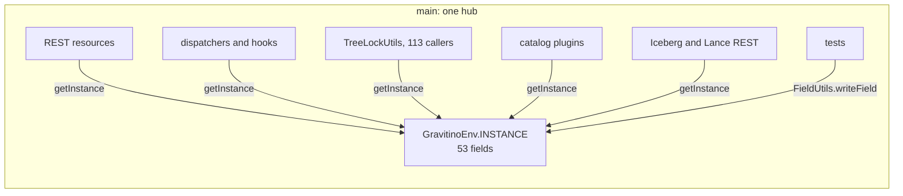
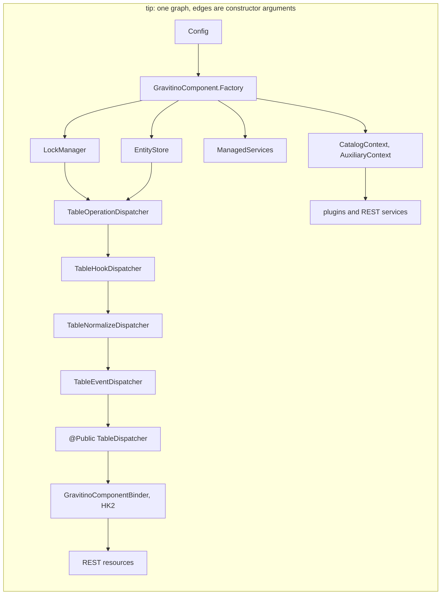
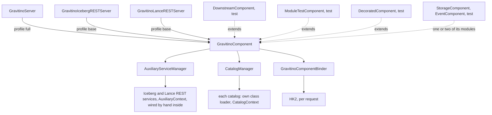
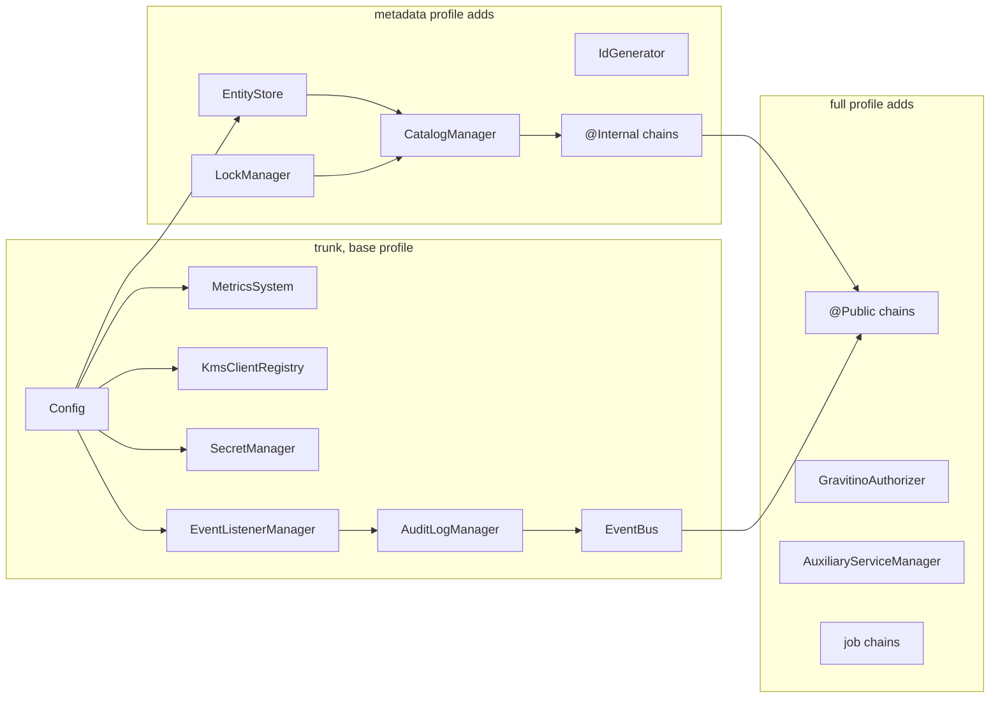
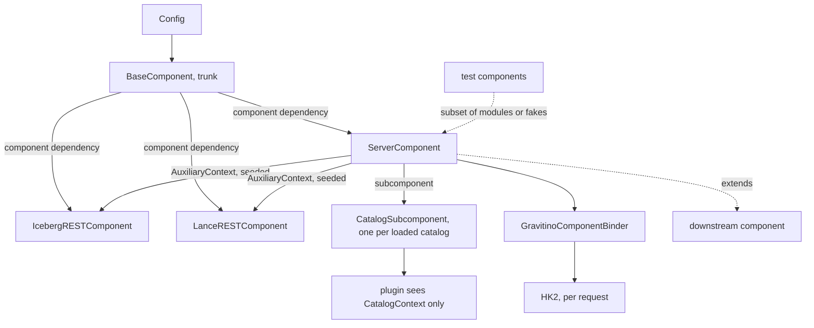
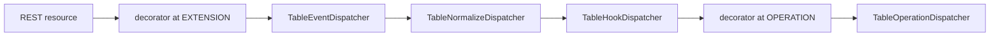

<!--
  Licensed to the Apache Software Foundation (ASF) under one
  or more contributor license agreements.  See the NOTICE file
  distributed with this work for additional information
  regarding copyright ownership.  The ASF licenses this file
  to you under the Apache License, Version 2.0 (the
  "License"); you may not use this file except in compliance
  with the License.  You may obtain a copy of the License at

   http://www.apache.org/licenses/LICENSE-2.0

  Unless required by applicable law or agreed to in writing,
  software distributed under the License is distributed on an
  "AS IS" BASIS, WITHOUT WARRANTIES OR CONDITIONS OF ANY
  KIND, either express or implied.  See the License for the
  specific language governing permissions and limitations
  under the License.
-->

# SPIP: Dependency injection with Dagger

| Field   | Value                                                                               |
| ------- | ----------------------------------------------------------------------------------- |
| Status  | Draft                                                                               |
| Author  | Nevin Zheng ([@nevzheng](https://github.com/nevzheng))                              |
| Updated | 2026-10-22                                                                          |
| Module  | `core`, `server`, `server-common`, `iceberg/iceberg-rest-server`, `lance`, `dev/di` |
| Code    | Line references are against apache `main` at `026a6603` (2026-10-19)                |
| Proof   | Draft stack of 26 PRs on `nevzheng/gravitino`, [#77] to [#119] (Appendix D.2)       |

The questions come first. The appendices hold the strategies with their proof PRs (Appendix A),
the measured dimensions (Appendix B), the detailed design and plan (Appendices C to J), and the
case for dependency injection and Dagger, with before and after code (Appendix K).

PRs are named by segment, a letter for the milestone and a number (A1, C5, F4), and linked to the
draft PR that implements the segment. Appendix D.2 lists them in order.

---

## Q1. What are you trying to do?

Make the way the Gravitino server is put together explicit, checked by the compiler, and easy to
extend without editing upstream files.

Today one global object, `GravitinoEnv`, builds every server component and hands it to whoever
asks. The goals:

- **Visible dependencies.** Every component receives what it needs through its constructor, so
  a reader sees its inputs and a test can pass its own.
- **Wiring errors at build time.** A missing, duplicate or circular dependency fails the compile,
  not the first request after start-up.
- **Tests without global state.** Tests build the objects they need instead of writing private
  fields of a process-wide singleton, so they can run in parallel and in any order.
- **One start and stop order.** Services start in the order the graph builds them, stop in
  reverse, and a failed start rolls back what already started. Nobody maintains a list.
- **Extension points instead of subclassing.** Downstream builds (forks, vendor distributions)
  add behaviour through declared seams, so an upstream sync does not conflict in core files.
- **Narrow plugin boundaries.** Catalog plugins, auxiliary services and authorizers receive a
  plain Java context that lists what they may use, instead of reaching the whole server through a
  static.
- **Progress that cannot regress.** Every anti-pattern is counted in CI, and a count can only go
  down.

## Q2. What problem is this proposal NOT designed to solve?

1. **No runtime DI framework swap.** HK2 stays as Jersey's injector for resources and filters. We
   do not add a second runtime container.
2. **No Jersey replacement.** REST resources, filters and `GravitinoInterceptionService` keep
   their current shape.
3. **Plugin SPI stays framework-free.** `CatalogOperations`, `GravitinoAuxiliaryService` and
   authorization plugins never see a Dagger or `javax.inject` type. They receive plain Java
   context objects.
4. **No behaviour change.** Requests, configuration keys, and the order components start in are
   preserved; only how objects are constructed and found changes. The one exception is a bug fix
   found on the way (Q3.3, forced metalake drop), which is its own PR.
5. **No big-bang rewrite.** Every PR leaves the server runnable and the ratchet green.
6. **Not the relational storage singletons.** The `*MetaService` classes, `SqlSessionFactoryHelper`
   and the other 41 `public static getInstance()` singletons (254 calls in `src/main`, 1219 in
   `src/test`) are a separate track. The ratchet reports them; this proposal does not move them.
7. **No new scopes.** No per-request or per-catalog scopes; Jersey owns the request.

## Q3. How is it done today, and what are the limits?

### Q3.1 The service locator

`GravitinoEnv` is a process-wide singleton (`core/.../GravitinoEnv.java:215-227`) that builds every
server component in `initializeFullComponents` (`:271`), exposes each one through a getter, and
starts and stops them by hand (`start()` at `:803`, `shutdown()` at `:814`). The numbers on apache
`main` at `026a6603`, from `python3 -B dev/di/di_ratchet.py report` run over that tree:

| Measure                                                 | Value                                    |
| ------------------------------------------------------- | ---------------------------------------- |
| `GravitinoEnv.java` length                              | 1207 lines, 89 `new` calls               |
| Instance fields in `GravitinoEnv`                       | 53                                       |
| `GravitinoEnv.getInstance()` in `src/main`              | 169 occurrences in 76 files              |
| `GravitinoEnv.getInstance()` in `src/test`              | 397 occurrences in 94 files              |
| Hidden lookups: `TreeLockUtils` callers in `src/main`   | 113, each reads `getInstance()` at `:46` |
| `public static X getInstance(` singleton declarations   | 41 in `src/main`, 2 in `src/test`        |
| `*MetaService.getInstance()` calls                      | 254 in `src/main`, 1219 in `src/test`    |
| `mockStatic(GravitinoEnv.class)` in tests               | 34 in 16 files                           |
| `FieldUtils` read/write on `GravitinoEnv.getInstance()` | 341 occurrences in 85 test files         |

Counts are code only: comments and string literals are stripped first, and a call that Spotless
wraps after `(` still counts once. With comments included, the `getInstance()` rows read 170 and
399.

The locator calls are spread across modules, so the problem is not confined to `core`: `core` 32
files, `server` 15, `iceberg-rest-server` 9, `server-common` 6, `plugins/idp-basic` 5, `lance` 3,
and five catalog modules, `plugins/tms` and `authorization-ranger` 1 each. Catalog plugins, which
load in an isolated classloader, still call back into the host singleton, for example
`FilesetCatalogOperations.java:214-215,263,293`. The debt grows with every feature.

### Q3.2 What goes wrong

- **Hidden dependencies.** A class's real inputs are not in its constructor. `TreeLockUtils`
  (`core/.../lock/TreeLockUtils.java:46`) looks up the lock manager on every call, so 113 call
  sites (108 `doWithTreeLock`, 5 `doWithRootTreeLock`) depend on the lock manager without saying so.
- **Wiring errors surface at runtime.** Nothing checks that every getter is set before it is
  read. A missing component is a `NullPointerException` on the first request that needs it, and a
  wrong start order shows only when the server runs.
- **Nullable components.** Optional features are `null` fields. `gravitinoAuthorizer` is set later
  through `setGravitinoAuthorizer` (`GravitinoEnv.java:748`) and callers test for `null` in
  `OwnerManager.java:218`, `AuthorizationUtils.java:461` and
  `AccessControlHookDispatcher.java:346,362,373,380`. A missed check is a `NullPointerException`
  in production; a present check silently skips the work (Q3.3).
- **Tests write global state.** Tests cannot pass a fake into a constructor, so they write
  private fields with reflection (341 `FieldUtils` reads and writes on
  `GravitinoEnv.getInstance()`), mock the static `getInstance()` (34 places in 16 files) or mock
  `PrincipalUtils` and `GravitinoAuthorizerProvider` statics (82 places). A test that does not put
  the fields back changes the next test's world, and shared static state means test classes that
  touch the store cannot run in parallel.
- **Lifecycle gaps.** `start()` and `shutdown()` are hand-ordered `if (x != null)` chains. Nothing
  guarantees stop is the reverse of start, and a failure in the middle of `GravitinoServer.start()`
  leaves half-started components with no rollback. `GravitinoServer.stop()` closes the authorizer
  before it stops Jetty, so a request in flight can reach a closed authorizer.
- **Two composition roots in one process.** Auxiliary services such as the Iceberg REST server
  (`iceberg/.../RESTService.java:108,128,129,148`) and the Lance REST server
  (`lance/.../LanceRESTService.java:87-88,98`,
  `GravitinoLanceNamespaceWrapper.java:166,302,310,433`) reach into the singleton from their own
  `serviceInit`, so their start order relative to `GravitinoEnv` is implicit.
- **Downstream builds extend by subclassing and editing.** The only way to change a component is
  to subclass `GravitinoEnv`, override its getters, and edit the upstream files that build the
  dispatcher chains. Every upstream change to those files then conflicts on the next sync. One
  downstream fork studied for this proposal has two `GravitinoEnv` subclasses with 47 overrides
  and 23 dispatcher subclasses, and each of its last five syncs needed conflict commits.

### Q3.3 Found while migrating

Moving construction into a checked graph surfaced defects that the locator hid. Each is fixed in
the proof stack.

| Finding | Where it showed | Fix |
| ------- | --------------- | --- |
| A forced metalake drop calls `CatalogManager.dropCatalog` directly (`MetalakeManager.java:423-438` on `026a6603`). For each catalog this skips the drop events (`DropCatalogPreEvent`, `DropCatalogEvent`, `DropCatalogFailureEvent`), any `@Public` decorator, and `CatalogHookDispatcher.dropCatalog`, which tells the authorization plugin to remove the catalog and its locations. | Hiding the raw managers (Appendix A.4): this was the only production caller that mutated catalogs through the raw manager | F4 ([#105]): the drop goes through the `@Public` catalog chain |
| The raw `CatalogManager` was handed out by the component, HK2 and three contexts, so any resource or plugin could create, alter or drop a catalog without events, hooks or decorators | Survey of `CatalogManager` consumers while binding chain bottoms `@Undecorated` | F4 ([#105]): read-only `CatalogAccess`; the managers are not exposed |
| HK2's `bind(x).to(C)` also advertises the implementation class of `x`, so binding the manager as `CatalogAccess` still let a resource inject `CatalogManager` | `TestGravitinoComponentBinder` | `ContractBinding.only(service, contract)` advertises one contract (F4, [#105]) |
| With no authorizer installed, callers either skip the check (`AuthorizationUtils.java:143` skips the metalake membership check) or throw a `NullPointerException` that a REST call reports as 500 | Making the authorizer non-null (C1) | `DenyAllGravitinoAuthorizer` while authorization is enabled and none is installed, so the request fails closed with 403 (C1, [#86]); from H1 ([#112]) the component builds the authorizer before the server takes requests |
| `GravitinoServer.stop()` closed the authorizer before Jetty stopped | Writing the server's start and stop as one `Lifecycle` | Jetty stops first (A3, [#79]) |
| Store tests (`BackendTestExtension`, `TestFilesetMetaService`, `AbstractEntityStorageTest`) wrote the env's config and ID generator and never put them back; `TestJdbcPartitionStatisticStorageFactory.testEmptyPassword` passed only when an earlier test left a store in the env | Running `core` tests in parallel forks | The store reads seeded values, and one fixture seeds and restores them (H2, [#109]) |
| `TestFilesetCatalogOperations` wrote a store into the env and one of its tests never reset it | Handing catalog plugins a context | The store and secret manager are constructor arguments (D1, [#92]) |
| Dagger cannot see constructors that Lombok 1.18.20 generates | Adding Dagger to `core` | Lombok 1.18.42, with Error Prone 2.42.0 and plugin 5.1.1, which renames `options.errorprone.isEnabled` to `enabled` in every build script (A1, [#77]) |

## Q4. What is new in your approach, and why will it succeed?

The server is built by one compile-time Dagger graph, `GravitinoComponent`, and migrated to it
with the strangler fig pattern. `GravitinoEnv` stays while the graph grows behind it, its getters
returning the component's objects, and is deleted in the last PR. Six strategies carry the
migration; Appendix A gives each with where it is applied, its outcome and its proof PR:

1. **Strangler fig facade, no shims** (A.1). One graph from the first PR, ownership moved one area
   at a time. Each PR changes a constructor or a contract and moves every caller and test of it in
   the same PR, so no deprecated constructor, environment-backed twin or bridge is ever added and
   later deleted.
2. **Count ratchet** (A.2). `dev/di/di_ratchet.py` counts every anti-pattern; `check` fails when a
   count rises, and each PR that lowers one commits the new ceiling.
3. **Layered decorator seams and multibindings** (A.3). Downstream builds contribute a decorator
   at a named layer of a chain, and managed services, instead of overriding getters. Two decorators
   at one layer of one chain fail the compile.
4. **Qualifiers** (A.4). `@Public` and `@Internal` name the two dispatcher chains; package-private
   `@Undecorated` hides the layers under a chain, so no module can skip hooks and events.
5. **Managed services and no-op bindings** (A.5). A service opts in to start and stop by
   implementing `ManagedService`; it registers as Dagger builds it, so start follows the graph and
   stop is its reverse. Disabled features bind a no-op, and a missing authorizer fails closed.
6. **Dual-stack mirror** (A.6). The same commits are applied to a downstream fork with a companion
   commit per breaking PR, and the shared paths are checked for zero diff at every step.

Why it will succeed:

- **The defects are wiring defects.** A dependency that is not declared, a component that is
  `null`, an order that is not written down. Dagger turns the first two into compile errors and
  derives the third from the graph.
- **Dagger generates plain Java.** No reflection to reason about in a security review, nothing to
  configure at runtime, and generated code can be stepped through. It reads both the
  `javax.inject` annotations Jersey 2.41 brings and the `jakarta.inject` annotations a later
  Jersey brings. Appendix H compares it with hand wiring, Guice, Avaje, Spring and HK2.
- **It is incremental and already demonstrated.** The proof stack moves construction of every
  component into the graph and deletes `GravitinoEnv` in 26 reviewable PRs, each green on its own,
  and the same commits apply to a downstream fork with 0 zero-diff failures (Appendix B).
- **The ratchet keeps the gains.** Counts are enforced by `./gradlew check`, so a regression is a
  red build, not a review comment.

## Q5. Who cares? If it succeeds, what difference does it make?

- **Downstream users and distributors.** Teams that ship Gravitino with their own components today
  must subclass `GravitinoEnv` and edit upstream files, and pay for it at every sync. With the
  seams they add a module: decorators at a layer of a chain, managed services, extra bindings on a
  component that extends `GravitinoComponent`. Upstream files stay untouched, so a sync merges
  cleanly. A PR that changes a public contract says what a downstream build changes with it
  (Appendix F). For maintainers this is the main payoff: downstream builds keep up with releases
  instead of drifting.
- **Maintainers and reviewers.** A component's dependencies are its constructor. A missing binding
  is a compile error in the PR that introduced it. The ratchet shows in numbers whether a PR moves
  the code toward or away from the target.
- **Test authors.** Tests build a component or pass fakes into constructors instead of writing
  private fields of a singleton. Order-dependent failures go away, and `core` unit tests run in
  parallel forks.
- **Plugin authors.** Catalog plugins, auxiliary services and authorizers get a plain Java context
  (`CatalogContext`, `AuxiliaryContext`, `AuthorizerContext`) with default methods, so existing
  plugins keep compiling and new ones see exactly what the host offers.
- **Operators and security reviewers.** Start and stop order follows the graph, a failed start
  rolls back, the authorizer is never `null`, and authorization fails closed when it is enabled
  but not installed. The forced metalake drop now fires catalog events and plugin cleanup.

## Q6. What are the risks?

| Risk | Mitigation |
| ---- | ---------- |
| Annotation-processor ordering with Lombok and Error Prone; Dagger cannot see Lombok 1.18.20 constructors | Lombok 1.18.42 and Error Prone 2.42.0 land first (A1). `@Inject` constructors are written by hand (C.9), and `disableWarningsInGeneratedCode` stays on so Error Prone skips `Dagger*` sources. B3 adds Dagger with the root component and is the build gate before any area module lands. |
| Generated code size and build time | One root component, modules per area; `./gradlew :core:compileJava` time before and after is not measured yet (Appendix B) |
| Reviewer unfamiliarity with Dagger | `dev/di/README.md` holds a one-page primer and the rules in C.9 |
| `GovernanceModule` grows into a monolithic factory shell | Rule: `@BindsInstance` only for `Config`; review gate |
| Upstream drift during a long stack | Small PRs; independent groups in parallel; re-baseline the ratchet at each merge |
| Python on CI runners for the ratchet | Standard library only; `-PdiRatchetPython`; fallback grep in `dev/di/README.md` |
| The scanner misses static imports, aliases and wrappers | The scanner is the metric, not the gate; the gate is the deletion of `GravitinoEnv` in I2, after which no locator call compiles |
| Downstream builds break when a PR changes a constructor or a contract with no deprecated path in between | Each PR moves its own callers and says in its description what a downstream build changes with it; the dual-stack mirror (A.6) writes that companion change before the sync that carries it. A deprecated path would only move the break to a later sync: a fork that compiles with `-Werror` breaks on the deprecation itself |
| A decorator replaces its chain instead of delegating, and drops the hook and event layers | The `DispatcherDecorator` contract requires delegation; a test pins that the hook layer runs under a delegating decorator |
| The two provider bags (`AuthorizationServices`, `MetadataObjectDispatchers`) hide edges from Dagger's cycle check | Bounded and listed in C.3; narrow dependencies are a follow-up (D.5) |
| Construction has side effects (store connects, lock threads start) that Dagger orders only by edges | Orders the server relies on are edges (C.5); an initialize phase is a follow-up (D.5) |

## Q7. How long will it take?

The proof stack exists: 26 draft PRs, 28 commits on `b748d734a`, from the build upgrades
to the deletion of `GravitinoEnv`. Upstream time is review time. The five M0 PRs have no code
dependencies on each other and can be opened on `main` with this proposal (D.2); the rest are a
stack, one PR per segment.

Remaining work after the stack, from the gap list in D.5:

| Step | Size |
| ---- | ---- |
| Narrow dependencies replace the provider bags in hooks and managers | M |
| Initialize phase: `@Provides` only constructs, I/O moves to start | M |
| Profile components (base, metadata, full) from module groups | M |
| Own components for the Iceberg and Lance REST services | M |
| Chains converted from replacing to wrapping decorators in a downstream build (K1 starts this) | S each |

The `*MetaService` track (Q2, item 6) is separate and larger.

## Q8. What are the mid-term and final "exams" to check for success?

Mid-term, at every PR:

- `./gradlew check` is green, which includes `checkDiRatchet` and `testDiRatchet`.
- Every hard ratchet count is at or below its baseline, and a PR that lowers one commits the new
  baseline.
- Each commit compiles and passes `spotlessCheck`.
- On the downstream mirror, the shared paths show zero diff against the upstream commit, outside
  a reviewed exception list (A.6).

Milestones, each with a number from Appendix B:

1. **M0** (A1, A3, A5, D1, B2): build upgrades, the server `Lifecycle`, the lock manager passed to
   `TreeLockUtils`, `CatalogContext` and the ratchet, each on `main`. Exam: legacy tree-lock calls
   in `src/main` 113 to 0; catalog plugins take a context.
2. **Graph** (B3, C1, C2, C5): exam: `GravitinoEnv` `new` calls 89 to 3; services start and
   stop through `ManagedServices` in graph order.
3. **Seams** (D2, D3, D5, D6): exam: a test component decorates all 34 chains at a named layer;
   HK2 is bound from the component; auxiliary services take a context.
4. **Host and authorization** (E1 to E4, H1, F1 to F4): exam: production `getInstance()` 169 to
   22; no component method returns a raw manager; the authorizer is built in the graph.
5. **M1** (H2, H4): exam: the store, the schema separator and the method monitor are seeded by
   the component; the standalone servers build a component without `GravitinoEnv`.

Final, M3 (I2, D.4):

- `GravitinoEnv` no longer exists, so no locator call compiles.
- `dev/di/di_ratchet.py report` shows 0 for every locator metric (`GravitinoEnv`, legacy tree-lock
  overloads, `mockStatic` and `FieldUtils` on the env) in both `src/main` and `src/test`.
- `./gradlew :core:coreUnitTest` runs with `maxParallelForks > 1`.
- A downstream fork builds on the seams with no `GravitinoEnv` subclass (Appendix F).

---

## Appendix A. Strategies

Each strategy lists the idea, where it is applied, the outcome, and the proof PRs.

### A.1 Strangler fig facade, no shims

- **Idea.** Keep the old entry point working while a new one takes over behind it. `GravitinoEnv`
  becomes a facade over one `GravitinoComponent`: each PR moves one area's construction into a
  module, the matching getter returns the component's object, and call sites move to constructor
  injection. There is one graph throughout; objects are never built twice.
- **Applied.** Nothing flows from `GravitinoEnv` into the graph: the component builds its objects
  and the facade only reads them (D.1). A PR that changes a constructor, an interface or a static
  helper changes every caller and test of it in the same PR; it adds no deprecated overload, no
  environment-backed implementation of a new context, and no bridge for a later PR to delete.
  Public SPIs that code outside the repository implements (`CatalogOperations`,
  `GravitinoAuxiliaryService`, `GravitinoAuthorizer`, `Authenticator`, `BaseAuthorization`) gain
  a default method that calls the old one, so a plugin keeps compiling.
- **Outcome.** `GravitinoEnv` `new` calls 89 to 3 by C5, production `getInstance()` 169 to
  5 by H4, and the facade is deleted in I2 with nothing left to migrate. No PR in the stack
  deletes code that an earlier PR of the stack added for compatibility.
- **Proof.** B3 ([#83]) adds the component; C1 ([#86]), C2 ([#89]) and C5 ([#90]) move the areas;
  D1 ([#92]), D5 ([#96]), E1 ([#98]) and E4 ([#101]) add the contexts; D3 ([#94]) binds HK2 from
  the component; I2 ([#117]) deletes `GravitinoEnv`.

### A.2 Count ratchet

- **Idea.** Count each anti-pattern, fail the build when a count rises, and lower the ceiling
  whenever a PR lowers the count. Same pattern as Betterer and ArchUnit's `FreezingArchRule`.
- **Applied.** `dev/di/di_ratchet.py` with `baseline.json`, the `checkDiRatchet` Gradle task in
  `check`, and overlays for downstream trees (Appendix E).
- **Outcome.** Every commit in the stack after B2 passes `checkDiRatchet`, and each PR that lowers
  a count commits the new baseline with it. Downstream, an overlay keeps the fork's own counts
  separate, so syncs do not fail the check.
- **Proof.** B2 ([#82]); the baseline change in each later PR.

### A.3 Layered decorator seams and multibindings

- **Idea.** Dagger rejects two bindings of the same type, so a downstream module cannot override
  an upstream binding. Instead upstream declares maps that downstream modules contribute to with
  `@IntoMap`: on every chain a `Map<Layer, DispatcherDecorator<T>>`, keyed by the layer of the
  chain a decorator sits over, and a `ManagedService` set for services with a start and a stop.
- **Applied.** `@Public` and `@Internal` maps per chain, assembled by `Chain`; `ManagedService`
  contributions in `LifecycleModule`; `GravitinoModules` lists the upstream modules so a
  downstream component extends `GravitinoComponent`; the server and the standalone servers take a
  component factory (Appendix F).
- **Outcome.** Upstream contributes nothing, so its chains do not change. A downstream fork
  builds its whole server from its own component with no edit to upstream wiring files.
  `TestDownstreamComponent` decorates all 34 chains and pins where each decorator sits.
- **Proof.** D2 ([#93]) and D3 ([#94]); applied downstream in the mirror (A.6).

### A.4 Qualifiers and hidden chain bottoms

- **Idea.** Name the two chains of one interface with `@Public` and `@Internal`, and bind the
  concrete layers under them with a package-private `@Undecorated`, so only `di` modules can name
  them and the component exposes none of them.
- **Applied.** Every dispatcher chain (C.2). `CatalogManager` and `MetalakeManager` are chain
  bottoms too; code outside `di` reads catalogs through `CatalogAccess`. HK2 binds `CatalogAccess`
  through `ContractBinding`, which advertises one contract.
- **Outcome.** The only writable path to a catalog or metalake is its chain. Hiding the managers
  surfaced the forced metalake drop bug (Q3.3), now fixed. `TestGravitinoComponent` checks that no
  component method returns either manager.
- **Proof.** C1 ([#86]) and C2 ([#89]) for the chain qualifiers; D2 ([#93]) for `@Undecorated`;
  F4 ([#105]) for `CatalogAccess` and the metalake drop.

### A.5 Managed services and no-op bindings

- **Idea.** Dagger constructs; `ManagedServices` starts and stops. A service opts in by
  implementing `ManagedService` and registers as the module that builds it returns it, so the
  registration order is a topological order of the graph. Optional features bind a no-op instead
  of `null`.
- **Applied.** `Lifecycle` in `GravitinoServer` first, for the server's own parts (C.5);
  `ManagedServices` in the component for everything the graph builds (C.5).
  `NoopGravitinoAuthorizer` when authorization is off; `DenyAllGravitinoAuthorizer` when it is on
  and none is installed, until the component builds the authorizer (C.4).
- **Outcome.** Jetty stops before the authorizer closes; services start in dependency order and
  close in reverse with no order to maintain; a failed start rolls back; `close()` aggregates stop
  failures and is idempotent; the authorizer null checks are gone.
- **Proof.** A3 ([#79]), C1 ([#86]), C5 ([#90]), H1 ([#112]).

### A.6 Dual-stack mirror

- **Idea.** Prove that a downstream fork can follow the stack before upstream merges it. Apply
  each upstream commit unchanged to a fork branch, add a companion commit wherever the fork's
  build breaks, and check that the shared paths stay byte-identical to upstream at every step.
- **Applied.** A private downstream fork. The fork-side detail (touch points, companion commits,
  exceptions) lives with that fork, not in this document.
- **Outcome.** Every upstream commit of the stack cherry-picked unchanged, a companion commit only
  where the fork's own code breaks, 0 zero-diff failures (Appendix B).
- **Proof.** The mirror branch; every upstream PR has its pair there.

---

## Appendix B. Measured dimensions

"main" is apache `main` at `026a6603`; "tip" is the head of the proof stack, I2 ([#117]) on
`b748d734a`. Ratchet rows come from `python3 -B dev/di/di_ratchet.py report` on each tree, written
as occurrences in files. The stack base `b748d734a` is above `main` on two test rows: 38
`mockStatic` in 17 files and 471 `FieldUtils` on any target in 107 files.

| Dimension | Measure | main | tip | Target |
| --------- | ------- | ---- | --- | ------ |
| Hidden wiring | `GravitinoEnv.getInstance()`, `src/main` | 169 in 76 | 0 | 0 |
| Hidden wiring | Legacy `TreeLockUtils` overloads, `src/main` | 113 in 15 | 0 | 0 |
| Facade size | `GravitinoEnv` lines / `new` calls | 1207 / 89 | deleted | deleted |
| Facade size | `GravitinoEnv` instance fields | 53 | deleted | 0 |
| Test global state | `GravitinoEnv.getInstance()`, `src/test` | 397 in 94 | 0 | 0 |
| Test global state | `FieldUtils` on the env | 341 in 85 | 0 | 0 |
| Test global state | `mockStatic(GravitinoEnv)` | 34 in 16 | 0 | 0 |
| Test global state | `FieldUtils` on any target (report only) | 465 in 103 | 95 in 40 | no target |
| Test parallelism | `core` unit test forks | 1 | half the processors | more than 1 |
| Correctness | Defects found and fixed | none known | 1 production (Q3.3), 3 test isolation, 1 fail-open path | |
| Downstream cost | Fork mirror: commits applied unchanged / companions | n/a | 29 / 27 | companions only where a fork's own code breaks |
| Downstream cost | Fork mirror: zero-diff failures / exception files | n/a | 0 / 19 | 0 / 0 |
| Out of scope | Other `public static getInstance()` singletons | 41 | 40 | separate track |
| Out of scope | `*MetaService.getInstance()` (report only) | 254 / 1219 | 254 / 1219 | separate track |

Tests at the tip: the `:core`, `:server`, `:server-common`, `:iceberg:iceberg-rest-server`,
`:lance:lance-rest-server` and authorization module unit tests pass (core 3,166, server 701,
server-common 515, Iceberg REST 479, Lance REST 119 tests; 0 failures). On the fork mirror, the
upstream commits conflicted only in reviewed exception files, and the unit tests of the fork's own
modules pass. Docker integration tests were not run.

Not measured yet:

- Build time: `./gradlew :core:compileJava` before and after, and Dagger's annotation-processing
  overhead.
- Size of the generated `Dagger*` sources.
- Wall time of `core` unit tests with parallel forks against one fork, and CI job time.
- Server start-up time and memory.
- Sync cost on the fork: conflict count per sync before and after the seams.

---

## Appendix C. Design

### C.1 One root component

There is one `@Singleton` component, `GravitinoComponent`, in `core`. Modules are grouped by area
and each module is small enough to review on its own.

```java
@Module(
    includes = {
      ConfigModule.class,       // IdGenerator, MetricsSystem
      StorageModule.class,      // EntityStore, KmsClientRegistry, SecretManager
      LockModule.class,         // LockManager
      EventModule.class,        // EventListenerManager, EventBus, AuditLogManager
      CatalogModule.class,      // @Undecorated CatalogManager, MetalakeManager; CatalogAccess
      SchemaTableModule.class,  // schema, table, partition, view dispatcher chains
      FilesetTopicModelModule.class,
      GovernanceModule.class,   // tag, policy, owner, statistics
      AuthorizationModule.class, // access control, bulk and future grant managers
      AuthorizerModule.class,   // GravitinoAuthorizer
      JobModule.class,
      AuxiliaryModule.class,    // AuxiliaryContext, AuxiliaryServiceManager
      LifecycleModule.class     // the downstream ManagedService set
    })
public abstract class GravitinoModules {}

@Singleton
@Component(modules = GravitinoModules.class)
public interface GravitinoComponent {
  @Public TableDispatcher tableDispatcher();
  @Internal TableDispatcher internalTableDispatcher();
  // one provision method per type the servers bind into HK2 or hand to a context
  ManagedServices managedServices();

  @Component.Factory
  interface Factory {
    GravitinoComponent create(@BindsInstance Config config);
  }
}
```

`Config` is the only `@BindsInstance` leaf. Everything else is built by a module or by an `@Inject`
constructor, so the compiler proves the graph is complete.

### C.2 Qualifiers for the two dispatcher chains

`GravitinoEnv` holds a public chain (operation → hook → normalize → event) and an internal
normalize-only chain for the same `TableDispatcher` type (`GravitinoEnv.java:145-146`, built at
`:1105-1111` and `:961-970`). Dagger needs a qualifier to tell them apart. This design uses two
shared qualifiers, `@Public` and `@Internal`, defined once in `org.apache.gravitino.di`, rather
than one pair per entity type.

```java
@Module
abstract class SchemaTableModule {
  @Provides @Singleton @Public
  static TableDispatcher tableDispatcher(EventBus eventBus,
      @Undecorated CatalogManager catalogs, /* store, ids, schemas, secrets, locks */
      AuthorizationServices authorization,
      @Public Map<Layer, DispatcherDecorator<TableDispatcher>> decorators) {
    TableOperationDispatcher operations = new TableOperationDispatcher(/* ... */);
    return Chain.<TableDispatcher>of("@Public TableDispatcher", operations, decorators)
        .hook(d -> new TableHookDispatcher(d, authorization))
        .normalize(d -> new TableNormalizeDispatcher(d, catalogs))
        .event(d -> new TableEventDispatcher(eventBus, d))
        .build();
  }

  @Provides @Singleton @Internal
  static TableDispatcher internalTableDispatcher(@Undecorated CatalogManager catalogs,
      /* store, ids, schemas, secrets, locks */
      @Internal Map<Layer, DispatcherDecorator<TableDispatcher>> decorators) {
    TableOperationDispatcher operations = new TableOperationDispatcher(/* ... */);
    return Chain.<TableDispatcher>of("@Internal TableDispatcher", operations, decorators)
        .normalize(d -> new TableNormalizeDispatcher(d, catalogs))
        .build();
  }
}
```

The qualifiers only protect the interface types. A manager or operation dispatcher at the bottom
of a chain (`TagManager`, `PolicyManager`, `OwnerManager`, `StatisticManager`,
`AccessControlManager`, `JobManager`, `JobTemplateValidationDispatcher`,
`SchemaOperationDispatcher`, `PartitionNormalizeDispatcher`, and the fileset, topic, model and
function operation dispatchers) is a concrete type, and an unqualified
binding for it would let any module, including a downstream one, inject it and skip both the hooks
and the decorators. These are bound with a third qualifier, `@Undecorated`, which is
package-private: only the modules in `org.apache.gravitino.di` can name it, and the component
exposes none of them.

`CatalogManager` and `MetalakeManager` are chain bottoms too, and are bound `@Undecorated` the same
way (F4). `MetalakeManager` has no consumer outside its chains. `CatalogManager` has two
faces that code outside `di` uses: lookups (`listCatalogs`, `listCatalogsInfo`, `loadCatalog`,
`catalogExists`) and leased access to the live catalog (`doWithCatalog`, which the normalize
dispatchers, `CapabilityHelpers`, `AuthorizationUtils`, `MetadataIdResolver` and the Iceberg REST
server use to read a catalog's capability, properties or authorization plugin). These form a
separate interface, `CatalogAccess`, together with `addCatalogCacheRemoveListener`, which the
Iceberg wrapper cache uses to follow evictions. `CatalogModule` binds it unqualified with `@Binds`
to the `@Undecorated` manager; the component provides `catalogAccess()` and no method returning
either manager, HK2 binds `CatalogAccess`, and `AuxiliaryContext`, `AuthorizationServices` and
`AuthorizerContext` hand out `catalogAccess()` in place of `catalogManager()`. A downstream build
that assembles its own operation dispatchers gets the manager under the public
`@ForDispatcherChains` qualifier, which no component method returns. `doWithCatalog` and
`doWithCatalogWrapper` still hand out the live catalog, a per-catalog write path below the entity
store; that is the existing leased access contract every operation dispatcher relies on, not a way
to change the catalog list.

A forced metalake drop removes the metalake's catalogs through the `@Public` catalog chain, which
`MetalakeManager` receives as a `Supplier` (`CatalogModule` passes a `Provider` to avoid a
cycle). Each catalog drop therefore fires its events and runs its hook and decorators, like a
user's forced catalog drop.

### C.3 `Provider<T>` for cycles

The table dispatcher needs the schema dispatcher and the access-control hook needs the owner
dispatcher, which needs the catalog dispatcher. Where a cycle is real, the consumer takes
`Provider<T>` (or the existing `Supplier<T>` style, adapted with `provider::get`) and resolves it
lazily. Dagger rejects a cycle that has no `Provider` edge at compile time, so the cycle list is
explicit and reviewable.

The graph has three real cycles:

- `CatalogManager` → its authorization plugin context → `@Internal CatalogDispatcher` →
  `CatalogManager`;
- `OwnerManager` → `AuthorizationServices` → `@Internal OwnerDispatcher` → `OwnerManager`;
- `AccessControlManager` → `AuthorizationServices` → `@Internal AccessControlDispatcher` →
  `AccessControlManager`.

Two parameter objects, `AuthorizationServices` (hooks, managers, `CatalogAccess` and the
authorization plugins) and `MetadataObjectDispatchers` (the tag and policy managers and REST
resources), hold a `Provider` for every service they hand out, not only for the three cycle edges.
Each has one implementation, built by the component (`ComponentAuthorizationServices`,
`ComponentMetadataObjectDispatchers`), and tests pass a plain fake. Their `Provider`s keep
the laziness the hooks had when they read the facade: building a hook builds no access-control,
owner or catalog object, which matters while authorization is off and on a store the owner
manager cannot use. The cost is that Dagger cannot report a new cycle that runs through one of
them, and a hook's real inputs are not visible in its constructor. The follow-up is for each hook
and manager to take the narrow dependencies it uses, with `Provider` only on the three edges
above.

### C.4 No-op bindings instead of `null`

Optional features are bound to a no-op implementation when disabled. `GravitinoAuthorizer` becomes
non-null everywhere; the six null checks in Q3.2 are deleted.

```java
@Module
abstract class AuthorizerModule {
  @Provides @Singleton
  static GravitinoAuthorizer gravitinoAuthorizer(@AuthorizationEnabled boolean enabled,
      Config config, AuthorizerContext context, ManagedServices services) {
    if (!enabled) {
      return NoopGravitinoAuthorizer.INSTANCE;
    }
    GravitinoAuthorizer authorizer = newAuthorizer(config.get(Configs.AUTHORIZATION_IMPL));
    authorizer.initialize(context); // closed and rethrown if it fails
    services.register(ManagedService.closing("GravitinoAuthorizer", authorizer));
    return authorizer;
  }
}
```

The class named by `gravitino.authorization.impl` is loaded by reflection, so `core` does not
depend on the server module that holds `JcasbinAuthorizer`. It registers with `ManagedServices`
after what it reads, so it closes before them. The server asks the component for it before Jetty
takes requests and installs it in `GravitinoAuthorizerProvider` for the code that still reads it
statically.

Until H1 moves the authorizer into the graph, the server installs it into `GravitinoEnv` after
the component is built and takes it back while it shuts down. While none is installed,
`gravitinoAuthorizer()` returns `NoopGravitinoAuthorizer` only when `ENABLE_AUTHORIZATION` is false.
When it is true, it returns `DenyAllGravitinoAuthorizer`, so a request that runs before the
authorizer is installed or after it is closed fails closed.

Whether authorization is enabled is bound once, as `@AuthorizationEnabled boolean`, and bindings
read it instead of the configuration. While it is false the owner chains bind
`NoopOwnerDispatcher`, so the owner manager, which needs a relational store, is never built and no
binding yields `null`. The access control, owner and future grant services of
`AuthorizationServices` are `null` while authorization is disabled, as the hooks have always found
them; replacing them with no-ops is a follow-up (D.5).

The same rule applies to `EventListenerManager`, `MetricsSystem` reporters and the cache.
`@BindsOptionalOf` is not used; `Optional<T>` leaks the same decision to every caller.

### C.5 `ManagedServices` for start and stop order

Dagger constructs objects; it does not start or stop them. A service with a start or a stop
implements `org.apache.gravitino.lifecycle.ManagedService`, an `AutoCloseable` with a default no-op
`start()` and a default `name()`. It carries no order. The module that builds it hands it to the
component's `ManagedServices` registry as it returns it:

```java
@Provides @Singleton
static LockManager lockManager(Config config, ManagedServices services) {
  return services.register(new LockManager(config));
}
```

Dagger builds the dependencies of an object before the object, so the registration order is a
topological order of the graph. `start()` starts the services in that order; when a start fails it
closes the services already started, in reverse, and rethrows. `close()` closes every registered
service in reverse, keeps going when one fails, rethrows the first failure with the others
suppressed, and is idempotent. A service registered after start, because something built it late,
is started when it registers. Each start and close is logged with its duration. A type that is not
a `ManagedService`, such as the entity store, registers through `ManagedService.closing(name,
resource)`. A profile builds only what it uses, so it registers and closes only what it built.

The order changes where the old hand-written list disagreed with the graph: the catalog manager now
closes before the entity store and the lock manager it uses, where the entity store used to close
first.

`GravitinoServer` keeps its own `Lifecycle` (A3), added before any Dagger code exists: it adds the
component's services, then the authorizer as stop-only, then Jetty. Jetty therefore cannot accept a
request before the services are up, and on shutdown Jetty stops before the authorizer closes and
before the services close. On `026a6603`, `GravitinoServer.stop()` (`GravitinoServer.java:280-283`)
closes the authorizer first, then stops Jetty, then the environment. `TestLifecycle` covers the
builder, `TestManagedServices` the registry and `TestGravitinoServerLifecycle` the server (rollback
on Jetty failure, idempotent stop, aggregated cleanup errors).

The lock manager is one of those services. It used to be a process singleton that was never
stopped; now each component builds its own, and each `LockManager` starts a lock cleaner and a
deadlock checker thread. `LockManager.close()` stops both. A test that builds many components
therefore leaks no lock threads, which parallel test forks need.

Construction still has side effects in a few `@Provides` methods: the entity store connects to its
backend, the lock manager starts its threads, the event listener manager loads its listeners, the
auxiliary service manager loads and initializes its services, and the audit log manager registers
its listener. Dagger orders these only by dependency edges, so an order the server relies on must
be an edge, not a position in an initialization sequence. The audit listener is one: the event bus
depends on the audit log manager, so the listener is registered before anything can post an event,
whoever asks for the bus first. The few orders that are not edges yet (the auxiliary services are
built after every host service they may use, the job manager after the auxiliary services) live in
`GravitinoProfiles`, with a comment each. Moving the I/O into an explicit start is a separate
change, because objects read the store while they are built (the metalake manager loads every
metalake in its constructor) and auxiliary services use host services while they initialize.

### C.6 HK2 at the edge

Jersey keeps HK2. `GravitinoServer.java:161-196` already binds finished instances into HK2 with
`bind(gravitinoEnv.x()).to(X.class).ranked(1)`. The only change is the source: the component's
provision methods instead of `GravitinoEnv` getters.

```java
GravitinoComponent graph = DaggerGravitinoComponent.factory().create(serverConfig);
config.register(new AbstractBinder() {
  @Override protected void configure() {
    bind(graph.tableDispatcher()).to(TableDispatcher.class).ranked(1);
    // ...
  }
});
```

No bridge library exists between Dagger and HK2, and none is needed: Dagger builds, HK2 binds.
Resources and filters keep `@Inject`/`@Context` fields served by HK2. `core` never depends on HK2.

Besides the dispatchers, `GravitinoComponentBinder` binds the host services that resources,
filters and REST features take through `@Inject` constructors: `Config`, `EventBus`,
`IdGenerator`, `EntityStore`, `CatalogAccess`, `AuxiliaryServiceManager`, the
`MetadataAccessChecker` and the `@Internal` table and view dispatchers. HK2 advertises
the implementation class of every `bind(instance)`, so `CatalogAccess` is bound through a
descriptor from `ContractBinding.only` that advertises only that contract; otherwise a resource
could still inject `CatalogManager`. The access-control dispatcher, owner dispatchers and
`BulkManager` exist only when authorization is enabled. HK2 cannot bind `null`, so the binders
bind them only then and the resources inject them as `@org.jvnet.hk2.annotations.Optional`. An
internal chain is bound with `qualifiedBy(InternalQualifier.INSTANCE)` at rank 0, below its public
chain at rank 1, because HK2 also serves a qualified binding to an unqualified lookup. Each
resource has one constructor, the `@Inject` one; `TestMetadataAccessCheckerInjection` checks it.

### C.7 `CatalogContext` for plugins

`CatalogOperations.initialize(Map<String,String>, CatalogInfo, HasPropertyMetadata)`
(`core/.../connector/CatalogOperations.java:48`) gives a plugin no way to receive host services, so
plugins call `GravitinoEnv.getInstance()` across the classloader boundary. The fix is a plain Java
interface, built by `CatalogManager` from the graph and passed to the plugin:

```java
/** Host services a catalog plugin may use. Plain Java, no DI types. */
public interface CatalogContext {
  EntityStore entityStore();
  SecretManager secretManager();
  MetricsSystem metricsSystem();
  IdGenerator idGenerator();
}
```

`CatalogOperations` gains a default method `initialize(Map, CatalogInfo, HasPropertyMetadata,
CatalogContext)` that delegates to the existing three-argument method, so third-party plugins keep
compiling. The host narrows what a plugin can reach to the methods on `CatalogContext`; a plugin can
no longer walk into the lock manager or authorizer through a static.

A `GravitinoAuthorizer` gets its host services the same way, through `AuthorizerContext`
(`config()`, `entityStore()`, `catalogAccess()`, `internalAccessControlDispatcher()`) and a default
`initialize(AuthorizerContext)` that calls `initialize()`. The component builds the authorizer and
initializes it with its own context (C.4). Authenticators get `AuthenticatorContext` and catalog
authorization plugins `AuthorizationPluginContext` the same way, each with a default method that
calls the old one.

### C.8 Iceberg and Lance auxiliary services

Auxiliary services receive their host services through `AuxiliaryContext`
(`core/.../auxiliary/AuxiliaryContext.java`), a plain Java interface like `CatalogContext`.
`IsolatedClassLoader` shares `org.apache.gravitino` classes, so the context crosses the loader
boundary that `AuxiliaryServiceManager` puts around each service.

- **Base services** that every profile builds: `config()`, `eventBus()`, `metricsSystem()`,
  `secretManager()` and `kmsClientRegistry()`.
- **Server services** that only the full profile builds: the ID generator, lock manager, entity
  store and catalog access; the `@Public` catalog, schema, table and policy dispatchers; the
  secret property dispatcher; the `@Internal` schema, table and view dispatchers; and
  `internalOwnerDispatcher()`, which is `null` when authorization is disabled. A context that does
  not have one of these throws `IllegalStateException`.

`GravitinoAuxiliaryService` gains a default `serviceInit(Map, boolean, AuxiliaryContext)` that calls
the two-argument method, so a service that does not override it, such as a downstream one, behaves
as before. `AuxiliaryServiceManager(AuxiliaryContext)`, its only constructor, passes the context to
the three-argument method.

There are two implementations:

| Context | Built by | Used by |
| ------- | -------- | ------- |
| `ComponentAuxiliaryContext` | `AuxiliaryModule`, from `Provider`s of the root graph | The full profile. `AuxiliaryModule` also provides the `AuxiliaryServiceManager`, a `ManagedService` that registers once its services are initialized, so it starts after every host service and closes before them. |
| `AuxiliaryContext.standalone(...)` | The standalone Iceberg and Lance servers, from the component they build with the base profile | The base profile. It holds only the base services, so the standalone servers build nothing they did not build before; its server-only methods throw `IllegalStateException`. |

`RESTService` and `LanceRESTService` override the three-argument method and pass the context down:
Iceberg to its config provider, catalog wrapper manager, cleanup manager and hook dispatchers;
Lance to the namespace wrapper of a backend with a `(LanceConfig, boolean, AuxiliaryContext)`
constructor. Their two-argument `serviceInit` throws `UnsupportedOperationException`, so a service
started without a context fails at once rather than on its first request. Server services are only
read in auxiliary mode or with authorization enabled, which a standalone server rejects, so the
standalone servers behave as before.

Neither service has its own Dagger component. `RESTService` builds its dispatcher chains by hand,
and downstream forks change those chains; a component would turn that textual conflict into a
second graph. A service can add a separate component, seeded with the context through
`@BindsInstance`, when it has enough wiring to justify one.

### C.9 Rules

- `@Inject` constructors are written by hand; no Lombok on classes Dagger constructs.
- A type that is not part of a dispatcher chain and that the graph builds with a plain `new` gets
  an `@Inject` constructor and no `@Provides` method (`BulkManager`, `FutureGrantManager`). The
  types of a chain stay in `@Provides` methods: an `@Inject` constructor creates an unqualified
  binding, which would let any module inject the object under the chain (C.2), and the wrappers of
  a chain each wrap one specific instance. Those modules hold only the qualifier and decorator
  wiring of each chain. `CredentialOperationDispatcher` and `SecretPropertyOperationDispatcher`
  take the `@Undecorated` catalog manager, so `CatalogModule` builds them.
- One root component in `core`. Auxiliary services get separate components, never subcomponents.
- `@BindsInstance` only for `Config` and for seeding auxiliary contexts.
- No `@Nullable` bindings. Disabled features bind a no-op.
- Modules are `abstract class` with `static @Provides` or `@Binds`; no instance state.
- `javax.inject` annotations until Jersey moves to Jakarta; Dagger accepts either.

---

## Appendix D. Migration plan

### D.1 Strangler fig mechanics

`GravitinoEnv` is the legacy facade. Each PR moves one area's construction into a module of the
single `GravitinoComponent`; the facade asks the component for the object at the point of its
initialization sequence where it used to build it, so construction order is unchanged; call sites
switch from the getter to constructor injection. There is one graph throughout; ownership moves,
objects do not get built twice, and nothing flows from the facade into the graph.

Rules every PR follows:

- **No compatibility shims inside the stack.** A PR that changes a constructor, a static helper or
  an interface moves every caller and test of it in the same PR. It adds no deprecated
  constructor, no `Environment*` implementation of a new context that reads the facade, and no
  bridge that seeds the graph from the facade. Only public SPIs that code outside the repository
  implements get a default method that calls the old one (A.1).
- **Each PR drains its own tests.** A test that wrote the facade's fields or mocked
  `getInstance()` for the code a PR changes is rewritten in that PR, with constructor arguments or
  a test component.
- **Each PR states its downstream change.** The PR description says what a downstream build that
  extends or calls the changed code does in the same sync.
- **The facade is deleted in one PR** (I2), once nothing reads it.

### D.2 PR plan and proof stack

Each PR leaves `./gradlew check` green. The milestone letter groups PRs that can be reviewed
together; M0 PRs are independent of each other and of the rest, and each later PR is stacked on
the one before it.

| Segment | PR | Base | What it does |
| ------- | -- | ---- | ------------ |
| B1 | [#81] | `main` | This document |
| A1 | [#77] | `main` | Lombok 1.18.20 to 1.18.42; Error Prone 2.10.0 to 2.42.0 and plugin 3.1.0 to 5.1.1 |
| A3 | [#79] | `main` | `Lifecycle`; `GravitinoServer` registers environment, authorizer (stop-only) and Jetty, so Jetty stops first |
| A5 | [#80] | `main` | `TreeLockUtils` takes the `LockManager`; 113 callers receive it by constructor; the overloads that read the facade are removed |
| D1 | [#92] | `main` | `CatalogContext`; catalog plugins take their host services from it |
| B2 | [#82] | `main` | `dev/di/di_ratchet.py`, `baseline.json`, `checkDiRatchet` in `check`, `testDiRatchet` |
| B3 | [#83] | M0 | Dagger 2.60.1; root `GravitinoComponent` with `ConfigModule`, `LockModule`, `StorageModule`, `EventModule` |
| C1 | [#86] | B3 | `CatalogModule`, `GovernanceModule`, `AuthorizationModule`; `@Public`, `@Internal`, `@AuthorizationEnabled`; the authorizer is never `null` |
| C2 | [#89] | C1 | `SchemaTableModule`, `FilesetTopicModelModule`, `JobModule` |
| C5 | [#90] | C2 | `ManagedService` and `ManagedServices`: start in graph order, stop in reverse |
| D2 | [#93] | C5 | `Layer`, `LayerKey`, `DispatcherDecorator`, `Chain`; a decorator map on every chain; `@Undecorated` chain bottoms; `GravitinoModules` |
| D3 | [#94] | D2 | Downstream `ManagedService` set; `GravitinoComponentBinder`; the server and the facade built from a component factory |
| D5 | [#96] | D3 | `AuxiliaryContext`, `AuxiliaryModule`; the component builds and manages `AuxiliaryServiceManager` |
| D6 | [#97] | D5 | Iceberg and Lance REST services take `AuxiliaryContext`; the standalone servers take a component factory |
| E1 | [#98] | D6 | `AuthorizerContext`; REST resources, filters and the `idp-basic` and `tms` features take their host services by `@Inject` constructor |
| E2 | [#99] | E1 | Injectable `MetadataAccessChecker` and `MetadataIdResolver` |
| E3 | [#100] | E2 | REST resources and the Iceberg and Lance REST services check access through the injected checker |
| E4 | [#101] | E3 | `AuthenticatorContext` and `AuthorizationPluginContext` |
| H1 | [#112] | E4 | `AuthorizerModule`: the component builds the authorizer |
| F1 | [#102] | H1 | `AuthorizationServices` for the access control and owner managers |
| F2 | [#103] | F1 | Hooks take `AuthorizationServices` |
| F3 | [#104] | F2 | `MetadataObjectDispatchers`; managers, operation dispatchers and REST resources take the host services they read from the facade |
| F4 | [#105] | F3 | `CatalogAccess`; the managers bound `@Undecorated`; the forced metalake drop goes through the catalog chain |
| H2 | [#109] | F4 | The relational store, the schema separator and the method monitor are seeded by the component; the internal view dispatcher is injected |
| H4 | [#113] | H2 | `GravitinoProfiles`; the standalone servers build a component without the facade |
| I2 | [#117] | H4 | Delete `GravitinoEnv`, `MetadataAuthzHelper` and `MetadataIdConverter`; the server owns its component; integration tests reach the server's component |
| K1 | [#119] | D2 | Forwarding dispatchers (schema, table, fileset, topic, model, view) that override every method, so a decorator delegates each call |

The M0 PRs (A1, A3, A5, D1, B2) are each one change on `main` and can be reviewed alongside this
document. B3 is stacked on all five.

### D.3 Static state that remains

After I2 nothing calls a locator, and these static holders remain, each set by the code that owns
the value:

- `GravitinoAuthorizerProvider`, which the server installs the component's authorizer into, for
  the authorization expression evaluator and the method interceptors that Jersey and HK2 build.
- `RelationalStoreSeeds`, which `StorageModule` seeds before it creates the entity store: the
  relational meta services are static singletons outside the component (Q2, item 6) and read the
  metrics system, the cache flag and the ID generator from it.
- `HierarchicalSchemaUtil.schemaSeparator()`, seeded by every profile, with about 50 callers in
  catalogs and REST code.
- `MethodMonitorAspect`, which AspectJ instantiates with no arguments, and which `ConfigModule`
  hands the metrics system to.
- `ServerAuthenticator`, `FileFetcher` and `SecretPropertyUtils`, process-wide as on `main`.

### D.4 Exit criteria

- `GravitinoEnv` is deleted.
- `dev/di/di_ratchet.py report` shows 0 for every locator metric in both `src/main` and `src/test`.
- `./gradlew :core:coreUnitTest` runs with `maxParallelForks > 1`.

### D.5 End state and remaining PRs

The target after the stack:

- **No facade, no locator.** The process entry points build a component and hand objects down;
  nothing static holds a graph.
- **HK2 at the edge.** `GravitinoComponentBinder` is the only binder.
- **Plugins behind contexts.** Catalog plugins, auxiliary services, authorizers, authenticators
  and authorization plugins receive plain Java contexts.
- **Lifecycle from the graph.** Services register as Dagger builds them and stop in reverse.
- **Tests.** No `FieldUtils` on the env, no `mockStatic` of it; fixtures are `ModuleTestComponent`,
  `TestGravitinoComponent` and `TestDownstreamComponent`.
- **Downstream.** A downstream component extends `GravitinoComponent` with its own factory and
  contributes layered decorators, managed services and its own bindings.

Remaining PRs, in order:

| # | Gap | Size |
| - | --- | ---- |
| 1 | Narrow dependencies replace `AuthorizationServices` and `MetadataObjectDispatchers` in hooks and managers; `Provider` only on the three cycle edges (C.3) | M |
| 2 | No-op `AccessControlDispatcher` and `FutureGrantManager` instead of `null` while authorization is disabled; Dagger as `api` for downstream components | S each |
| 3 | Initialize phase: `@Provides` only constructs; connecting the store, starting lock threads, loading listeners and auxiliary services, and the metalake preload move to start | M |
| 4 | Profile components from module groups instead of `GravitinoProfiles` | M |
| 5 | Own components for the Iceberg and Lance REST services, seeded with `AuxiliaryContext` | M |
| 6 | `*MetaService` and `SqlSessionFactoryHelper` as instances in `StorageModule`; `RelationalStoreSeeds` deleted | L, separate track |

---

## Appendix E. Guardrails: the anti-pattern count ratchet

The ratchet is `dev/di/di_ratchet.py` (Python standard library only, with `test_di_ratchet.py`).
It is lexical: it strips comments and string literals and balances parentheses to count arguments,
so it does not need a Java parser. It lands in B2, before any DI code, so counts can only fall
from then on. It has three subcommands: `report` prints the current counts, `check` fails
when a hard metric rises above its baseline, and `update` rewrites the baseline from the current
tree.

### E.1 What it counts

Every metric is counted for `src/main` and `src/test` separately. The values below were measured
on apache `main` `026a6603`; the committed `baseline.json` is taken at the stack base `b748d734a`,
where some test counts are higher. Appendix B has the values at the stack tip, where every
`GravitinoEnv` metric is 0 and stays as a guard.

| Metric | Kind | Baseline (main / test) |
| --------------------------------------------------------------- | ----------- | ----------- |
| `\w*GravitinoEnv.getInstance(` occurrences and files | Hard | 169 / 397 |
| Instance fields in `GravitinoEnv` | Hard | 53 |
| `TreeLockUtils` legacy overloads: `doWithTreeLock` with 3 arguments | Hard | 108 / 3 |
| `TreeLockUtils` legacy overloads: `doWithRootTreeLock` with 2 arguments | Hard | 5 / 0 |
| `public static X getInstance(` singleton declarations | Hard | 41 / 2 |
| `mockStatic(\w*GravitinoEnv.class` | Hard | 0 / 34 |
| `FieldUtils` read or write on `GravitinoEnv.getInstance()` | Hard | 0 / 341 |
| Any legacy pattern inside a package in `migrated_packages` | Hard (zero) | 0 |
| `FieldUtils` read or write on any target | Report only | 23 / 465 |
| `*MetaService.getInstance(` calls | Report only | 254 / 1219 |
| `GravitinoEnv.java` line count and `new` calls | Report only | 1207, 89 |

The `\w*` prefix on the locator patterns means the locators of `GravitinoEnv` subclasses in a
downstream tree, such as `DownstreamGravitinoEnv.getInstance()`, are counted too (Appendix F).

### E.2 Baseline file and Gradle gate

- `dev/di/baseline.json` holds the counts, `source_revision` and `migrated_packages`.
- `./gradlew checkDiRatchet` runs `di_ratchet.py check`; it fails when a hard metric rises.
  `-PdiRatchetPython` selects the interpreter.
- `./gradlew testDiRatchet` runs the tool's own unit tests.
- `checkDiRatchet` is a dependency of `check`, so every CI run and every local `./gradlew check`
  enforce it.
- A PR that lowers a count also runs `di_ratchet.py update` and commits the regenerated baseline,
  so the ceiling drops with it.
- `migrated_packages` lists packages where every legacy pattern is held at zero. It starts empty;
  a package is added once it is clean.

### E.3 Layered baselines

The tool reads `--baseline` plus repeatable `--overlay` files. An overlay names the baseline it
`extends`, has a `name`, and scopes its limits with `paths` globs, not by package, so files that
live in `org.apache.gravitino.*` packages but belong to another tree are still attributed
correctly. Apache `main` ships one baseline. A downstream tree ships its own overlay with its own
file name, so an upstream sync never overwrites it, and runs `update --overlays-only` to lower
only its own limits.

---

## Appendix F. Downstream builds

A downstream fork or distribution today plugs in by subclassing: a `GravitinoEnv` subclass with
its own `INSTANCE` overrides getters, a server subclass passes it to `GravitinoServer`, and
dispatcher subclasses rebuild the hook, normalize and event chains by hand. Each subclass is a
second locator, and code that reads the wrong one silently gets the upstream object. Every
upstream change to a chain is a merge conflict, or merges cleanly and is missing from the copy.

What this design gives a downstream fork:

1. **Layered decorator seams, not subclassing.** Dagger reports a duplicate binding when two
   modules bind the same type, so a fork cannot override an upstream binding. D2 adds seams
   instead:
   - Every `@Public` and `@Internal` chain has its own map, for example
     `@Public Map<Layer, DispatcherDecorator<TableDispatcher>>`. A decorator is keyed with the
     `Layer` it sits over: `OPERATION`, `HOOK`, `NORMALIZE`, `EVENT` or `EXTENSION` (outermost).
     On a chain without that layer, such as an internal chain, which has no hook or event layer,
     it sits at the same position. Section F.1 gives the reasons for named layers.
   - A public chain and the internal chain of its type start from the same undecorated bottom, so
     the decorators of one chain never appear in the other. Every upstream consumer of a chain,
     such as the hooks that read the owner dispatcher, gets the decorated chain.
   - A decorator must delegate to the dispatcher it is given. A decorator that replaces the chain
     drops the hook and event layers under it. On a public chain the hook layer keeps
     authorization in step with metadata changes: it sets owners and future grants on new objects,
     notifies the catalogs' authorization plugins, and refreshes the authorizer's caches after role,
     privilege and role-binding changes. Without it a user whose role is revoked keeps the access
     `JcasbinAuthorizer` has cached until the cache expires, and no audit event is sent. The
     contract is documented on `DispatcherDecorator` and not enforced; the forwarding dispatchers
     of K1 make delegation the default for a decorator author.
   - `ManagedService` contributions (D3) register when they are built, after what they depend on,
     so they start in dependency order with the rest and close in reverse. A shutdown without a
     start builds none of them.
   - `GravitinoModules` lists the upstream modules. A downstream component that extends
     `GravitinoComponent` is built from it and the downstream modules. The server and the
     standalone Iceberg and Lance servers take a component factory in their constructor and in
     `run(args, factory)`, which their `main` calls with the upstream factory. A downstream entry
     point passes its own factory, so its decorators and managed services are present in every
     profile, not only on the full server.

   Upstream contributes no decorators and no services, so its chains do not change.

   ```java
   @Provides @IntoMap @LayerKey(Layer.EXTENSION) @Public
   static DispatcherDecorator<CatalogDispatcher> auditedCatalogs(AuditTrail trail) {
     return catalogs -> new AuditedCatalogDispatcher(catalogs, trail);
   }
   ```

2. **Server seam.** D3 binds HK2 from the component's provision methods through
   `GravitinoComponentBinder`, with the contracts and ranks the facade's getters had. A downstream
   server passes its own component factory to `GravitinoServer` and binds its own services from its
   own component.
3. **Separate baseline and limits.** The fork commits its own ratchet overlay with `"extends":
   "baseline.json"` and two scopes: the paths it shares with upstream, held to the upstream numbers
   so drift is caught where it would conflict, and its own paths, seeded from a `report` run.
   Without this, the first upstream sync after B2 fails `check` on the fork.
4. **Sync step.** The sync workflow re-runs `check` with the overlay and labels the sync PR when
   the shared scope moves.
5. **Same-sync changes.** No PR adds a deprecated path, so a fork moves with each PR that changes a
   contract it extends. The PR description names the change, for example F2: a fork whose hooks
   extend the upstream hook dispatchers passes them `AuthorizationServices` in the same sync.

### F.1 Why decorators are keyed by named layers

A decorator's position on a chain carries meaning: an extension wraps outside the event layer so
each call it makes is audited, while a check that must see normalized identifiers sits over the
operation layer. Bare integer orders do not say which; a downstream build picks a number such as
100 without knowing what upstream reserves around it, and two equal numbers are found only when a
chain is built.

Named phases instead of numbers have precedent:

- **Spring Security WebFlux** places a `WebFilter` at a named position with
  `ServerHttpSecurity.addFilterAt(webFilter, SecurityWebFiltersOrder)`, next to `addFilterBefore`
  and `addFilterAfter`.
- **Maven** binds plugin goals to named lifecycle phases (`validate`, `compile`, `test`, `package`,
  `verify`, `install`, `deploy`) with `<execution><phase>`, not to numbers.
- **JAX-RS** names priority bands in `javax.ws.rs.Priorities` (and `jakarta.ws.rs.Priorities`):
  `AUTHENTICATION` (1000), `AUTHORIZATION` (2000), `HEADER_DECORATOR` (3000), `ENTITY_CODER`
  (4000) and `USER` (5000), used with `@Priority`. Gravitino's REST filters do not use `@Priority`;
  six exception mappers in `server/.../web/mapper` use `@Priority(1)`, a bare number.

The cautionary tale is Spring's `org.springframework.core.Ordered`: a plain `int` from
`HIGHEST_PRECEDENCE` to `LOWEST_PRECEDENCE`, whose Javadoc warns that "same order values will
result in arbitrary sort positions for the affected objects".

What the `Layer` map gives:

- **No silent misordering.** A decorator sits over the layer it names, so its position follows its
  meaning and does not depend on the numbers other builds chose.
- **Collisions are compile errors.** Two decorators at one layer of one chain are a duplicate map
  key, which Dagger rejects when the component is compiled.
- **Intent is in the name.** A reviewer reads `@LayerKey(Layer.HOOK)`, not `100`.
- **Downstream binds at `EXTENSION`** without knowing any upstream number.

The trade-off: one decorator per layer per chain, which is stricter than Spring and Maven. If two
decorators at one layer become necessary, the fallback is a list per layer, applied in
declaration order, as Maven runs the goals bound to one phase in the order the POM declares them.

---

## Appendix G. Testing strategy

All tests run through Gradle tasks: `./gradlew :core:coreUnitTest`, `./gradlew :server:test
-PskipITs`, `./gradlew checkDiRatchet testDiRatchet`.

- **Graph tests.** `TestGravitinoComponent` builds the component with a test `Config` and asserts
  that every provision method returns the same instance twice (singletons), that `@Public` and
  `@Internal` chains are distinct, and that no method returns `CatalogManager` or
  `MetalakeManager`. Dagger's compile step is itself the test for completeness.
- **Module tests.** Each area module gets a `TestXxxModule` that replaces one dependency with a
  fake through a test component, for example `AuthorizerModule` with `ENABLE_AUTHORIZATION`
  false must bind `NoopGravitinoAuthorizer`.
- **Lifecycle tests.** `TestLifecycle` covers ordered start, reverse stop, rollback on a start
  failure, idempotent `close()` and aggregated stop errors. `TestManagedServices` covers
  registration order, rollback, late registration and aggregated close.
  `TestGravitinoServerLifecycle` checks that the server registers its services, the authorizer and
  Jetty in that order, that Jetty stops first, and that a Jetty start failure rolls the others back.
- **Downstream tests.** `TestDownstreamComponent` builds a component from `GravitinoModules` plus a
  test module that decorates every chain, and checks where each decorator sits, delegation through
  the hook layer and the order of the contributed services. `TestChain` covers the positions and
  missing layers.
- **Ratchet tests.** `dev/di/test_di_ratchet.py` runs through `testDiRatchet` in `check`.
- **Test drain, per PR.** Each PR rewrites the tests of the code it changes: a replaced
  `FieldUtils.writeField` becomes a constructor argument or a test module binding. The relational
  store still reads its metrics system, cache flag and ID generator statically, so
  `StoreSeedsFixture` is the only place that seeds them, and closing it restores the previous
  values. `:core:test` stays at one fork when Docker tests are enabled, because the MySQL and
  PostgreSQL backends share containers.
- **Integration.** Existing Docker integration tests run unchanged; no behaviour change means no
  new integration tests, only the existing ones kept green at every PR.

---

## Appendix H. Options considered

| Option | What it is | Pros | Cons | Decision |
| ----------------- | ----------------------------------------- | ------------------------------------------- | ---------------------------------------------------------------------- | ----------- |
| Pure constructor injection, no framework | Hand-written wiring in one `Wiring` class | Zero dependencies; trivially debuggable | The wiring class becomes a 1200-line `GravitinoEnv` again; cycles and optionals handled by convention only; no compile-time check that every binding exists | Rejected as the end state; it is the first migration step |
| Guice | Runtime reflection DI (Google) | Well known; `javax`/`jakarta` dual support in 6.x | Last release 7.0.0 in May 2023 and no activity since; Airlift forked it in Aug 2026 to keep it alive; 7.x is `jakarta.inject` only, which conflicts with Jersey 2.41's `javax` stack; errors appear at start-up, not compile time; reflection and runtime bytecode generation | Rejected |
| Avaje Inject | Compile-time DI, annotation processor | Small, fast, Jakarta-native | Single-maintainer project with no Apache-project precedent; Jakarta-only annotations; smaller reviewer familiarity | Rejected |
| Spring / Quarkus | Full application frameworks | Large ecosystem | Replaces Jersey/Jetty; classpath-scanning and reflection; far outside the "no behaviour change" non-goal; heavy transitive footprint for an ASF `LICENSE.bin` | Rejected |
| HK2 everywhere | Extend the injector Jersey already uses | Already on the classpath | Runtime reflection; no compile-time validation; coupled to Jersey's lifecycle so `core` would depend on a web framework | Rejected |
| **Dagger 2** | Compile-time DI, generated plain Java | Missing binding, duplicate binding and cycles are compile errors; no reflection; generated code is readable and steppable; reads both `javax.inject` and `jakarta.inject` since 2.41; active releases (2.60.1 as of 2026-10) | Annotation processor must co-exist with Lombok and Error Prone; new `LICENSE.bin` entries (Dagger, Jakarta Inject API, JSpecify); server-side use is a niche practice, so fewer examples | **Chosen** |

Prior exploration: Nevin Zheng's July 2026 proof of concept (`codex/dagger-gradual-migration-poc`,
Appendix J) is reading material for this design, not a code base for it. No code is reused. It
taught four things: lifecycle needs its own owner, separate from the object graph; a monolithic
factory shell with a dozen constructor arguments adds little over the singleton it replaces; an
auxiliary-service graph needs a settled start order before it can drop `Supplier` indirection; and
a lexical ratchet over the Java sources is enough to hold the line in CI.

---

## Appendix I. Open questions

| Question | Owner or next step |
| -------- | ------------------ |
| Downstream dispatchers add methods (`listEntities`, `preview`) to every layer | A decorator at `EXTENSION` adds methods to the outermost object; a method every layer must implement still needs a replaced chain (K.7, way 3) |
| `javax.inject` now, `jakarta.inject` when Jersey moves? | Dagger reads both; decide when Jersey is upgraded |
| Per-request or per-catalog scopes after migration? | Out of scope; subcomponents only after the stack (K.5.2) |
| Should `doWithCatalog`, which hands out the live `BaseCatalog`, stay on `CatalogAccess`? | Kept: every leased-access consumer would otherwise inject two interfaces |

---

## Appendix J. References

- Dagger: <https://dagger.dev/> and `@Component` Javadoc:
  <https://dagger.dev/api/latest/dagger/Component.html>
- Dagger 2.41 release notes (Jakarta support):
  <https://github.com/google/dagger/releases/tag/dagger-2.41>
- Dagger multibindings: <https://dagger.dev/dev-guide/multibindings>
- Hilt migration guide (incremental adoption pattern): <https://dagger.dev/hilt/migration-guide>
- Strangler Fig, Martin Fowler: <https://www.martinfowler.com/bliki/StranglerApplication.html>
- Spring Security WebFlux `ServerHttpSecurity` (`addFilterAt`, `SecurityWebFiltersOrder`):
  <https://docs.spring.io/spring-security/reference/api/kotlin/spring-security-config/org.springframework.security.config.web.server/-server-http-security-dsl/index.html>
- Spring `Ordered`:
  <https://docs.spring.io/spring/docs/5.3.x/javadoc-api/org/springframework/core/Ordered.html>
- Maven build lifecycle:
  <https://maven.apache.org/guides/introduction/introduction-to-the-lifecycle.html>
- ArchUnit `FreezingArchRule` as used by Flink:
  <https://apache.googlesource.com/flink/+/refs/heads/master/flink-architecture-tests/>
- Betterer (count ratchet pattern): <https://dev.to/phenomnominal/betterer-v1-0-0-301b>
- Jersey custom DI (`AbstractBinder`):
  <https://third-party-mirror.googlesource.com/jersey/+/48c4fb8e03b1656f4a68d8b5d71ed7aebe89b44b/docs/src/main/docbook/custom-di.xml>
- Guice: <https://github.com/google/guice>
- Prior exploration (reading only, no code reused; Appendix H):
  `origin/codex/dagger-gradual-migration-poc` (`4c79d1bea..8ea476bfe`) and
  `origin/codex/dagger-iceberg-integration` (`..965b6126a`), Nevin Zheng, 2026-07-26

---

## Appendix K. Why dependency injection, and why Dagger

Q1 to Q4 state the goals. This appendix makes the case with the code: the problems first, highest
impact first, then every other reason, then the limits. "main" is `b748d734a`, the stack base, and
counts on it come from `dev/di/di_ratchet.py report`. "Tip" is the head of this stack, where
`GravitinoEnv` no longer exists. Excerpts are shortened; `// ...` marks a cut.

### K.1 Problems in the code today, by impact

| #   | Problem                                    | Evidence on main                                                                                                                            | Fixed by                                              |
| --- | ------------------------------------------ | ------------------------------------------------------------------------------------------------------------------------------------------- | ----------------------------------------------------- |
| 1   | A write path can skip a chain's layers     | Forced metalake drop calls `CatalogManager.dropCatalog` directly (Q3.3); the raw manager is handed to any caller                            | One chain per qualifier; hidden chain bottoms (K.1.1) |
| 2   | One mutable global object holds everything | `GravitinoEnv`: 53 fields, 1207 lines; `getInstance()` 169 times in 76 `src/main` files                                                     | Constructor injection (K.1.2)                         |
| 3   | Tests rewrite that global object           | 341 `FieldUtils` calls on it in 85 test files; 38 `mockStatic(GravitinoEnv)` in 17; `core` unit tests in one fork                           | Fakes through constructors (K.1.3)                    |
| 4   | Wiring errors surface at run time          | `null` until set: `setGravitinoAuthorizer` (`GravitinoEnv.java:748`); `entityStore()` throws "GravitinoEnv is not initialized"              | Compile-time graph (K.1.4)                            |
| 5   | Build order is the position of a line      | `initGravitinoServerComponents` (`:1056`); "Fileset dispatcher is created before schema dispatcher so schema can take it directly" (`:918`) | Order follows dependency edges (K.1.5)                |
| 6   | Stop order and state after stop are ad hoc | `shutdown()` (`:814`) is a list of `if (x != null)` blocks; only one field is cleared (`:852`)                                              | `ManagedServices` (K.1.6)                             |
| 7   | Downstream builds extend by subclassing    | A downstream fork: two `GravitinoEnv` subclasses, 47 overrides, 23 dispatcher subclasses                                                    | Decorator and service seams (K.1.7)                   |

#### K.1.1 A write path can skip a chain's layers

The public chain of each type is event, normalize, hook, then operation. On main each chain is
assembled by hand in `initPublicMetadataDispatchers`, and the objects at its bottom are ordinary
getters, so any caller can go around the chain. The forced metalake drop did: it called the raw
manager and skipped the drop events, the decorators and the hook that tells authorization plugins
to clean up (Q3.3).

Before (main, `MetalakeManager.dropCatalogsUnderMetalake`):

```java
for (CatalogEntity catalog : catalogs) {
  catalogManager.dropCatalog( // the raw manager: no event, no decorator, no hook
      NameIdentifier.of(metalakeIdent.name(), catalog.name()), true /* force */);
}
```

After (tip): the chain bottoms are bound with the package-private `@Undecorated`, so only modules
in `org.apache.gravitino.di` can name them, and other code reads catalogs through `CatalogAccess`,
which has no mutation. The manager is handed the public chain and drops through it:

```java
// CatalogModule
@Provides @Singleton @Undecorated
static MetalakeManager metalakeManager(EntityStore entityStore, IdGenerator idGenerator,
    @Undecorated CatalogManager catalogManager,
    @Public Provider<CatalogDispatcher> catalogDispatcher, LockManager lockManager,
    ManagedServices services) { /* ... */ }

// MetalakeManager.dropCatalogsUnderMetalake
CatalogDispatcher childCatalogs = catalogDispatcher.get();
for (CatalogEntity catalog : catalogs) {
  childCatalogs.dropCatalog( // events, decorators and hook run
      NameIdentifier.of(metalakeIdent.name(), catalog.name()), true /* force */);
}
```

`TestGravitinoComponent` checks that no component method returns either manager.

#### K.1.2 One mutable global object holds everything

Before (main, `TreeLockUtils.java:46`): every one of 113 call sites depends on the lock manager
without saying so.

```java
public static <R, E extends Exception> R doWithTreeLock(
    NameIdentifier identifier, LockType lockType, Executable<R, E> executable) throws E {
  TreeLock lock = GravitinoEnv.getInstance().lockManager().createTreeLock(identifier);
  // ...
}
```

Before (main, `TableOperationDispatcher`): the four-argument constructor, which the public table
chain used, reaches into the singleton for another chain.

```java
public TableOperationDispatcher(
    CatalogManager catalogManager, EntityStore store, IdGenerator idGenerator,
    SecretManager secretManager) {
  this(catalogManager, store, idGenerator,
      () -> GravitinoEnv.getInstance().internalSchemaDispatcher(), secretManager);
}
```

After (tip): the inputs are the constructor.

```java
public TableOperationDispatcher(
    CatalogManager catalogManager, EntityStore store, IdGenerator idGenerator,
    Supplier<SchemaDispatcher> schemaDispatcherSupplier, SecretManager secretManager,
    LockManager lockManager) { /* ... */ }

TreeLockUtils.doWithTreeLock(lockManager, ident, LockType.READ, () -> load(ident));
```





Arrows in the second diagram point from a dependency to the object built from it.

#### K.1.3 Tests rewrite the global object

A test could not hand a fake to code that called `getInstance()`, so it wrote the singleton.
Writes that were not undone leaked into the next test, which is why `core` unit tests ran in one
fork on main (`core/build.gradle.kts:161`, `maxParallelForks = 1`). Q3.3 lists the leaks found.

Before (main, `TestMetalakeManager`):

```java
FieldUtils.writeField(GravitinoEnv.getInstance(), "lockManager", new LockManager(config), true);
metalakeManager = new MetalakeManager(entityStore, new RandomIdGenerator());
```

After (tip):

```java
lockManager = new LockManager(config);
metalakeManager =
    new MetalakeManager(entityStore, new RandomIdGenerator(), null, null, lockManager);
```

Before (main, `TestFunctionHookDispatcher`): the hook read the authorizer and catalog manager from
the singleton, so the test mocked the static method.

```java
GravitinoEnv env = Mockito.mock(GravitinoEnv.class);
Mockito.when(env.gravitinoAuthorizer()).thenReturn(authorizer);
Mockito.when(env.catalogManager()).thenReturn(catalogManager);
try (MockedStatic<GravitinoEnv> envStatic = Mockito.mockStatic(GravitinoEnv.class)) {
  envStatic.when(GravitinoEnv::getInstance).thenReturn(env);
  FunctionDispatcher hookDispatcher =
      new FunctionNormalizeDispatcher(
          new FunctionHookDispatcher(dispatcher, () -> null), catalogManager);
  // assertions
}
```

After (tip): the hook takes `AuthorizationServices`, and the test passes a plain fake.

```java
FunctionDispatcher hookDispatcher =
    new FunctionNormalizeDispatcher(
        new FunctionHookDispatcher(
            dispatcher,
            new FakeAuthorizationServices()
                .withAuthorizer(authorizer)
                .withCatalogAccess(catalogManager)),
        catalogManager);
```

| Measure                                  | main       | tip                 |
| ---------------------------------------- | ---------- | ------------------- |
| `FieldUtils` read or write on the env    | 341 in 85  | 0                   |
| `mockStatic(GravitinoEnv)`               | 38 in 17   | 0                   |
| `GravitinoEnv.getInstance()`, `src/test` | 397 in 94  | 0                   |
| `FieldUtils` on any target, `src/test`   | 471 in 107 | 95 in 40            |
| `core` unit test forks                   | 1          | half the processors |

#### K.1.4 Wiring errors surface at run time

On main nothing checks that a getter is set before it is read. The authorizer is a field set later
through `setGravitinoAuthorizer` (`GravitinoEnv.java:748`), callers test it for `null`, and a missed
test is a `NullPointerException` on a request. In the graph every binding must exist when `javac`
runs, and disabled features bind a no-op (C.4). A binding that nothing provides fails the build;
Dagger's message names the missing type and the path that needs it, in this form (illustrative,
abridged):

```text
error: [Dagger/MissingBinding] org.apache.gravitino.lock.LockManager cannot be provided without
an @Inject constructor or an @Provides-annotated method.
    org.apache.gravitino.lock.LockManager is injected at
        SchemaTableModule.schemaOperationDispatcher(..., lockManager)
```

#### K.1.5 Build order is the position of a line

On main, `initializeMetadataComponents` must run on the singleton because "some metadata components
read their dependencies directly from that singleton" (`GravitinoEnv.java:249-257`), and
`initMetadataComponents` builds the fileset chain first only so that the schema chain can take it
(`:918`). Moving a line changes behaviour, and nothing says which lines may move.

At the tip a dependency is a parameter, so Dagger builds it first wherever the line is:

```java
@Provides @Singleton @Undecorated
static SchemaOperationDispatcher schemaOperationDispatcher(
    @Undecorated CatalogManager catalogManager, EntityStore entityStore, IdGenerator idGenerator,
    SecretManager secretManager, @Internal FilesetDispatcher filesetDispatcher,
    LockManager lockManager) { /* ... */ }
```

The few orders that are not data dependencies (the store connects before the metalake manager loads
metalakes, auxiliary services start after the host services) live in one place,
`GravitinoProfiles`, with a comment each, and become edges or an initialize phase later (D.5).

#### K.1.6 Stop order and state after stop

On main, `start()` starts metrics, listeners and auxiliary services, and `shutdown()` closes the
store, catalogs, auxiliary services, metrics, listeners and the rest, each behind `if (x != null)`.
Stop is not the reverse of start, a failure in the middle of start rolls nothing back, and after
`shutdown()` every field except the job dispatcher (`:852`) still points at a closed object, which
the next `getInstance()` caller in the same JVM receives. A side fix for the stale references is
in review separately; the structural cause is that the singleton outlives what it holds.

At the tip each component owns its objects and its `ManagedServices`: start in the order the graph
built them, stop in reverse, roll back on a failed start, aggregate stop errors, idempotent
`close()` (C.5). A closed component is dropped; a new server or test builds a new one.

#### K.1.7 Downstream builds extend by subclassing

A downstream build that changes one dispatcher on main subclasses `GravitinoEnv`, overrides its
getters and rebuilds the chain by hand, so every upstream change to a chain is a merge conflict or,
worse, merges cleanly and is missing from the copy. K.7 shows the seams that replace this.

### K.2 Standard reasons for dependency injection

| Reason                      | What it means here                                                        |
| --------------------------- | ------------------------------------------------------------------------- |
| Explicit dependencies       | A class's inputs are its constructor; a reviewer sees them in one place   |
| No global mutable state     | No `static` holder; two components in one JVM share nothing               |
| One composition root        | `GravitinoComponent` and its modules are the only place objects are wired |
| Order from the graph        | A dependency is built before its user, by construction                    |
| Swap implementations        | Tests pass fakes; a test component replaces a module (K.6)                |
| Readable constructors       | A long constructor is a visible design smell, not hidden in a getter call |
| Narrow plugin boundaries    | Plugins get a context listing what they may use (C.7, C.8)                |
| Lifecycle tied to ownership | Whoever builds an object closes it (`ManagedServices`)                    |

### K.3 Why a generator and not hand wiring

Dependency injection is the pattern: constructor injection plus one composition root. It is not a
framework. C++ and Rust services usually wire their objects by hand in `main`, and that is still
dependency injection.

Dagger is that hand wiring, generated at compile time. The output is plain Java that calls
constructors in dependency order and caches scoped instances; there is no reflection and no
runtime container, unlike Spring or Guice, which resolve the graph when the application starts.

A generator pays off when the graph is large, has several entry points and must be extended
downstream, and Gravitino has all three:

- **Size.** The root component has 58 provision methods, and its modules hold 107 `@Provides`,
  `@Binds` and `@Multibinds` declarations.
- **Entry points.** The server builds the full profile, the standalone Iceberg and Lance REST
  servers build the base profile, and tests build six components of their own, each from a
  subset of the modules or with a module replaced.
- **Extension.** Downstream builds add decorators, services and bindings (K.7).

Hand wiring at that size is how `GravitinoEnv` grew to 53 fields, 1207 lines and 89 `new` calls,
with build order carried by line position (`:918`), a profile that works only on the singleton
(`:249-257`), and each entry point calling a different subset of its init methods.

What DI does not do: it does not shorten a dispatcher chain. The public table chain still has an
event, normalize, hook and operation layer. What changes is that each layer is written once, in
order, in one `@Provides` method; scoped instances are shared, so the internal and public chains
share their undecorated layers; and Dagger generates only the bindings reachable from a
component's entry points, so a test component that never asks for a chain does not build it.

### K.4 Why Dagger

Appendix H compares the options. The reasons that decide it:

- **The graph is checked when `javac` runs.** A missing binding, a duplicate binding of one type
  and a dependency cycle with no `Provider` edge fail the build, in the PR that introduces them.
- **Generated plain Java, no runtime reflection.** The generated component is ordinary code that
  can be read and stepped through. An excerpt of `DaggerGravitinoComponent` at the tip:

  ```java
  this.managedServicesProvider = DoubleCheck.provider(ManagedServices_Factory.create());
  this.lockManagerProvider = DoubleCheck.provider(
      LockModule_LockManagerFactory.create(configProvider, managedServicesProvider));
  this.internalTableDispatcherProvider = DoubleCheck.provider(
      SchemaTableModule_InternalTableDispatcherFactory.create(catalogManagerProvider,
          /* ... */, MapFactory.<Layer, DispatcherDecorator<TableDispatcher>>emptyMapProvider()));
  ```

  The empty `MapFactory` is upstream's layer map: with no contributions the chain is exactly
  what its module builds. Each `@Provides` method that starts a thread or opens a connection takes
  `ManagedServices` and registers the service as it is built, so the generated order is also the
  start order. Plugins are still loaded by class name from the configuration, as
  before; Dagger adds no reflection of its own.
- **Start-up cost** *(inferred, not measured)*. There is no classpath scanning or reflective
  injection when the server starts, only the constructor calls the old code made by hand.
  Appendix B lists start-up time as not measured.
- **Multibindings for extension.** `@IntoMap` and `@IntoSet` let any module add to a map or a set
  that upstream declares with `@Multibinds`. Upstream contributes nothing, downstream contributes
  what it needs, and neither edits the other's files. A duplicate map key is a compile error, which
  is what makes two decorators at one layer of one chain fail the build (F.1).
- **Scopes.** `@Singleton` means one instance per component, not per JVM. Two components in one
  test JVM have two lock managers and two entity store objects. The relational meta services under
  the store are still static (Q2, item 6).
- **Qualifiers.** `@Public`, `@Internal` and the package-private `@Undecorated` are checked by the
  compiler, so code outside `di` cannot name the layer under a chain.
- **Fits the toolchain.** It runs beside Lombok and Error Prone in one `javac` (A1, B3), and reads
  both `javax.inject` and `jakarta.inject`.
- **Native images.** Because the graph needs no reflection, it needs no reflection configuration
  for GraalVM `native-image`. Gravitino does not build native images, and this was not tested.

### K.5 Graph shape and proposed construction

The dependency graph is a directed acyclic graph checked at compile time. A cycle is a build
error unless one edge is a `Provider` (or `Lazy`); the three real cycles take a `Provider` and are
listed in C.3. An object is built the first time it is requested, after everything it depends on,
so construction follows a topological order of the graph that Dagger generates.

The shape is a shared trunk with branches, and roots at the entry points. At the tip there is one
production component, `GravitinoComponent`, and each entry point builds the part it needs through
a profile in `GravitinoProfiles`:



Inside the component:



#### K.5.1 Rules of thumb

- **Split by lifetime.** Process-wide objects, objects that live as long as one loaded catalog
  (each with its own class loader), and per-request objects belong to different graphs.
- **Split by deployable.** The server, the standalone Iceberg REST server, the standalone Lance
  REST server and each test build only what they run.
- **Share the trunk only by explicit export.** A graph reaches another graph's objects through a
  component dependency (only the provision methods it exports) or as a subcomponent (a shorter
  lifetime inside the same deployable), never through a static.
- **No god component.** One component that every process and every lifetime shares is
  `GravitinoEnv` rebuilt with a code generator.

#### K.5.2 Proposed construction

This is a proposal. Today there is one production component with three profiles (the diagram
above); the rows marked "proposed" do not exist.



| Component               | Lifetime                     | Entry point                                    | Depends on                                           | Status                                                                                   |
| ----------------------- | ---------------------------- | ---------------------------------------------- | ---------------------------------------------------- | ---------------------------------------------------------------------------------------- |
| `GravitinoComponent`    | Process                      | Server (full), Iceberg and Lance REST (base)   | `Config`                                             | Exists today; split into the rows below                                                  |
| `BaseComponent` (trunk) | Process                      | Every process                                  | `Config`                                             | Proposed; today `ConfigModule`, `StorageModule`'s KMS and secret bindings, `EventModule` |
| `ServerComponent`       | Process                      | `GravitinoServer`                              | `BaseComponent`                                      | Proposed; today the full profile                                                         |
| `IcebergRESTComponent`  | Process or auxiliary service | `GravitinoIcebergRESTServer`, `RESTService`    | `BaseComponent`, or `AuxiliaryContext` in the server | Proposed (D.5, row 8); today wired by hand in `RESTService`                              |
| `LanceRESTComponent`    | Process or auxiliary service | `GravitinoLanceRESTServer`, `LanceRESTService` | `BaseComponent`, or `AuxiliaryContext` in the server | Proposed (D.5, row 8); today wired by hand                                               |
| `CatalogSubcomponent`   | One loaded catalog           | `CatalogManager` cache load                    | `ServerComponent`                                    | Proposed; today `CatalogManager` builds each wrapper by hand                             |
| HK2 request scope       | Request                      | Jersey                                         | `GravitinoComponentBinder`                           | Exists today; stays (Q2, item 7)                                                         |
| Test components         | Test                         | Each test                                      | A subset of the modules, or fakes                    | Exist today (six)                                                                        |
| Downstream components   | Process                      | Downstream server                              | Extend the server component                          | Exist today, extending `GravitinoComponent`                                              |

The trunk is what every entry point builds today: `Config`, `MetricsSystem`, `KmsClientRegistry`,
`SecretManager`, `EventListenerManager`, `EventBus` and `AuditLogManager` (the base profile).
`EntityStore`, `IdGenerator`, `LockManager`, `CatalogManager` and the chains are server bindings;
the metadata profile becomes a module group of the server component, or its own component if a
caller outside tests needs it.

Notes on the rows that need care:

- **REST service components** take the trunk through an interface, not a concrete component:
  `AuxiliaryContext` already has a standalone form and a server form (C.8), so one component works
  in both deployables.
- **Per-catalog subcomponent.** `CatalogManager` keeps loaded catalogs in a Caffeine cache, builds
  each `CatalogWrapper` with an `IsolatedClassLoader`, and hands every catalog the same
  `CatalogContext`. A subcomponent created on cache load and closed on eviction fits that
  lifetime. Two cautions from the code: class loaders can come from a shared `ClassLoaderPool`, so
  the loader may outlive one catalog, and the plugin must still see only plain context types
  (Q2, item 3). Appendix I keeps subcomponents until after the stack.
- **Component dependency, not inheritance, for the trunk.** A dependent component sees only the
  trunk's provision methods, which is the explicit export the rules ask for. Downstream builds
  keep extending the server component, as they do today.

#### K.5.3 Ordering

Construction order is never written by hand: Dagger builds every object after what it depends on.
Start and stop order follow the same graph (C.5): a service registers with `ManagedServices` when
its `@Provides` method builds it, so the registration order is a topological order of the graph.
`ManagedServices` starts in that order and closes in reverse, and `ManagedService` contributions
register the same way. Nothing carries an order number, and there is no list to keep in step with
the graph.

Two orders are not edges yet and stay where they are written: the auxiliary services are built
after every host service they may use, and the job manager after the auxiliary services
(`GravitinoProfiles`). Both become edges or an initialize phase later (D.5).

Order is written only where it is meaning rather than dependency: the layering of decorators on a
dispatcher chain, where the reader decides, for example, that an extension wraps outside the event
layer. That order is a named `Layer`, not a number (F.1).

### K.6 Testing

- **Ease.** A unit test calls the constructor with the objects it wants. An integration-style test
  builds a real component from a test `Config`:
  `DaggerDownstreamComponent.factory().create(config())` in `TestDownstreamComponent`, closed with
  `component.managedServices().close()`.
- **Swapping a module.** `ModuleTestComponent` leaves out `StorageModule`, `EventModule` and
  `AuthorizerModule` and binds their types in `FakeLeavesModule`, so the real chains run over a
  fake store, event bus and authorizer.
- **Mocking.** Fakes and Mockito mocks go in through constructors; no `mockStatic` of the env and
  no `FieldUtils` on it remain (K.1.3). Static mocks of other classes remain and are not part of
  this proposal: `PrincipalUtils` 48, `SessionUtils` 48, `GravitinoAuthorizerProvider` 42 and
  `AuthorizationUtils` 37 `mockStatic` calls at the tip.
- **Isolation and parallelism.** Nothing a test builds is process-wide, so tests do not restore
  state for the next one, and `coreUnitTest` runs in half the processors' worth of forks. The
  relational meta services are still static singletons (Q2, item 6); `StoreSeedsFixture` sets
  their inputs, and each fork has its own copy.
- **Speed.** No per-test speedup is claimed. The gain that follows directly is parallel forks:
  `coreUnitTest` ran in 1 fork on main and runs in half the processors' worth at the tip
  *(inferred: wall time with forks against one fork is not measured, Appendix B)*. Removing
  `mockStatic` also removes Mockito's per-`try` class retransformation, a small cost per test
  *(inferred, not measured)*.

### K.7 Extending without editing upstream

A downstream build creates its own component from `GravitinoModules` and its modules:

```java
@Singleton
@Component(modules = {GravitinoModules.class, DownstreamModule.class})
interface DownstreamComponent extends GravitinoComponent {
  DownstreamService downstreamService();          // a new binding

  @Component.Factory
  interface Factory {
    DownstreamComponent create(@BindsInstance Config config);
  }
}
```

**Add a step to a chain.** Contribute a decorator to the chain's map, keyed by the layer it sits
over. A decorator must delegate to the dispatcher it is given; the forwarding dispatchers of K1
make that the default.

```java
@Provides @IntoMap @LayerKey(Layer.EXTENSION) @Public
static DispatcherDecorator<TableDispatcher> auditedTables(AuditTrail trail) {
  return tables -> new AuditedTableDispatcher(tables, trail);
}

@Provides @IntoMap @LayerKey(Layer.OPERATION) @Public
static DispatcherDecorator<TableDispatcher> quotas(QuotaService quotas) {
  return tables -> new QuotaCheckingTableDispatcher(tables, quotas);
}
```



Every upstream layer stays in place around the decorators. When upstream adds a layer to the
chain, the downstream build gets it with no change. Two decorators at one layer of one chain are a
duplicate map key, which fails the Dagger compile.

**Add a service with a lifecycle.** Contribute a `ManagedService`. It is built after what it
depends on and registers then, so it starts after them and closes before them.

```java
@Provides @IntoSet
static ManagedService searchIndex(SearchIndex index) {
  return index; // implements ManagedService: name(), start(), close()
}
```

**Add a new object.** Bind it in the downstream module and add a provision method, as
`downstreamService()` above. It can inject anything upstream binds, such as `CatalogAccess` or
`@Public CatalogDispatcher`.

**Swap a binding.** Dagger rejects a second binding of a type, so a downstream module cannot
override an upstream one, and an upstream sync cannot silently change which one wins. There are
three ways to change what a type resolves to:

1. Configuration, as today, for pluggable implementations: the authorizer, entity store and event
   listeners are chosen by configuration keys.
2. A wrapping decorator, as above, for behaviour on a chain.
3. A decorator that returns its own chain and ignores the one it is given. This breaks the
   delegation contract and drops the upstream layers; it exists to carry a hand-built chain during
   migration (K.8). A downstream chain built that way takes the catalog manager it needs as
   `@ForDispatcherChains CatalogManager`.

The server and the standalone Iceberg and Lance servers take the component factory, so a
downstream entry point passes its own and its contributions are present in every profile.

### K.8 Hand-built and Dagger-built chains coexist

The migration did not need a flag day, and a downstream build does not need one either:

- **During the stack**, the component built objects while `GravitinoEnv` delegated its getters to
  the component (A.1, D.1). Callers moved one area at a time; the old and new entry points
  returned the same instance.
- **Inside the graph**, a hand-built chain becomes the chain's binding through a decorator that
  replaces it (K.7, way 3). The rest of the graph, HK2 and the lifecycle use it like any other
  chain.
- **One chain at a time.** Converting a replaced chain to wrapping decorators is local to that
  chain's module; the others keep working.

The cost of a replaced chain is the one this proposal removes elsewhere: it does not get upstream
layer changes. It is a bridge, not a target.

### K.9 What does not change

- Dispatcher chains keep their layers (K.3).
- `*MetaService` and the other 40 `public static getInstance()` singletons stay (Q2, item 6).
- HK2 stays at the REST edge (C.6).
- Plugins are loaded by class name from configuration, as before.
- The decorator delegation contract is documented, not enforced.

[#77]: https://github.com/nevzheng/gravitino/pull/77
[#79]: https://github.com/nevzheng/gravitino/pull/79
[#80]: https://github.com/nevzheng/gravitino/pull/80
[#81]: https://github.com/nevzheng/gravitino/pull/81
[#82]: https://github.com/nevzheng/gravitino/pull/82
[#83]: https://github.com/nevzheng/gravitino/pull/83
[#86]: https://github.com/nevzheng/gravitino/pull/86
[#89]: https://github.com/nevzheng/gravitino/pull/89
[#90]: https://github.com/nevzheng/gravitino/pull/90
[#92]: https://github.com/nevzheng/gravitino/pull/92
[#93]: https://github.com/nevzheng/gravitino/pull/93
[#94]: https://github.com/nevzheng/gravitino/pull/94
[#96]: https://github.com/nevzheng/gravitino/pull/96
[#97]: https://github.com/nevzheng/gravitino/pull/97
[#98]: https://github.com/nevzheng/gravitino/pull/98
[#99]: https://github.com/nevzheng/gravitino/pull/99
[#100]: https://github.com/nevzheng/gravitino/pull/100
[#101]: https://github.com/nevzheng/gravitino/pull/101
[#102]: https://github.com/nevzheng/gravitino/pull/102
[#103]: https://github.com/nevzheng/gravitino/pull/103
[#104]: https://github.com/nevzheng/gravitino/pull/104
[#105]: https://github.com/nevzheng/gravitino/pull/105
[#109]: https://github.com/nevzheng/gravitino/pull/109
[#112]: https://github.com/nevzheng/gravitino/pull/112
[#113]: https://github.com/nevzheng/gravitino/pull/113
[#117]: https://github.com/nevzheng/gravitino/pull/117
[#119]: https://github.com/nevzheng/gravitino/pull/119
