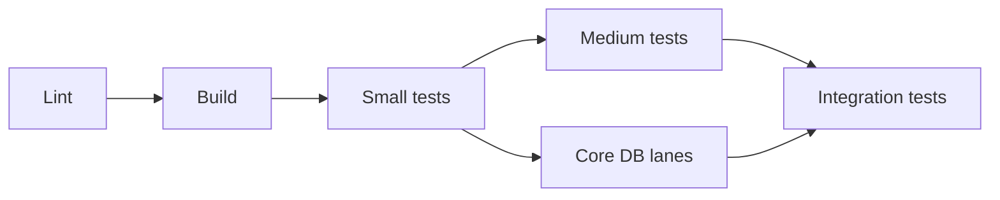

<!--
  Licensed to the Apache Software Foundation (ASF) under one
  or more contributor license agreements.  See the NOTICE file
  distributed with this work for additional information
  regarding copyright ownership.  The ASF licenses this file
  to you under the Apache License, Version 2.0 (the
  "License"); you may not use this file except in compliance
  with the License.  You may obtain a copy of the License at

   http://www.apache.org/licenses/LICENSE-2.0

  Unless required by applicable law or agreed to in writing,
  software distributed under the License is distributed on an
  "AS IS" BASIS, WITHOUT WARRANTIES OR CONDITIONS OF ANY
  KIND, either express or implied.  See the License for the
  specific language governing permissions and limitations
  under the License.
-->

# SPIP: A Staged Presubmit for Apache Gravitino

| Field      | Value                                                   |
| ---------- | ------------------------------------------------------- |
| Status     | Draft                                                   |
| Author     | Nevin Zheng                                             |
| Reviewers  | TBD                                                     |
| Created    | 2026-10-22                                              |
| Updated    | 2026-10-22                                              |
| Related    | Test organization ([#14092][i14092], [#14093][i14093])  |
| Decide by  | `<date, two weeks after posting>`                       |

[i14092]: https://github.com/apache/gravitino/issues/14092
[i14093]: https://github.com/apache/gravitino/pull/14093

---

## Q1. What are we trying to do

**One presubmit workflow that runs the cheapest checks first and the most expensive last, with each
stage gated on the one before and fanned out in parallel inside.**

1. **Lint:** formatting and license headers.
2. **Build:** compile everything and publish locally, no tests.
3. **Small tests:** unit tests that need no container.
4. **Medium tests:** unit tests that need one container, and the core database lanes.
5. **Integration tests:** one job per area (backend, Spark, Trino, Flink, ...), each only when its
   paths change.

**Why it matters:** today 16 workflows start the moment a PR is pushed, and none waits for
anything. A PR with a formatting error still starts every integration test, and a red `build (17)`
can mean a lint error, a unit test or a slow container, because they share one Gradle call.

### The picture

Each box is a stage; each stage is one or more parallel jobs. A red stage stops the run.

### Who owns what

**Gradle owns what runs; GitHub Actions owns when, where and how wide.** A contributor can run any
presubmit job locally by typing the same `./gradlew <task>` the job runs.

| Concern                                      | Owner   | How                                     |
| -------------------------------------------- | ------- | --------------------------------------- |
| What a stage or shard is                     | Gradle  | One task per stage or shard             |
| The shard list for a matrix                  | Gradle  | `ciShards` writes JSON to the job       |
| Order between stages                         | Actions | `needs:`                                |
| Fan-out within a stage                       | Actions | `strategy.matrix` from `fromJSON`       |
| Which areas changed                          | Actions | `dorny/paths-filter`, as today          |
| Reports, coverage files                      | Actions | `upload-artifact` / `download-artifact` |
| Shell scripts                                | Nobody  | A Gradle task or an action instead      |

---

## Q2. Non-goals

- **Moving tests.** Which source set a test lives in is test organization's job
  ([#14093][i14093]). This SPIP only changes how CI calls today's tasks.
- **New test sizes in Gradle.** The small and medium stages reuse today's `test` task per module.
- **Faster tests.** Wall time may go up for a green PR, since stages wait for each other. The goal
  is an order that fails fast and a pipeline that test organization can slot into.
- **Remote build cache.** Sharing compiled output across jobs needs ASF Develocity onboarding; see
  Q7.

---

## Q3. Today and limits

| What                    | Today                                                                   |
| ----------------------- | ----------------------------------------------------------------------- |
| PR workflows            | 16, all triggered by `pull_request`, none gated on another              |
| Lint                    | Inside `build (17)`, in the same Gradle call as the tests               |
| Unit tests              | `build -PskipITs -PskipDockerTests=false` plus `-x` exclusions          |
| Docker-tagged unit tests| Same call; 9 modules, about 64% of the job's test time                  |
| Integration tests       | 10 wrapper workflows, each a `paths-filter` plus a reusable workflow    |
| Arguments               | Built in bash (`gradle_args` arrays, `printf`, loops)                   |

**Limit:** Gradle has no task that means "small tests" or "this shard", so a stage cannot be one
task name without some Gradle glue. The interim glue is one file, replaced by test organization.

---

## Q4. What we need to implement

### Workflow

`build.yml` becomes `presubmit.yml`:

| Stage | Job | Command |
| ----- | ------------------------ | ----------------------------------------------------------- |
| 0 | `lint` | `./gradlew spotlessCheck rat` |
| 1 | `compile` | `./gradlew publishToMavenLocal -x test`, `build -x test` |
| 2 | `test` | `./gradlew ciSmallTest -PskipITs -PskipDockerTests=false` |
| 3 | `medium-test (<shard>)` | `./gradlew ciMediumTest<Shard> -PskipITs -PskipDockerTests=false` |
| 3 | `core-test (<lane>)` | `./gradlew :core:core<Lane>Test`, as today |
| 4 | `<area>-it` | The area's existing `*-action.yml`, unchanged |

- The ten wrapper workflows (access control, backend, Flink, Iceberg REST + Trino, idp-basic,
  maintenance, MCP, Python, Spark, Trino) are folded into presubmit. Their path filters move into
  the `changes` job unchanged, and their matrices are kept.
- `contrib-catalog-test`, `frontend-integration-test` and `web-ui-tests` run their own steps rather
  than a reusable workflow, so they stay separate until they are split the same way.
- `coverage` waits for every unit test stage and merges their reports, as today.

### Gradle

`gradle/ci-stages.gradle.kts`, applied by one line in the root `build.gradle.kts`:

- `ciSmallTest`: the `test` task of every module except the medium modules and the modules CI
  tests elsewhere (core lanes, Python client, contrib catalogs).
- `ciMediumTest<Shard>`: the `test` task of the modules with Docker-tagged unit tests, in three
  shards (`hive`, `jdbc`, `others`).
- `ciShards`: writes the shard list as JSON to `$GITHUB_OUTPUT`; the matrix reads it.

### Guarantees

1. **No test lost.** Small, medium and skipped together are exactly today's set: a dry run lists
   the same 102 `test` tasks.
2. **Misplaced, never dropped.** A module with Docker-tagged tests missing from the medium list
   still runs in `ciSmallTest` with Docker on.
3. **Same command locally.** Every job is one `./gradlew` line.
4. **No shell to choose what runs.** Task names and workflow expressions only.

---

## Q5. Who cares

| Persona          | Difference                                                        |
| ---------------- | ----------------------------------------------------------------- |
| Contributor      | A lint error fails in minutes and stops the run                   |
| Reviewer         | A red check names the stage that failed                           |
| CI maintainers   | One workflow, task names in the matrix, no `gradle_args` bash     |
| ASF runner pool  | A broken PR uses one lint job instead of 16 workflows             |

---

## Q6. Risks

| Risk                                   | Impact                     | Mitigation                          |
| -------------------------------------- | -------------------------- | ----------------------------------- |
| Stages add wall time to green PRs      | Slower merge for green PRs | Lint and compile are short (1)      |
| Each job recompiles                    | More runner minutes        | Remote build cache (Q7)             |
| A Docker module is not listed          | Runs in the small stage    | Guarantee 2; list is 9 entries      |
| Fewer workflows in the Checks list     | Unfamiliar check names     | Job names match the old areas       |
| Pending changes to `build.yml`         | Rebase onto `presubmit.yml`| One-time move of the change         |

1. To be measured on the first CI runs and filled in here.

---

## Q7. Timeline

| Step | Change                                                                 | Revert      |
| ---- | ---------------------------------------------------------------------- | ----------- |
| P1   | `presubmit.yml` with the five stages, `ci-stages.gradle.kts`, IT fold  | Revert PR   |
| P2   | Remaining shell: `libssl` step, toolchain `awk`, coverage loop         | Revert PR   |
| P3   | `gradle/actions/setup-gradle` for caching; ASF Develocity onboarding   | Revert PR   |
| P4   | Contrib catalog, frontend and web UI workflows join presubmit          | Revert PR   |

**After test organization** ([#14093][i14093]), the jobs stay and only their commands change:

| Job           | Interim command       | After test organization                                  |
| ------------- | --------------------- | -------------------------------------------------------- |
| `lint`        | `spotlessCheck rat`   | `spotlessCheck rat` (no compile)                         |
| `compile`     | `build -x test`       | `build` (`check` runs no tests)                          |
| `test`        | `ciSmallTest`         | `test`                                                   |
| `medium-test` | `ciMediumTest<Shard>` | `containerOnlyIT`, one job                               |
| `core-test`   | `core<Lane>Test`      | Unchanged                                                |
| `backend-it`  | `*-action.yml` inputs | `backendITHive`, `backendITLakehouse`, `backendITOthers` |

Lint stays `spotlessCheck rat` rather than `check`, because `check` compiles (Error Prone runs in
`compileJava`). The medium stage has no suite of its own in test organization: its container-only
tests become tagged integration tests that run once, in one job.

`ci-stages.gradle.kts` is then deleted; module declarations replace its lists.

---

## Q8. Exams

- A PR with a Spotless violation fails `lint` and starts no other test job.
- A PR that changes only `docs/` text starts no Gradle job.
- Every job's command runs unchanged on a laptop.
- `grep -c 'gradle_args' .github/workflows/presubmit.yml` prints `0`.
- The executed test classes per job, summed, match the old `build (17)` and wrapper workflows.

---

## Appendix A. Options considered

- **Keep `build.yml`, add `needs:` only.** Cannot gate the integration tests, because `needs:` does
  not cross workflows.
- **`workflow_run` chains.** Results do not show on the PR as checks of one run, and each link
  re-checks out and re-filters.
- **Shard lists in YAML.** Two places to keep in sync (the matrix and the `-x` list); Gradle
  owning the list keeps one.
- **Shell scripts for sharding** (as in [#13495](https://github.com/apache/gravitino/pull/13495)).
  Logic outside Gradle cannot be run or tested like the build.

## Appendix B. References

- [Test sizes](https://testing.googleblog.com/2010/12/test-sizes.html), Google Testing Blog.
- [setup-gradle](https://community.gradle.org/github-actions/docs/setup-gradle), caching on CI.
- [Isolated Projects](https://docs.gradle.org/current/userguide/isolated_projects.html), aggregate
  tasks by path.
- [Reusing workflows](https://docs.github.com/en/actions/how-tos/reuse-automations/reuse-workflows),
  GitHub Actions.
- [ASF Gradle / Develocity](https://infra.apache.org/gradle.html), build scans and cache.
- [Apache Kafka CI overhaul](https://develocity.ai/blog/apache-kafka-ci-overhaul/), a peer project
  on Gradle and Actions.
